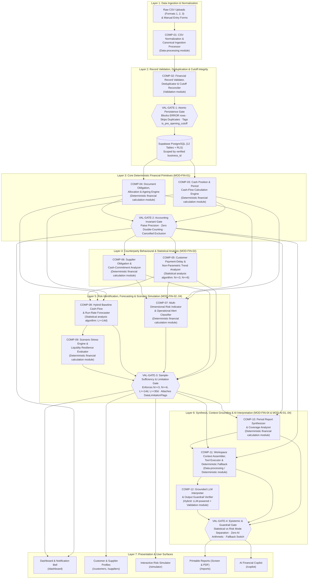
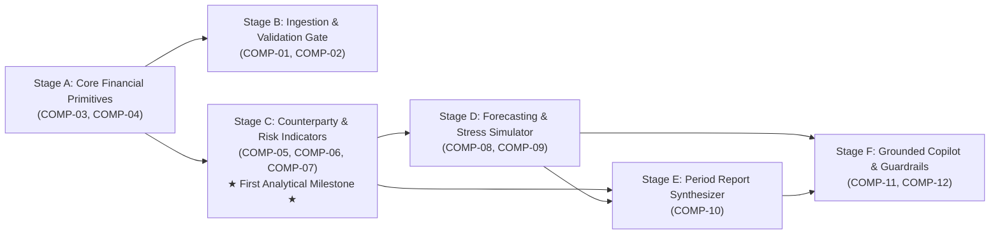

# FlowTrust — Layered Intelligence Architecture and Analytical Component Specification

**Document ID:** `FT-ARCH-004`  
**Status:** Proposed Layered Intelligence & Component Architecture (Planning Phase — No Application Code Implemented)  
**Project:** FlowTrust — *Beyond Balance. Into Resilience.*  
**Related Specifications:** [TECH_STACK_AND_ARCHITECTURE.md](./TECH_STACK_AND_ARCHITECTURE.md) · [AI_SYSTEM_ARCHITECTURE.md](./AI_SYSTEM_ARCHITECTURE.md) · [FINANCIAL_FOUNDATION_SPECIFICATION.md](../financial/FINANCIAL_FOUNDATION_SPECIFICATION.md) · [CSV_IMPORT_AND_VALIDATION_SPECIFICATION.md](../data/CSV_IMPORT_AND_VALIDATION_SPECIFICATION.md) · [CUSTOMER_SUPPLIER_INTELLIGENCE_SPECIFICATION.md](../features/CUSTOMER_SUPPLIER_INTELLIGENCE_SPECIFICATION.md) · [RISK_SIMULATOR_SPECIFICATION.md](../features/RISK_SIMULATOR_SPECIFICATION.md) · [REPORTS_SPECIFICATION.md](../features/REPORTS_SPECIFICATION.md) · [AI_COPILOT_SPECIFICATION.md](../features/AI_COPILOT_SPECIFICATION.md) · [NOTIFICATIONS_AND_REMINDERS_SPECIFICATION.md](../features/NOTIFICATIONS_AND_REMINDERS_SPECIFICATION.md)

---

## 1. Executive Summary & Architectural Purpose

Before implementing application routes or the AI Copilot, FlowTrust requires a rigorous blueprint of the **individual analytical models, calculators, validators, and data-processing components** that transform raw small-business records into verified financial insights.

This document defines FlowTrust's **7-Layer Intelligence Architecture** from first principles:
1. It audits the 14 candidate analytical capabilities against the approved specifications to separate **mandatory MVP components** from **deferred post-MVP enhancements**.
2. It defines **12 distinct MVP analytical & processing components (`COMP-01` through `COMP-12`)**—and **4 deferred future-release components (`FUT-01` through `FUT-04`)**—with strict input/output contracts, missing-data behaviors, validation gates, and test criteria.
3. It classifies every component honestly by technical type: **0 components in the MVP are custom Machine Learning models**, **2 are statistical analysis algorithms**, **6 are deterministic financial calculation modules**, **2 are data-processing modules**, **1 is a validation module**, and **1 is a hybrid LLM-powered + guardrail-verified component**.
4. It establishes a **Multi-Dimensional Risk Indicator Methodology (5 distinct domain indicators)** rather than an arbitrary single 0–100 composite risk score.

### 1.1 Epistemic Classification of Requirements & Decisions

| Classification | Scope in This Document |
|---|---|
| **Confirmed Requirement (`REQ`)** | Analytical rules, formulas, sample-size thresholds ($N_{\text{eligible}} \ge 3$, $N_{\text{eligible}} \ge 6$, $L \ge 14\text{d}$, $L \ge 30\text{d}$), CSV validation rules, and read-only AI grounding rules explicitly finalized in `docs/financial/`, `docs/data/`, and `docs/features/`. |
| **Proposed Design (`PROP`)** | Decomposition of the system into 12 granular analytical components (`COMP-01`..`COMP-12`) across 7 dependency layers, with 4 intermediate validation gates (`VAL-GATE-1`..`4`). |
| **Deferred Future Scope (`FUT`)** | Capabilities explicitly excluded from the MVP (`FUT-01` ML/Rule Auto-Categorization, `FUT-02` OLS Payment-Delay Regression, `FUT-03` Statistical Expense Anomaly Detection, `FUT-04` Probabilistic Credit/Monte Carlo Scoring). |
| **Unresolved Calibration (`OPEN`)** | Non-blocking visual layout calibration (`OPEN-01`) and deployment-time external LLM API key provisioning (`OPEN-02`, mitigated by deterministic fallback in `COMP-11`). |

---

## 2. Candidate Capability Audit (MVP vs. Shared vs. Deferred)

The table below evaluates all 14 candidate analytical areas against the authoritative FlowTrust specifications to determine whether each requires a dedicated MVP component, shares a component boundary, or belongs in a future release:

| # | Candidate Analytical Area | Authoritative Specification Status | Architectural Disposition | Assigned Component ID(s) |
|---|---|---|---|---|
| **1** | **Raw financial data processing and cleaning** | **Confirmed MVP** ([CSV_IMPORT_AND_VALIDATION_SPECIFICATION.md](../data/CSV_IMPORT_AND_VALIDATION_SPECIFICATION.md) §2.1–2.2) | **Dedicated MVP Component:** Parses UTF-8 CSVs, normalizes header aliases, maps split Debit/Credit vs. single-amount columns, parses `DD/MM/YYYY` & `YYYY-MM-DD`, strips `₹`/commas, and converts to integer paise. | **`COMP-01`** |
| **2** | **Data validation and integrity checks** | **Confirmed MVP** ([CSV_IMPORT_AND_VALIDATION_SPECIFICATION.md](../data/CSV_IMPORT_AND_VALIDATION_SPECIFICATION.md) §2.3, §2.5, §3; [FINANCIAL_FOUNDATION_SPECIFICATION.md](../financial/FINANCIAL_FOUNDATION_SPECIFICATION.md) §10) | **Dedicated MVP Component:** Executes 3-tier schema validation (`ERROR`/`WARNING`/`INFO`), 2-layer SHA-256 duplicate detection, `opening_balance_date` cutoff tagging (`is_pre_opening_cutoff`), and payment allocation bounds. | **`COMP-02`** |
| **3** | **Transaction categorisation** | **Split:** Predefined/custom category assignment + default fallback is **Confirmed MVP**; automatic narration-to-category inference is **Future Scope** ([FINANCIAL_FOUNDATION_SPECIFICATION.md](../financial/FINANCIAL_FOUNDATION_SPECIFICATION.md) §5). | **Shared in MVP + Deferred Component:** Deterministic category mapping & default assignment (`Other Income`/`Other Expenses`) is handled in `COMP-01`, and category share breakdown in `COMP-03`. Automated narration classification is deferred. | **`COMP-01` / `COMP-03`** (MVP) **`FUT-01`** (Future) |
| **4** | **Financial metric calculation** | **Confirmed MVP** ([FINANCIAL_FOUNDATION_SPECIFICATION.md](../financial/FINANCIAL_FOUNDATION_SPECIFICATION.md) §3–8, §14) | **Split into 2 Dedicated MVP Components** along the core accounting boundary: (a) Settled Cash & Period Cash Flow (`COMP-03`) and (b) Accrual Document Obligations, Allocations & Ageing (`COMP-04`). | **`COMP-03`**, **`COMP-04`** |
| **5** | **Statistical analysis and trend detection** | **Confirmed MVP** for $N \ge 3$ order-statistic median/mean delays, $N \ge 6$ non-parametric recent-vs-prior delay shift, and $L \ge 14\text{d}$ run-rate estimation; **Deferred** for OLS regression ([CUSTOMER_SUPPLIER_INTELLIGENCE_SPECIFICATION.md](../features/CUSTOMER_SUPPLIER_INTELLIGENCE_SPECIFICATION.md) §3–6). | **Integrated into Counterparty & Forecasting Statistical Components (`COMP-05` & `COMP-08`)** in MVP; formal OLS regression is deferred to `FUT-02`. | **`COMP-05`**, **`COMP-08`** (MVP) **`FUT-02`** (Future) |
| **6** | **Cash-flow forecasting (Baseline)** | **Confirmed MVP** ([RISK_SIMULATOR_SPECIFICATION.md](../features/RISK_SIMULATOR_SPECIFICATION.md) §4) | **Dedicated MVP Component:** Computes the daily ($d = 0..H$) hybrid baseline trajectory combining scheduled open documents (with median-delay overdue recovery) and trailing $L$-day operating run-rates ($L \ge 14\text{d}$ gate). | **`COMP-08`** |
| **7** | **Customer payment-behaviour analysis** | **Confirmed MVP** ([CUSTOMER_SUPPLIER_INTELLIGENCE_SPECIFICATION.md](../features/CUSTOMER_SUPPLIER_INTELLIGENCE_SPECIFICATION.md) §3–6) | **Dedicated MVP Component:** Computes completed-invoice delays (amount-weighted for multi-payment invoices), On-Time Rate ($d_{\text{final}} \le \text{due\_date}$), $N_{\text{eligible}} \ge 3$ sufficiency gating, and $N_{\text{eligible}} \ge 6$ delay trend. | **`COMP-05`** |
| **8** | **Supplier obligation analysis** | **Confirmed MVP** ([CUSTOMER_SUPPLIER_INTELLIGENCE_SPECIFICATION.md](../features/CUSTOMER_SUPPLIER_INTELLIGENCE_SPECIFICATION.md) §7) | **Dedicated MVP Component:** Computes supplier billed/paid/outstanding totals, `Overdue Payables`, `Bills Due Soon (7d)`, `Bills Due in 8–30d`, spend concentration share, and `Our Payment Timing` ($N \ge 3$). | **`COMP-06`** |
| **9** | **Risk factor identification** | **Confirmed MVP** ([CUSTOMER_SUPPLIER_INTELLIGENCE_SPECIFICATION.md](../features/CUSTOMER_SUPPLIER_INTELLIGENCE_SPECIFICATION.md) §5; [NOTIFICATIONS_AND_REMINDERS_SPECIFICATION.md](../features/NOTIFICATIONS_AND_REMINDERS_SPECIFICATION.md) §2; [REPORTS_SPECIFICATION.md](../features/REPORTS_SPECIFICATION.md) §4.3) | **Combined with Rule-Based Risk Indicator Classification (`COMP-07`):** Identifies overdue exposure, single-customer concentration ($\ge 30\%$), 7-day cash coverage deficits, and operational notification conditions (`condition_key`). | **`COMP-07`** |
| **10** | **Risk scoring and ranking** | **Confirmed MVP as Separate Explainable Indicators**; opaque 0–100 credit/default scores are **Strictly Prohibited** ([CUSTOMER_SUPPLIER_INTELLIGENCE_SPECIFICATION.md](../features/CUSTOMER_SUPPLIER_INTELLIGENCE_SPECIFICATION.md) §5; [PRODUCT_SCOPE.md](../product/PRODUCT_SCOPE.md) §1.7). | **Handled in `COMP-07` (Counterparty & Liquidity Risk Indicators) and `COMP-09` (Scenario Buffer/Shortfall Tiers).** Probabilistic credit default scoring is deferred (`FUT-04`). | **`COMP-07`**, **`COMP-09`** (MVP) **`FUT-04`** (Future) |
| **11** | **Risk Simulator calculations** | **Confirmed MVP** ([RISK_SIMULATOR_SPECIFICATION.md](../features/RISK_SIMULATOR_SPECIFICATION.md) §5–9) | **Dedicated MVP Component:** Applies the 4 combinable stress transformations (`revenueDeclinePct`, `customerDelayDays`, `unexpectedExpenseAmount`, `investment`) over `COMP-08`'s baseline to compute $C_{\text{scen}}(d)$, `Minimum Projected Cash`, `Shortfall`, `Shifted Receivables`, `Buffer Status`, and `Runway`. | **`COMP-09`** |
| **12** | **Anomaly detection** | **Not in MVP Scope** ([PRODUCT_SCOPE.md](../product/PRODUCT_SCOPE.md) §1.4, §1.7) | **Deferred to Future Release (`FUT-03`):** Unsupervised Z-score/IQR expense spike and unusual transaction detection requires multi-month dense history and is not needed for MVP correctness. | **`FUT-03`** (Future) |
| **13** | **Financial report analysis** | **Confirmed MVP** ([REPORTS_SPECIFICATION.md](../features/REPORTS_SPECIFICATION.md) §1–6) | **Dedicated MVP Component:** Resolves period & Indian FY (`Apr 1 – Mar 31`) boundaries, detects partial period coverage, compiles `Statistical` reports (Sections 1–5), and synthesizes deterministic `Risk Overview` assessments (Section 6). | **`COMP-10`** |
| **14** | **Natural-language explanations and recommendations** | **Confirmed MVP** ([AI_COPILOT_SPECIFICATION.md](../features/AI_COPILOT_SPECIFICATION.md) §1–6) | **Split into 2 MVP Components** to guarantee offline resilience and zero AI arithmetic: (a) Deterministic Context Snapshot, Read-Only Tool Executor & Template Fallback (`COMP-11`) and (b) Grounded LLM Interpreter & Guardrail Verifier (`COMP-12`). | **`COMP-11`**, **`COMP-12`** |

---

## 3. Component Type Taxonomy & Model Count Justification

### 3.1 Recommended Component Count

* **Initial MVP Release:** **12 Distinct Analytical & Processing Components (`COMP-01` through `COMP-12`)**
* **Post-MVP Future Releases:** **4 Deferred Analytical Components (`FUT-01` through `FUT-04`)**

#### Why 12 MVP Components Is the Right Engineering Balance
1. **Why not 21+ components?** Inflating the architecture by splitting every arithmetic formula (e.g., making `Net Cash Flow` one model, `Available Cash` a second model, `Average Delay` a third, and `Median Delay` a fourth) or inventing unrequested ML models (like churn predictors or ARIMA forecasters) adds artificial complexity and violates FlowTrust's product scope ([PRODUCT_SCOPE.md](../product/PRODUCT_SCOPE.md) §1.7).
2. **Why not 3–4 coarse components?** Merging CSV normalization (`COMP-01`) with duplicate/cutoff validation (`COMP-02`), or merging cash ledger math (`COMP-03`) with document ageing (`COMP-04`), or merging baseline run-rate estimation (`COMP-08`) with scenario stress perturbation (`COMP-09`) obscures critical data dependencies and validation gates. Each of the 12 components has a **distinct input schema, a distinct mathematical or logical responsibility, and an independent unit test suite**.
3. **Honest Classification of AI and ML Usage:**
   * **Custom Machine-Learning Models in MVP:** **`0`**. Small-business owners need exact rupee accounting and transparent, auditable rules—not black-box weights trained on synthetic data.
   * **Statistical Analysis Algorithms in MVP:** **`2`** (`COMP-05` for sample-gated order statistics, weighted delay averages, and non-parametric trend shifts; `COMP-08` for trailing time-window run-rate estimation and median-delay overdue recovery scheduling).
   * **LLM-Powered / Hybrid Components in MVP:** **`1`** (`COMP-12`, which uses an external LLM strictly for natural-language intent extraction and grounded explanation synthesis, paired with deterministic guardrail verification and automatic fallback to `COMP-11`).

### 3.2 Classification Summary Table (All 12 MVP + 4 Future Components)

| Component ID | Component Name | Strictly Classified Component Type | Target Code Location | Maps to Module in `AI_SYSTEM_ARCHITECTURE.md` | Release Scope |
|---|---|---|---|---|---|
| **`COMP-01`** | **CSV Normalization & Canonical Ingestion Processor** | `Data-processing module` | `lib/csv/parser-and-mapper.ts` | Ingestion Prerequisite | **MVP (P1)** |
| **`COMP-02`** | **Financial Record Validator, Deduplicator & Cutoff Reconciler** | `Validation module` | `lib/csv/{validators,deduplicator}.ts`, `lib/validations/finance.ts` | Data Integrity Prerequisite | **MVP (P0/P1)** |
| **`COMP-03`** | **Cash Position & Period Cash-Flow Calculation Engine** | `Deterministic financial calculation module` | `lib/finance/{money,cash,cashflow}.ts` | `MOD-FIN-01` (Part A) | **MVP (P0/P1)** |
| **`COMP-04`** | **Document Obligation, Allocation & Ageing Engine** | `Deterministic financial calculation module` | `lib/finance/obligations.ts` | `MOD-FIN-01` (Part B) | **MVP (P0/P1)** |
| **`COMP-05`** | **Customer Payment-Delay & Non-Parametric Trend Analyzer** | `Statistical analysis algorithm` | `lib/finance/intelligence.ts` (`customer`) | `MOD-FIN-02` (Part A) | **MVP (P2)** |
| **`COMP-06`** | **Supplier Obligation & Cash-Commitment Analyzer** | `Deterministic financial calculation module` | `lib/finance/intelligence.ts` (`supplier`) | `MOD-FIN-02` (Part B) | **MVP (P2)** |
| **`COMP-07`** | **Multi-Dimensional Risk Indicator & Operational Alert Classifier** | `Deterministic financial calculation module` | `lib/finance/{intelligence,notifications}.ts` | `MOD-FIN-02` (Part C) & `MOD-FIN-04` (Alerts) | **MVP (P2/P3)** |
| **`COMP-08`** | **Hybrid Baseline Cash-Flow & Run-Rate Forecaster** | `Statistical analysis algorithm` | `lib/finance/simulator.ts` (`buildBaselineForecast`) | `MOD-FIN-03` (Part A) | **MVP (P2)** |
| **`COMP-09`** | **Scenario Stress Engine & Liquidity Resilience Evaluator** | `Deterministic financial calculation module` | `lib/finance/simulator.ts` (`runScenarioSimulation`) | `MOD-FIN-03` (Part B) | **MVP (P2)** |
| **`COMP-10`** | **Period Report Synthesizer & Coverage Analyzer** | `Deterministic financial calculation module` | `lib/finance/reports.ts` | `MOD-FIN-04` (Reports) | **MVP (P3)** |
| **`COMP-11`** | **Workspace Context Assembler, Tool Executor & Deterministic Fallback Explainer** | `Data-processing module` & `Deterministic financial calculation module` | `lib/ai/{context-builder,tools,fallback-explainer}.ts` | `MOD-AI-01` & `MOD-AI-03` | **MVP (P3)** |
| **`COMP-12`** | **Grounded LLM Financial Interpreter & Output Guardrail Verifier** | `Hybrid component` (`LLM-powered component` + `Validation module`) | `lib/ai/{provider,prompts,orchestrator,guardrails}.ts` | `MOD-AI-02` & `MOD-AI-04` | **MVP (P3)** |
| *`FUT-01`* | *Automated Narration-to-Category Classifier* | *`Hybrid component` (Keyword Rules + ML Classifier)* | *Future `lib/csv/auto-categorizer.ts`* | *Deferred Post-MVP* | *Future Release* |
| *`FUT-02`* | *Parametric OLS / Multivariate Payment-Delay Regressor* | *`Statistical analysis algorithm`* | *Future `lib/finance/regression.ts`* | *Deferred Post-MVP* | *Future Release* |
| *`FUT-03`* | *Category Expense & Cash-Outflow Anomaly Detector* | *`Statistical analysis algorithm` (IQR / Robust Z-Score)* | *Future `lib/finance/anomalies.ts`* | *Deferred Post-MVP* | *Future Release* |
| *`FUT-04`* | *Monte Carlo Cash-Flow & Counterparty Default Simulator* | *`Statistical analysis algorithm` / `Machine-learning model`* | *Future `lib/finance/monte-carlo.ts`* | *Deferred Post-MVP* | *Future Release* |

---

## 4. Layered Intelligence Pipeline Architecture (Section 5)

### 4.1 Sequential vs. Parallel Pipeline Structure

FlowTrust uses a **7-Layer Directed Acyclic Graph (DAG) Pipeline** that combines a **strictly sequential foundation (Layers 1 $\rightarrow$ 2 $\rightarrow$ 3)** with **parallel analytical branches (Layers 4 $\rightarrow$ 5)** and a **convergent synthesis & presentation top layer (Layers 6 $\rightarrow$ 7)**:

1. **Why Layers 1 $\rightarrow$ 2 $\rightarrow$ 3 Must Be Sequential:**
   * Raw user inputs or CSV files (`Layer 1: COMP-01`) **cannot** enter the database or financial calculators until they pass `VAL-GATE-1` in `Layer 2 (COMP-02)` (schema check, duplicate filtering, and `is_pre_opening_cutoff` tagging).
   * Higher-level analytics (`Layers 4–6`) **cannot** inspect raw database rows directly; they depend on `Layer 3 (COMP-03 & COMP-04)` to establish exact integer-paise `Available Cash(T)`, settled period flows, and per-document `outstanding_amount(T)` and `days_overdue(T)`.
2. **Where Parallel Execution Occurs (Layers 4 & 5):**
   * Once `Layer 3` (`COMP-03`, `COMP-04`) has computed the canonical cash and obligation state for `authorizedBusinessId`, the system can execute `COMP-05` (Customer Behaviour), `COMP-06` (Supplier Obligations), and `COMP-03` (Category Breakdowns) **in parallel**.
   * `COMP-05`'s `median_delay_days` output then feeds **both** `COMP-07` (Customer Collection Risk Indicator) and `COMP-08` (Baseline Cash-Flow Forecaster's overdue invoice recovery offset $d_{\text{overdue\_recovery}} = \min(90, \max(14, \lceil\text{CustomerMedianDelayDays}\rceil))$).
   * `COMP-08` (Baseline Forecast) feeds `COMP-09` (Scenario Stress Engine). Whenever a user drags a slider in `/simulator`, **only `COMP-09` re-executes** in-memory (`< 2ms`) over `COMP-08`'s immutable baseline array—without re-running Layers 1–4.
3. **Validation Gates Between Layers (`VAL-GATE-1` through `VAL-GATE-4`):**
   * **`VAL-GATE-1` (Post-Layer 2):** Blocks malformed CSV rows (`ERROR`), skips `CONFIRMED_DUPLICATE` rows, and enforces `amount_paid <= total_amount` and `is_pre_opening_cutoff` flags before PostgreSQL persistence.
   * **`VAL-GATE-2` (Post-Layer 3):** Asserts paise-integer invariants (`outstanding_amount = total_amount - amount_paid >= 0`, `CANCELLED` documents excluded from active receivables/payables, `OPENING_BALANCE_MARKER` and `INTERNAL_TRANSFER` excluded from operating inflows/outflows).
   * **`VAL-GATE-3` (Post-Layers 4 & 5 — Sample-Size & Coverage Gate):** Enforces $N_{\text{eligible}} \ge 3$ (sets delay averages/rates to `null` if $< 3$), $N_{\text{eligible}} \ge 6$ (sets trend to `INSUFFICIENT_HISTORY` if $< 6$), $L \ge 14\text{d}$ (sets operating run-rate to `0` if $< 14\text{d}$), and $L \ge 30\text{d}$ (sets cash runway to `null` if $< 30\text{d}$).
   * **`VAL-GATE-4` (Post-Layer 6 — Epistemic & AI Output Gate):** In `COMP-10`, strips Section 6 risk assessments when `reportMode === 'STATISTICAL'`. In `COMP-12`, validates LLM JSON via Zod, injects verified metric cards directly from `COMP-11`, rejects prohibited claims (`"accounting profit"`, `"supplier delivery quality"`, ungrounded numbers), and triggers deterministic fallback (`COMP-11`) if any check fails.

### 4.2 Complete 7-Layer Pipeline Diagram

### 4.3 Component Execution Mode Matrix (Sequential vs. Parallel vs. On-Demand)

| Component | When It Runs | Can Run in Parallel With | Downstream Consumers That Require Its Validated Output |
|---|---|---|---|
| **`COMP-01`** | On CSV file upload / manual form submission | Independent per upload request | `COMP-02` |
| **`COMP-02`** | Immediately after `COMP-01` (Stages 3–6 of import) or manual write | None (Sequential gate before DB commit) | PostgreSQL (`transactions`, `invoices`, `bills`, `payments`, `import_batches`) |
| **`COMP-03`** | On workspace read query (Dashboard, Simulator, Reports, Copilot) | Runs in parallel with `COMP-04` | `COMP-07`, `COMP-08`, `COMP-10`, `COMP-11`, Dashboard |
| **`COMP-04`** | On workspace read query | Runs in parallel with `COMP-03` | `COMP-05`, `COMP-06`, `COMP-07`, `COMP-08`, `COMP-10`, `COMP-11` |
| **`COMP-05`** | After `COMP-04` resolves invoice payment statuses | Runs in parallel with `COMP-06` and `COMP-03` | `COMP-07` (Customer Risk Indicator), `COMP-08` (Overdue recovery day offset), `COMP-10`, `COMP-11` |
| **`COMP-06`** | After `COMP-04` resolves bill payment statuses | Runs in parallel with `COMP-05` and `COMP-03` | `COMP-07` (`CASH_COVERAGE_WARNING`), `COMP-10`, `COMP-11`, `/suppliers` |
| **`COMP-07`** | After `COMP-03`, `COMP-04`, `COMP-05`, `COMP-06` | Runs in parallel with `COMP-08` / `COMP-09` | `COMP-10` (Report Section 6), `COMP-11` (Copilot snapshot), Dashboard & Notification Bell |
| **`COMP-08`** | On Simulator load or Copilot simulation tool call | Runs in parallel with `COMP-07` | `COMP-09` (Scenario Stress Engine) |
| **`COMP-09`** | Immediately after `COMP-08` (and re-runs on every slider change in `<2ms`) | Independent in-memory calculation | `/simulator` UI, `COMP-11` (`runRiskSimulation` tool) |
| **`COMP-10`** | On `/reports` view or Copilot `getPeriodFinancialReport` call | Independent per selected report period | `/reports` UI (Screen & `@media print`), `COMP-11` |
| **`COMP-11`** | On `/api/copilot/chat` request | Assembles snapshot in parallel via `Promise.all` over `COMP-03..07` | `COMP-12` (LLM Interpreter) or directly serves response in `DETERMINISTIC_FALLBACK` mode |
| **`COMP-12`** | On `/api/copilot/chat` after `COMP-11` snapshot assembly | Single request pipeline with 12s timeout | `/copilot` UI |

---

## 5. Detailed Component Contracts (`COMP-01` – `COMP-12` & `FUT-01` – `FUT-04`)

Every component below is specified against the 12 mandatory contract attributes.

---

### 5.1 `COMP-01`: CSV Normalization & Canonical Ingestion Processor

1. **Unique Identifier & Name:** `COMP-01` — CSV Normalization & Canonical Ingestion Processor (`lib/csv/parser-and-mapper.ts`).
2. **Component Type:** `Data-processing module`.
3. **Purpose:** Transforms heterogeneous user-uploaded CSV files (Formats 1, 2, and 3) and manual form payloads into canonical, strongly typed candidate records ready for validation.
4. **Specific Responsibility:**
   * Strip UTF-8 BOM (`\uFEFF`), reject binary/0-byte/header-only files (`> 5 MB` or `> 10,000` rows), and parse RFC 4180 CSV rows via PapaParse.
   * Normalize header names and match aliases against Format 1 (`Unified Transactions`), Format 2 (`Bank Statement Split Debit/Credit`), and Format 3 (`Invoices & Bills Schedule`), while enforcing the **Anti-Semantic-Collision Rule** (never mapping `closing_balance` to `amount` or `issue_date` to `due_date`).
   * Parse dates according to the explicit date format convention (`DD/MM/YYYY` Indian default or `YYYY-MM-DD`).
   * Strip currency symbols (`₹`, `Rs.`, `INR`) and Indian digit-grouping commas (`1,25,000.50` $\rightarrow$ `12500050` paise).
   * Detect bank statement `"Opening Balance"` / `"B/F"` narration rows and tag them `transaction_kind = 'OPENING_BALANCE_MARKER'`.
   * Assign deterministic default categories (`Other Income` for unmapped inflows, `Other Expenses` for unmapped outflows) and default payment account (`BANK`) when optional columns are unmapped.
5. **Input Data & Schema:**
   * `RawCsvUploadInput`: `{ fileBuffer: ArrayBuffer | string, fileName: string, fileSizeBytes: number, importMode: 'TRANSACTIONS' | 'DOCUMENTS', userColumnMapping?: ColumnMappingConfig, dateFormatConvention: 'DD/MM/YYYY' | 'YYYY-MM-DD', useSignedAmounts?: boolean }`.
6. **Output Data & Schema:**
   * `NormalizedImportBatchCandidate`: `{ fileSha256: string, detectedHeaders: string[], proposedMapping: ColumnMappingConfig, candidateRows: Array<NormalizedTransactionCandidate | NormalizedDocumentCandidate>, skippedBlankRowCount: number, informationalNotices: ImportNotice[] }`.
7. **Dependencies:** PapaParse (`papaparse`), `COMP-03` integer-paise helper (`toPaise`).
8. **Processing Logic / Approach:** Deterministic multi-pass lexical normalization: header alias dictionary lookup $\rightarrow$ cell trimming $\rightarrow$ regex currency/comma stripping $\rightarrow$ calendar date extraction $\rightarrow$ integer paise conversion (`Math.round(Number(cleaned) * 100)`).
9. **Validation Requirements:** Rejects files $> 5\text{ MB}$, $> 10,000$ data rows, $0$ bytes, or containing null bytes (`\x00`) prior to row iteration.
10. **Behaviour When Data Is Missing or Insufficient:**
    * Unmapped optional `category` $\rightarrow$ sets `'Other Income'` / `'Other Expenses'` and emits `INFO: DEFAULT_CATEGORY_APPLIED`.
    * Unmapped optional `due_date` on Format 3 $\rightarrow$ sets `due_date = null` (never invents a 30-day due date).
    * Missing required columns (`date`, `amount`, `description`/`document_number`) $\rightarrow$ halts at Stage 2 Column Mapping with a prompt to map the missing column.
11. **Testing & Evaluation Criteria:** Unit tests `CSV-T01`, `CSV-T02`, `CSV-T03`, `CSV-T04`, `CSV-T05` verified against `datasets/synthetic/csv_import/` and `edge_cases/fixture_01..03`.
12. **Security Considerations & Release Scope:**
    * **Security:** Neutralizes CSV formula injection (`=`, `+`, `-`, `@` prefixes in text cells escaped on export/display); processes strictly in memory scoped to `authorizedBusinessId`.
    * **Release Scope:** **Initial MVP Release (Phase P1).**

---

### 5.2 `COMP-02`: Financial Record Validator, Deduplicator & Cutoff Reconciler

1. **Unique Identifier & Name:** `COMP-02` — Financial Record Validator, Deduplicator & Cutoff Reconciler (`lib/csv/validators.ts`, `lib/csv/deduplicator.ts`, `lib/validations/finance.ts`).
2. **Component Type:** `Validation module`.
3. **Purpose:** Protects canonical ledger integrity by blocking malformed records, identifying exact and fuzzy duplicates, enforcing opening-balance cutoff partitioning, and preventing orphan/overpayment corruption.
4. **Specific Responsibility:**
   * Evaluate all 10 Level-1 Row-Blocking Errors (`MISSING_REQUIRED_FIELD`, `INVALID_DATE`, `AMBIGUOUS_DATE_FORMAT`, `INVALID_AMOUNT`, `NEGATIVE_UNSIGNED_AMOUNT`, `CONFLICTING_DEBIT_CREDIT`, `CURRENCY_MISMATCH`, `UNSUPPORTED_TRANSACTION_TYPE`, `INVALID_DOCUMENT_AMOUNTS`, `INVALID_DATE_ORDER`).
   * Evaluate all 7 Level-2 Reviewable Warnings (`POSSIBLE_DUPLICATE`, `SAME_DATE_AMOUNT_DIFFERENT_DESC`, `PRE_OPENING_CUTOFF`, `FUTURE_DATED_TRANSACTION`, `MISSING_DUE_DATE`, `NEW_COUNTERPARTY_WILL_BE_CREATED`, `UNMATCHED_DOCUMENT_REFERENCE`).
   * Execute **Two-Layer Deterministic Duplicate Detection**:
     * **Layer 1 (`CONFIRMED_DUPLICATE`):** File `file_sha256` match against `import_batches`, or exact match on `external_reference` (`UTR`) / `document_number` within `business_id`. Default action: `Skip`.
     * **Layer 2 (`POSSIBLE_DUPLICATE`):** Composite SHA-256 fingerprint $\text{SHA256}(\text{business\_id} \,\|\, \text{date} \,\|\, \text{direction} \,\|\, \text{amount\_paise} \,\|\, \text{normalize}(\text{description}))$. Default action: `Skip` (with user override). Same date+amount with *different* description is classified `SAME_DATE_AMOUNT_DIFFERENT_DESC` (Default action: `Import`).
   * Tag every transaction where `transaction_date <= businesses.opening_balance_date` with `is_pre_opening_cutoff = true` (and recompute this flag across all workspace transactions whenever `opening_balance_date` is updated in Settings).
   * Enforce entity deletion/archiving rules (blocking hard deletion of any customer/supplier with $\ge 1$ linked financial record in favor of `status = 'ARCHIVED'`).
5. **Input Data & Schema:**
   * `NormalizedImportBatchCandidate` (from `COMP-01`) + `ExistingWorkspaceDedupIndex` (`existingFileHashes`, `existingExternalRefs`, `existingDocumentNumbers`, `existingFingerprints`, `openingBalanceDate`, `currencyCode`).
6. **Output Data & Schema:**
   * `ValidatedImportPreviewPayload`: `{ summaryCounts: { total: number, validReady: number, warnings: number, errors: number, confirmedDuplicates: number, possibleDuplicates: number, preOpeningCutoffRows: number }, rows: ValidatedRowResult[] }`.
7. **Dependencies:** `COMP-01`, Node/Web Crypto SHA-256 (`node:crypto`), Zod (`zod`).
8. **Processing Logic / Approach:** Deterministic rule evaluation + hash-set membership lookup ($O(1)$ per row over pre-fetched workspace dedup hashes) + transactional PostgreSQL RPC persistence on Stage 6 confirmation.
9. **Validation Requirements:** Must never silently drop an `ERROR` row; every rejected row must carry its 1-based `sourceRowNumber`, `columnName`, `errorCode`, and human-readable message.
10. **Behaviour When Data Is Missing or Insufficient:**
    * When `businesses.opening_balance_date` is `null`, sets `is_pre_opening_cutoff = false` on all rows and emits an Import Summary reminder that `Available Cash` reflects imported transactions only until an opening balance is set.
11. **Testing & Evaluation Criteria:** Must pass `CSV-T06` through `CSV-T12` and match 100% of assertions in `datasets/synthetic/edge_cases/expected_validation_outcomes.json` across `fixture_01`..`fixture_08`.
12. **Security Considerations & Release Scope:**
    * **Security:** All dedup lookups and Stage 6 atomic batch inserts enforce `WHERE business_id = $authorizedBusinessId` inside a single PostgreSQL transaction (rolling back completely on any mid-batch error).
    * **Release Scope:** **Initial MVP Release (Phase P0/P1).**

---

### 5.3 `COMP-03`: Cash Position & Period Cash-Flow Calculation Engine

1. **Unique Identifier & Name:** `COMP-03` — Cash Position & Period Cash-Flow Calculation Engine (`lib/finance/money.ts`, `lib/finance/cash.ts`, `lib/finance/cashflow.ts`).
2. **Component Type:** `Deterministic financial calculation module`.
3. **Purpose:** Serves as the single source of truth for `Available Cash`, period `Cash Inflows`, `Cash Outflows`, `Net Cash Flow`, `Category Breakdowns`, and `Prior-Period Comparison Deltas`.
4. **Specific Responsibility:**
   * Execute all currency additions/subtractions in integer paise (`Math.round(amount * 100)`).
   * Compute `Available Cash(T)` as of any date $T$:
     $$\text{Available Cash}(T) = \text{opening\_cash\_balance} + \sum_{tx \in \mathcal{T}_{\text{post}}(T),\, \text{INFLOW}} tx.\text{amount} - \sum_{tx \in \mathcal{T}_{\text{post}}(T),\, \text{OUTFLOW}} tx.\text{amount}$$
     where $\mathcal{T}_{\text{post}}(T)$ includes only `ACTIVE` settled transactions in `BANK` or `CASH` accounts with `transaction_date <= T` and `is_pre_opening_cutoff = false`.
   * Compute period `[D_start, D_end]` `Cash Inflows`, `Cash Outflows`, and `Net Cash Flow` across `ACTIVE` settled transactions (including `is_pre_opening_cutoff = true` rows when querying historical periods, while strictly excluding `OPENING_BALANCE_MARKER` and `INTERNAL_TRANSFER` rows).
   * Aggregate income and expense totals and percentage shares (`round_1`) by category.
   * Compute prior-period change (`deltaAmount`, `deltaPct`) **only** when the workspace's recorded history covers the prior period $[P_{\text{prev\_start}}, P_{\text{prev\_end}}]$ and the prior baseline is non-zero.
5. **Input Data & Schema:**
   * `WorkspaceCashLedgerInput`: `{ openingCashBalancePaise: number, openingBalanceDate: string | null, transactions: CanonicalTransactionRow[], queryAsOfDate: string, periodRange?: { startDate: string, endDate: string, prevStartDate?: string, prevEndDate?: string } }`.
6. **Output Data & Schema:**
   * `CashAndFlowCalculationOutput`: `{ availableCash: number, bankCash: number, physicalCash: number, postCutoffInflows: number, postCutoffOutflows: number, preCutoffExcludedCount: number, periodSummary: { inflows: number, outflows: number, netCashFlow: number, categoryBreakdown: CategoryShareItem[], priorComparison: { available: boolean, reasonIfUnavailable?: string, deltaAmount: number | null, deltaPct: number | null } } }`.
7. **Dependencies:** Validated records from `COMP-02` / PostgreSQL (`businesses`, `transactions`, `categories`).
8. **Processing Logic / Approach:** Pure, side-effect-free TypeScript functions operating over integer paise arrays in $O(N)$ single-pass scans.
9. **Validation Requirements:** `availableCash === bankCash + physicalCash`; sum of category breakdown amounts equals total period inflows/outflows; `OPENING_BALANCE_MARKER` and `INTERNAL_TRANSFER` rows never alter `inflows` or `outflows`.
10. **Behaviour When Data Is Missing or Insufficient:**
    * Zero transactions & zero opening balance $\rightarrow$ returns `0.00` with `isEmptyWorkspace: true`.
    * No records in prior period $\rightarrow$ sets `priorComparison.available = false` and `deltaPct = null` (never returns `+100%` or `Infinity%`).
11. **Testing & Evaluation Criteria:** Unit tests `FIN-T01`, `FIN-T02`, `FIN-T03`, `FIN-T04`, `FIN-T09` + exact ground-truth parity against `Profile A` (`₹4,80,000.00`), `Profile B` (`₹1,12,450.00`), `Profile C` (`₹78,620.00`), and `Profile D` (`₹65,700.00`) in `datasets/synthetic/manifest.json`.
12. **Security Considerations & Release Scope:**
    * **Security:** Pure calculation over records already filtered by `business_id` and RLS.
    * **Release Scope:** **Initial MVP Release (Phase P0/P1).**

---

### 5.4 `COMP-04`: Document Obligation, Allocation & Ageing Engine

1. **Unique Identifier & Name:** `COMP-04` — Document Obligation, Allocation & Ageing Engine (`lib/finance/obligations.ts`).
2. **Component Type:** `Deterministic financial calculation module`.
3. **Purpose:** Computes the exact payment progress, remaining balance, overdue status, and ageing schedule of every customer invoice and supplier bill without conflating unpaid documents with settled cash.
4. **Specific Responsibility:**
   * For every non-cancelled invoice $i$ or bill $b$ as of date $T$:
     * Sum active payment allocations: $\text{amount\_paid}(T) = \sum_{p.\text{payment\_date} \le T} p.\text{allocated\_amount}$.
     * Compute $\text{outstanding\_amount}(T) = \text{total\_amount} - \text{amount\_paid}(T)$.
     * Derive payment status: `'CANCELLED'` (if `is_cancelled`), `'UNPAID'` ($\text{amount\_paid} == 0$), `'PARTIALLY_PAID'` ($0 < \text{amount\_paid} < \text{total\_amount}$), or `'PAID'` ($\text{amount\_paid} == \text{total\_amount}$).
     * Derive overdue dimension: `is_overdue = status IN ('UNPAID', 'PARTIALLY_PAID') && due_date !== null && due_date < T`, and `days_overdue = T - due_date` (or `0` if not overdue / `null` if `due_date IS NULL`).
   * Partition open receivables and payables into standard ageing buckets: `Current (Not Yet Due)`, `1–30 Days Overdue`, `31–60 Days Overdue`, `61–90 Days Overdue`, `>90 Days Overdue`, and `Missing Due Date (due_date IS NULL)`.
   * Compute workspace totals: `Total Outstanding Receivables` (including `opening_receivables_balance`), `Total Overdue Receivables`, `Total Outstanding Payables` (including `opening_payables_balance`), `Total Overdue Payables`, `Bills Due Soon (Next 7 Days: T <= due_date <= T + 7d)`, and `Bills Due in 8–30 Days`.
5. **Input Data & Schema:**
   * `ObligationsEngineInput`: `{ asOfDate: string, openingReceivablesBalance: number, openingPayablesBalance: number, invoices: CanonicalInvoiceRow[], bills: CanonicalBillRow[], payments: CanonicalPaymentAllocationRow[] }`.
6. **Output Data & Schema:**
   * `ObligationsEngineOutput`: `{ derivedInvoices: DerivedInvoiceState[], derivedBills: DerivedBillState[], receivablesSummary: { totalOutstanding: number, totalOverdue: number, missingDueDateAmount: number, missingDueDateCount: number, ageingBuckets: AgeingBucketSummary }, payablesSummary: { totalOutstanding: number, totalOverdue: number, dueSoon7dAmount: number, dueSoon7dCount: number, due8To30dAmount: number, missingDueDateAmount: number, ageingBuckets: AgeingBucketSummary } }`.
7. **Dependencies:** Integer-paise helpers in `COMP-03` (`lib/finance/money.ts`).
8. **Processing Logic / Approach:** Hash-join of `payments` grouped by `invoice_id` / `bill_id` followed by deterministic state-machine evaluation per document in integer paise.
9. **Validation Requirements:** `CANCELLED` documents must contribute `₹0.00` to all outstanding and overdue totals; documents with `due_date === null` must never have `is_overdue === true`.
10. **Behaviour When Data Is Missing or Insufficient:**
    * Open invoice/bill with `due_date = null` $\rightarrow$ included in `totalOutstanding`, excluded from `totalOverdue`, and counted in `missingDueDateAmount` / `missingDueDateCount` with status notice `"No due date recorded"`.
11. **Testing & Evaluation Criteria:** Unit tests `FIN-T05`, `FIN-T06`, `FIN-T07`, `FIN-T08` + ground-truth verification across `Profile A` (`₹3,15,000` AR, `₹75,000` overdue; `₹1,95,000` AP, `₹85,000` due $\le 7\text{d}`), `Profile B`, `Profile C`, and `Profile D` (`₹24,000` missing `due_date`).
12. **Security Considerations & Release Scope:**
    * **Security:** Scoped strictly to `authorizedBusinessId`.
    * **Release Scope:** **Initial MVP Release (Phase P0/P1).**

---

### 5.5 `COMP-05`: Customer Payment-Delay & Non-Parametric Trend Analyzer

1. **Unique Identifier & Name:** `COMP-05` — Customer Payment-Delay & Non-Parametric Trend Analyzer (`lib/finance/intelligence.ts` — customer statistical subsystem).
2. **Component Type:** `Statistical analysis algorithm`.
3. **Purpose:** Quantifies each customer's historical settlement timeliness, on-time reliability, and recent payment-delay trajectory from completed invoices while enforcing strict sample-size sufficiency thresholds ($N_{\text{eligible}} \ge 3$ and $N_{\text{eligible}} \ge 6$).
4. **Specific Responsibility:**
   * Construct the eligible completed-invoice sample set $\mathcal{I}_{\text{completed}}(C)$ for customer $C$: strictly `status === 'PAID'`, `is_cancelled === false`, and `due_date !== null`. (Excludes `UNPAID`, `PARTIALLY_PAID`, and `due_date === null` invoices).
   * For each $i \in \mathcal{I}_{\text{completed}}(C)$ with linked payments $p_{i,1}, \dots, p_{i,k}$:
     * Count invoice $i$ as **1 observation** in $N_{\text{eligible}}$ (regardless of how many partial payments $k$ settled it).
     * Compute amount-weighted average delay in calendar days:
       $$\text{delay\_days}_i = \frac{\sum_{j=1}^{k} p_{i,j}.\text{allocated\_amount} \times (p_{i,j}.\text{payment\_date} - i.\text{due\_date})}{i.\text{total\_amount}}$$
     * Compute final settlement date $d_{\text{final},i} = \max_j(p_{i,j}.\text{payment\_date})$ and classify as **On-Time** iff $d_{\text{final},i} \le i.\text{due\_date}$.
   * **When $N_{\text{eligible}} \ge 3$:** Compute signed `Average Payment Delay (days)` (mean rounded to 1 decimal), signed `Median Payment Delay (days)` (middle order statistic $D_{(N+1)/2}$ or average of middle two for even $N$, robust to single-invoice outliers), and `On-Time Payment Rate (%)`.
   * **When $N_{\text{eligible}} \ge 6$:** Order $\mathcal{I}_{\text{completed}}(C)$ chronologically by `issue_date` and compute the non-parametric median shift between the 3 most recent completed invoices and all prior completed invoices:
     $$\Delta_{\text{trend}} = \text{Median}(D_{\text{recent},3}) - \text{Median}(D_{\text{prior}})$$
     Classify as `'DELAYS_INCREASING'` ($\Delta_{\text{trend}} \ge +5.0\text{d}$), `'TIMING_IMPROVING'` ($\Delta_{\text{trend}} \le -5.0\text{d}$), or `'STABLE'` ($|\Delta_{\text{trend}}| < 5.0\text{d}$).
5. **Input Data & Schema:**
   * `CustomerDelayAnalysisInput`: `{ customer: CanonicalCustomerRow, derivedInvoices: DerivedInvoiceState[], paymentsByInvoiceId: Map<string, CanonicalPaymentAllocationRow[]>, asOfDate: string }`.
6. **Output Data & Schema:**
   * `CustomerStatisticalDelayMetrics`: `{ customerId: string, eligibleCompletedCount: number, excludedPaidMissingDueDateCount: number, hasSufficientSampleForSummary: boolean, averageDelayDays: number | null, medianDelayDays: number | null, onTimePaymentRatePct: number | null, hasSufficientSampleForTrend: boolean, recentDelayTrend: 'DELAYS_INCREASING' | 'TIMING_IMPROVING' | 'STABLE' | 'INSUFFICIENT_HISTORY', recent3MedianDelayDays: number | null, priorMedianDelayDays: number | null, rawObservationDisclosure: string }`.
7. **Dependencies:** `COMP-04` (`DerivedInvoiceState`).
8. **Processing Logic / Approach:** Order-statistic sorting ($O(N \log N)$ per customer) + amount-weighted expectation + non-parametric two-window median comparison gated by explicit sample thresholds ($N \ge 3$ and $N \ge 6$).
9. **Validation Requirements:** Open (`UNPAID`/`PARTIALLY_PAID`) invoices must never enter $\mathcal{I}_{\text{completed}}(C)$; early payments ($p.\text{payment\_date} < \text{due\_date}$) must preserve negative `delay_days` values.
10. **Behaviour When Data Is Missing or Insufficient:**
    * $N_{\text{eligible}} = 0$: `averageDelayDays = null`, `medianDelayDays = null`, `onTimePaymentRatePct = null`, `rawObservationDisclosure = "Insufficient data (0 completed invoices with due dates)"`.
    * $1 \le N_{\text{eligible}} \le 2$: Summary rates remain `null`; returns factual observation string only (`"[k] of [n] completed invoices paid on time — Minimum 3 completed invoices required for statistical averages"`).
    * $N_{\text{eligible}} < 6$: `recentDelayTrend = 'INSUFFICIENT_HISTORY'`.
11. **Testing & Evaluation Criteria:** Unit tests `INT-T01` through `INT-T05` verified against `CUST-001`..`CUST-008` in `Profile A` (`datasets/synthetic/manifest.json`).
12. **Security Considerations & Release Scope:**
    * **Security:** Scoped strictly to `authorizedBusinessId`.
    * **Release Scope:** **Initial MVP Release (Phase P2).**

---

### 5.6 `COMP-06`: Supplier Obligation & Cash-Commitment Analyzer

1. **Unique Identifier & Name:** `COMP-06` — Supplier Obligation & Cash-Commitment Analyzer (`lib/finance/intelligence.ts` — supplier subsystem).
2. **Component Type:** `Deterministic financial calculation module`.
3. **Purpose:** Evaluates outgoing payment commitments to each supplier—highlighting overdue bills, bills due within the next 7 and 30 days, supplier spend share, and the business's own historical payment timing—without making unsupported claims about supplier product or delivery quality.
4. **Specific Responsibility:**
   * Compute per-supplier `Total Billed Amount`, `Total Amount Paid`, `Current Outstanding Payable`, and `Overdue Payable` (with `max_days_overdue`).
   * Compute **`Bills Due Soon (Next 7 Calendar Days)`** ($T \le \text{due\_date} \le T + 7\text{d}$) and **`Bills Due in 8–30 Days`** ($T + 8\text{d} \le \text{due\_date} \le T + 30\text{d}$) for short-term cash reservation planning.
   * Compute supplier share of total workspace billed spend (`spendSharePct`).
   * Compute **`Our Historical Payment Timing`** across settled (`PAID`) bills with non-null `due_date` (when $N_{\text{settled\_bills}} \ge 3$): our median payment timing relative to bill due dates, explicitly labelled as **our** payment behaviour rather than a supplier reliability score.
5. **Input Data & Schema:**
   * `SupplierAnalysisInput`: `{ supplier: CanonicalSupplierRow, derivedBills: DerivedBillState[], paymentsByBillId: Map<string, CanonicalPaymentAllocationRow[]>, totalWorkspaceBilledPaise: number, asOfDate: string }`.
6. **Output Data & Schema:**
   * `SupplierIntelligenceProfile`: `{ supplierId: string, supplierName: string, status: 'ACTIVE' | 'ARCHIVED', totalBilled: number, totalPaid: number, outstandingPayable: number, overduePayable: number, maxDaysOverdue: number, billsDueSoon7dAmount: number, billsDueSoon7dCount: number, billsDue8To30dAmount: number, spendSharePct: number, ourPaymentTiming: { settledBillsCount: number, hasSufficientSample: boolean, ourMedianDelayDays: number | null, label: string } }`.
7. **Dependencies:** `COMP-04` (`DerivedBillState`).
8. **Processing Logic / Approach:** Deterministic aggregation by `supplier_id` + 7-day / 30-day date-window filtering + order-statistic median on settled bill payment dates.
9. **Validation Requirements:** Zero fields or labels may rate supplier delivery speed, defect rate, or operational reliability ([CUSTOMER_SUPPLIER_INTELLIGENCE_SPECIFICATION.md](../features/CUSTOMER_SUPPLIER_INTELLIGENCE_SPECIFICATION.md) §7.2).
10. **Behaviour When Data Is Missing or Insufficient:**
    * When $N_{\text{settled\_bills}} < 3$, `ourPaymentTiming.ourMedianDelayDays = null` and `label = "Fewer than 3 settled bills with due dates"`.
    * Open bills with `due_date = null` are included in `outstandingPayable` and disclosed in `missingDueDateBillsCount`.
11. **Testing & Evaluation Criteria:** Unit test `INT-T06` + ground-truth match against suppliers in `Profile A` and `Profile B` (`manifest.json`).
12. **Security Considerations & Release Scope:**
    * **Security:** Scoped strictly to `authorizedBusinessId`.
    * **Release Scope:** **Initial MVP Release (Phase P2).**

---

### 5.7 `COMP-07`: Multi-Dimensional Risk Indicator & Operational Alert Classifier

1. **Unique Identifier & Name:** `COMP-07` — Multi-Dimensional Risk Indicator & Operational Alert Classifier (`lib/finance/intelligence.ts` risk matrix + `lib/finance/notifications.ts`).
2. **Component Type:** `Deterministic financial calculation module`.
3. **Purpose:** Evaluates transparent, rule-based risk indicators across customer collections, receivables concentration, and 7-day supplier cash coverage, and manages the lifecycle of deterministic in-app operational notifications.
4. **Specific Responsibility:**
   * **Evaluate the 4-Tier Customer Collection Risk Indicator** in strict priority order:
     1. **`Elevated Overdue Exposure`:** (`overdue_amount > 0` AND `max_days_overdue > 30`) OR (`overdue_amount > 0` AND $N_{\text{eligible}} \ge 3$ AND (`median_delay_days > 15` OR `on_time_rate_pct < 50%`)).
     2. **`Watch — Payment Delays`:** (`overdue_amount > 0` with `1 <= max_days_overdue <= 30`) OR (`overdue_amount == 0` AND $N_{\text{eligible}} \ge 3$ AND (`median_delay_days > 7` OR `on_time_rate_pct < 75%`)).
     3. **`Regular Payer`:** `overdue_amount == 0` AND $N_{\text{eligible}} \ge 3$ AND `on_time_rate_pct >= 75%` AND `median_delay_days <= 7`.
     4. **`Insufficient Data`:** `overdue_amount == 0` AND $N_{\text{eligible}} < 3$.
   * **Generate Factual Explanation Strings:** Attach a deterministic explanation citing exact rupee amounts, overdue days, median delay, and sample size $n$ to every indicator.
   * **Evaluate Receivables Concentration Risk:** Flag any customer representing $\ge 30\%$ of total overdue receivables or total outstanding receivables.
   * **Evaluate Near-Term Liquidity Coverage (`CASH_COVERAGE_WARNING`):** Trigger when `Total Overdue Supplier Bills + Supplier Bills Due Within 7 Days > Available Cash` (and obligations $> ₹0$).
   * **Evaluate & Reconcile Operational Notifications:** Generate, deduplicate by `(business_id, condition_key)`, escalate (`tier_1` $\rightarrow$ `tier_30`), and auto-resolve the 4 notification types (`OVERDUE_INVOICE`, `BILL_DUE_SOON`, `CASH_COVERAGE_WARNING`, `IMPORT_SUMMARY`).
5. **Input Data & Schema:**
   * Outputs of `COMP-03` (`availableCash`), `COMP-04` (`derivedInvoices`, `derivedBills`, `payablesSummary`), `COMP-05` (`CustomerStatisticalDelayMetrics`), `COMP-06` (`SupplierIntelligenceProfile`), and existing active `notifications` rows.
6. **Output Data & Schema:**
   * `WorkspaceRiskAndAlertsOutput`: `{ customerIndicators: Map<string, { label: CustomerRiskIndicatorLabel, priority: 1 | 2 | 3 | 4, explanation: string, overdueSharePct: number, isConcentrationRisk: boolean }>, cashCoverageWarning: { active: boolean, obligations7dAndOverdue: number, availableCash: number, deficitAmount: number }, notificationMutations: { toUpsert: NotificationCandidate[], toAutoResolveIds: string[] } }`.
7. **Dependencies:** `COMP-03`, `COMP-04`, `COMP-05`, `COMP-06`.
8. **Processing Logic / Approach:** Priority-ordered decision tree + deterministic `condition_key` set reconciliation.
9. **Validation Requirements:** A customer with $N_{\text{eligible}} < 3$ and `overdue_amount == 0` must **never** be classified as `Elevated Overdue Exposure` or `Watch — Payment Delays`; dismissed notifications for a given `condition_key` must never re-trigger unless crossing the 31-day escalation milestone (`overdue_invoice:<id>:tier_30`).
10. **Behaviour When Data Is Missing or Insufficient:**
    * Defaults customers with $N_{\text{eligible}} < 3$ and zero current overdue balance to `'Insufficient Data'` with an explicit explanation.
11. **Testing & Evaluation Criteria:** Unit tests `INT-T04`, `INT-T05`, and notification lifecycle tests verified against `Profile A` (`cashCoverageWarning = false`) and `Profile B` (`cashCoverageWarning = true`, `₹2,25,000 > ₹1,12,450`).
12. **Security Considerations & Release Scope:**
    * **Security:** Notifications are scoped strictly to `business_id` and never triggered by hypothetical Risk Simulator sliders.
    * **Release Scope:** **Initial MVP Release (Phase P2/P3).**

---

### 5.8 `COMP-08`: Hybrid Baseline Cash-Flow & Run-Rate Forecaster

1. **Unique Identifier & Name:** `COMP-08` — Hybrid Baseline Cash-Flow & Run-Rate Forecaster (`lib/finance/simulator.ts` — baseline forecasting subsystem).
2. **Component Type:** `Statistical analysis algorithm` (combining deterministic obligation scheduling with trailing time-window run-rate estimation and median-delay overdue recovery offsets).
3. **Purpose:** Constructs the day-by-day ($d = 0, 1, \dots, H$ for $H \in \{30, 60, 90\}$) baseline cash trajectory $C_{\text{base}}(d)$ from current `Available Cash`, scheduled open invoices/bills, and historical non-document operating run-rates without double-counting.
4. **Specific Responsibility:**
   * Set $C_{\text{base}}(0) = \text{Available Cash}(T_0)$ (from `COMP-03`).
   * **Schedule Open Customer Invoices ($I_{\text{sched}}(d)$):**
     * Future-due open invoices ($T_0 \le \text{due\_date} \le T_0 + H$) scheduled on $d = \text{due\_date} - T_0$.
     * Currently overdue open invoices aged `1..90 days` ($1 \le T_0 - \text{due\_date} \le 90$) scheduled at the conservative recovery day offset:
       $$d_{\text{overdue\_recovery}} = \min\left(90, \max\left(14, \lceil\text{CustomerMedianDelayDays}\rceil\right)\right)$$
       using `COMP-05`'s `medianDelayDays` (defaulting to `Day 14` when customer median delay is $< 14$ or `null`).
     * Severely overdue invoices aged `> 90 days` ($T_0 - \text{due\_date} > 90$) and open invoices with `due_date === null` are **excluded** from $I_{\text{sched}}(d)$ and recorded in `excludedUncertainReceivables` / `excludedMissingDueDateReceivables`.
   * **Schedule Open Supplier Bills ($O_{\text{sched}}(d)$):**
     * Overdue open bills ($\text{due\_date} < T_0$) scheduled on `Day 1` ($d = 1$); future-due open bills scheduled on $d = \text{due\_date} - T_0$.
   * **Estimate Trailing Non-Document Operating Run-Rate ($I_{\text{run}}(d), O_{\text{run}}(d)$):**
     * Evaluate active settled transactions over lookback window $L = \min(90, \text{available\_history\_days})$.
     * **Sufficiency Gate:** Requires $L \ge 14\text{ calendar days}$ and $\ge 3$ active transactions.
     * **Anti-Double-Counting Partition:** When open invoices exist, $I_{\text{run}}(d)$ sums only `DIRECT_INCOME` divided by $L$ (excluding `INVOICE_PAYMENT`). When open bills exist, $O_{\text{run}}(d)$ sums only `DIRECT_EXPENSE` divided by $L$ (excluding `BILL_PAYMENT`).
   * Compute daily baseline balance: $C_{\text{base}}(d) = C_{\text{base}}(d - 1) + I_{\text{sched}}(d) + I_{\text{run}}(d) - O_{\text{sched}}(d) - O_{\text{run}}(d)$.
5. **Input Data & Schema:**
   * `BaselineForecastInput`: `{ asOfDate: string, horizonDays: 30 | 60 | 90, availableCashPaise: number, derivedInvoices: DerivedInvoiceState[], derivedBills: DerivedBillState[], customerDelayMap: Map<string, CustomerStatisticalDelayMetrics>, settledTransactions: CanonicalTransactionRow[], historySpanDays: number }`.
6. **Output Data & Schema:**
   * `BaselineForecastSchedule`: `{ horizonDays: 30 | 60 | 90, startingCash: number, baselineEndingCash: number, baselineMinCash: number, baselineMinCashDate: string, dailySchedule: ReadonlyArray<DailyBaselineSlot>, dailyInflowRunRate: number, dailyOutflowRunRate: number, dataLimitations: { hasSufficientHistoryForRunRate: boolean, historySpanDays: number, excludedOverdueOver90dAmount: number, excludedOverdueOver90dCount: number, excludedMissingDueDateReceivablesAmount: number, excludedMissingDueDatePayablesAmount: number } }`.
7. **Dependencies:** `COMP-03`, `COMP-04`, `COMP-05`.
8. **Processing Logic / Approach:** Hybrid deterministic-plus-statistical time-series construction over daily slots $d \in [0, H]$ in integer paise. Output array is frozen (`Object.freeze`) so downstream scenario simulations cannot mutate the baseline.
9. **Validation Requirements:** `INVOICE_PAYMENT` and `BILL_PAYMENT` transactions must never be double-counted in $I_{\text{run}}$ / $O_{\text{run}}$ when open documents exist; invoices $> 90\text{d}$ overdue (such as `INV-B26-004` in `Profile B`, `102 days` overdue) must be excluded from baseline recovery.
10. **Behaviour When Data Is Missing or Insufficient:**
    * When $L < 14\text{ days}$ or active transactions $< 3$ (e.g., `Profile D` with `history_span_days = 11`), sets `hasSufficientHistoryForRunRate = false`, $I_{\text{run}}(d) = 0$, $O_{\text{run}}(d) = 0$, and projects strictly from scheduled open invoices and bills with an explicit disclosure banner.
11. **Testing & Evaluation Criteria:** Unit tests `SIM-T01`, `SIM-T08`, `SIM-T11`, `SIM-T12` + ground-truth baseline verification across `Profile A` (`Baseline Ending Cash = ₹5,00,666.40`, `Min Cash = ₹4,16,755.52`), `Profile B` (`>90d` overdue exclusion), and `Profile D` (`<14d` run-rate suppression).
12. **Security Considerations & Release Scope:**
    * **Security:** Strictly read-only in-memory computation.
    * **Release Scope:** **Initial MVP Release (Phase P2).**

---

### 5.9 `COMP-09`: Scenario Stress Engine & Liquidity Resilience Evaluator

1. **Unique Identifier & Name:** `COMP-09` — Scenario Stress Engine & Liquidity Resilience Evaluator (`lib/finance/simulator.ts` — scenario & resilience subsystem).
2. **Component Type:** `Deterministic financial calculation module`.
3. **Purpose:** Applies user-selected or Copilot-requested stress parameters to `COMP-08`'s immutable baseline schedule to evaluate cash shortfalls, minimum cash troughs, shifted receivables, cash buffer status, and cash runway.
4. **Specific Responsibility:**
   * Validate scenario parameters via Zod: `revenueDeclinePct` (`0..100%`), `customerDelayDays` (`0..180d`), `unexpectedExpenseAmount` ($\ge 0$), `unexpectedExpenseDay` (`1..H`), and `investment` (`initialAmount`, `plannedDay`, `recurringMonthlyCost`, `estimatedMonthlyBenefit`, `includeBenefitInCash`).
   * Transform daily inflows/outflows orthogonally:
     * Scale operating inflows by $(1 - \text{revenueDeclinePct}/100)$.
     * Shift scheduled customer invoice receipts from $d_{\text{base}}$ to $d_{\text{scen}} = d_{\text{base}} + \text{customerDelayDays}$; any invoice where $d_{\text{base}} \le H$ and $d_{\text{scen}} > H$ is moved into `Receivables Shifted Beyond Horizon`.
     * Deduct `unexpectedExpenseAmount` on `unexpectedExpenseDay` and `investment` outflows on `plannedDay` (`+30d`, `+60d`), keeping `estimatedMonthlyBenefit` excluded unless `includeBenefitInCash === true` (which attaches `Includes Unverified Benefit Assumption`).
   * Compute daily $C_{\text{scen}}(d)$ ($d = 1..H$), `Scenario Ending Cash`, `Net Scenario Cash Impact` ($C_{\text{scen}}(H) - C_{\text{base}}(H)$), `Minimum Projected Cash` ($C_{\min}$), `minCashDate`, `Projected Cash Shortfall` ($\max(0, -C_{\min})$), and `firstShortfallDate`.
   * Evaluate the **3-Tier Cash Buffer Status** (`Projected Cash Shortfall < ₹0`, `Below Cash Buffer Target`, `Positive Projected Cash Position`) and **`Estimated Cash Runway`** (when average daily net change $\Delta_{\text{daily}} < 0$ and $L \ge 30\text{ days}$: $\lfloor C_0 / |\Delta_{\text{daily}}| \rfloor$ days).
   * Check `saved_scenarios.source_data_as_of` against the latest workspace record `updated_at` timestamp to flag stale saved scenarios.
5. **Input Data & Schema:**
   * `ScenarioSimulationInput`: `{ baseline: BaselineForecastSchedule, params: SimulationScenarioParams, targetCashBuffer: number | null }`.
6. **Output Data & Schema:**
   * `RiskSimulationResult`: `{ horizonDays: 30 | 60 | 90, activeAssumptions: AssumptionPill[], currentAvailableCash: number, baselineEndingCash: number, scenarioEndingCash: number, netScenarioImpact: number, minimumProjectedCash: number, minimumProjectedCashDate: string, projectedCashShortfall: number, firstShortfallDate: string | null, receivablesShiftedBeyondHorizonAmount: number, receivablesShiftedBeyondHorizonCount: number, payablesDueWithinHorizonAmount: number, bufferComparison: BufferComparisonStatus, estimatedCashRunwayDays: number | null, runwayDisclosure: string, dailyTrajectory: DailyComparisonPoint[], dataLimitations: BaselineDataLimitations }`.
7. **Dependencies:** `COMP-08` (`BaselineForecastSchedule`).
8. **Processing Logic / Approach:** Pure, idempotent single-pass array transformation over $H \le 90$ daily slots (executes in $< 2\text{ ms}$ on client or server).
9. **Validation Requirements:** Idempotence (`15d` $\rightarrow$ `30d` $\rightarrow$ `15d` yields identical paise results); zero mutation of `transactions`, `invoices`, `bills`, or `notifications`.
10. **Behaviour When Data Is Missing or Insufficient:**
    * When $L < 30\text{ days}$, sets `estimatedCashRunwayDays = null` and `runwayDisclosure = "Insufficient history (<30 days) for runway estimate"`.
    * When workspace has 0 open invoices, `customerDelayDays > 0` produces `₹0.00` impact with notice `"No open customer invoices with due dates are affected by payment delay"`.
11. **Testing & Evaluation Criteria:** Unit tests `SIM-T01` through `SIM-T16` + exact match against `Profile A` combined stress test (`Scenario Ending Cash = -₹48,666.90`, `Shortfall = ₹48,666.90`, `firstShortfallDate = Day 23 / 2026-11-14`) in `manifest.json`.
12. **Security Considerations & Release Scope:**
    * **Security:** Read-only simulation; `saved_scenarios` persistence verifies `requireAuthorizedWorkspace`.
    * **Release Scope:** **Initial MVP Release (Phase P2).**

---

### 5.10 `COMP-10`: Period Report Synthesizer & Coverage Analyzer

1. **Unique Identifier & Name:** `COMP-10` — Period Report Synthesizer & Coverage Analyzer (`lib/finance/reports.ts`).
2. **Component Type:** `Deterministic financial calculation module`.
3. **Purpose:** Compiles the 5 printable report categories (`Weekly`, `Monthly`, `Yearly FY Apr–Mar`, `Customer`, `Supplier`) in both `Statistical Report` (facts only) and `Risk Overview Report` (facts + Section 6 Risk Assessment) modes, while detecting partial period coverage.
4. **Specific Responsibility:**
   * Resolve inclusive calendar date boundaries $[P_{\text{start}}, P_{\text{end}}]$ and prior comparison windows $[P_{\text{prev\_start}}, P_{\text{prev\_end}}]$ in workspace timezone (`Asia/Kolkata`), enforcing the Indian Financial Year (`1 April – 31 March`) for Yearly reports.
   * Compare $[P_{\text{start}}, P_{\text{end}}]$ against workspace record span $[D_{\min}, D_{\max}]$ to generate mandatory **Partial Period Coverage Disclosures** and mark unrecorded months in Yearly reports as `'NO_RECORDS'` rather than `₹0.00`.
   * Assemble Sections 1–5 (Executive Summary Strip, Cash-Flow Breakdown, Category Breakdown, Receivables/Payables Schedule, and Completed-Payment Timing Statistics) by invoking `COMP-03`, `COMP-04`, `COMP-05`, and `COMP-06`.
   * **Mode Separation Gate:**
     * If `reportMode === 'STATISTICAL'`: Strictly omit Section 6 (`section6RiskAssessment = null`) and strip all risk badges/recommendations (`REP-T04`).
     * If `reportMode === 'RISK_OVERVIEW'`: Deterministically construct Section 6 (`Financial Risk Assessment & Practical Next Steps`) from `COMP-07`'s verified risk observations (cash-flow pressure, overdue concentration $\ge 30\%$, 7-day bill coverage, data limitations, and evidence-linked action items).
5. **Input Data & Schema:**
   * `ReportGenerationInput`: `{ category: 'WEEKLY' | 'MONTHLY' | 'YEARLY_FY' | 'CUSTOMER' | 'SUPPLIER', reportMode: 'STATISTICAL' | 'RISK_OVERVIEW', periodStart: string, periodEnd: string, entityId?: string }` + outputs of `COMP-03..07`.
6. **Output Data & Schema:**
   * `FinancialReportPayload`: `{ header: ReportHeaderMetadata, coverageDisclosure: CoverageDisclosureBanner | null, section1ExecutiveSummary: SummaryKpiCard[], section2CashFlowSeries: CashFlowBucketRow[] | null, section3CategoryBreakdown: CategoryShareItem[] | null, section4ObligationsSchedule: ObligationsReportTable, section5PaymentTimingStats: PaymentTimingReportBlock | null, section6RiskAssessment: RiskAssessmentReportSection | null }`.
7. **Dependencies:** `COMP-03`, `COMP-04`, `COMP-05`, `COMP-06`, `COMP-07`.
8. **Processing Logic / Approach:** Deterministic composition and period-bucket aggregation over `COMP-03..07` outputs.
9. **Validation Requirements:** `REP-T01` (exact paisa parity with Dashboard KPIs for identical date ranges), `REP-T02` (exact parity with Customer/Supplier profile pages), `REP-T04` (zero risk labels in `STATISTICAL` mode).
10. **Behaviour When Data Is Missing or Insufficient:**
    * Partial period coverage $\rightarrow$ populates `coverageDisclosure` banner and marks unrecorded sub-periods `'NO_RECORDS'`.
    * `opening_balance_date` unset or $\ge P_{\text{start}}$ $\rightarrow$ labels `Opening Available Cash` as `"Opening balance not established prior to period start"`.
11. **Testing & Evaluation Criteria:** Unit tests `REP-T01` through `REP-T05` verified against `Profile A`..`D` in `manifest.json`.
12. **Security Considerations & Release Scope:**
    * **Security:** Read-only server query scoped to `authorizedBusinessId`.
    * **Release Scope:** **Initial MVP Release (Phase P3).**

---

### 5.11 `COMP-11`: Workspace Context Assembler, Tool Executor & Deterministic Fallback Explainer

1. **Unique Identifier & Name:** `COMP-11` — Workspace Context Assembler, Tool Executor & Deterministic Fallback Explainer (`lib/ai/context-builder.ts`, `lib/ai/tools.ts`, `lib/ai/fallback-explainer.ts`).
2. **Component Type:** `Data-processing module` & `Deterministic financial calculation module`.
3. **Purpose:** Bridges the deterministic analytical layers (`COMP-03`..`COMP-10`) to the AI Copilot by assembling the bounded `WorkspaceFinancialContextSnapshot`, executing the 4 read-only deterministic tools, and providing a complete **Deterministic Financial Explainer Fallback** that guarantees 100% availability without an external LLM.
4. **Specific Responsibility:**
   * Assemble `WorkspaceFinancialContextSnapshot` (~1.5–3 KB JSON) for `authorizedBusinessId` from `COMP-03..07`.
   * Expose the 4 read-only Zod-validated tools bound to `authorizedBusinessId` in a server closure:
     1. `getPeriodFinancialReport` ($\rightarrow$ `COMP-10`)
     2. `getCustomerOrSupplierProfile` ($\rightarrow$ `COMP-05` / `COMP-06` / `COMP-07`)
     3. `runRiskSimulation` ($\rightarrow$ `COMP-08` + `COMP-09`)
     4. `listOverdueOrUpcomingDocuments` ($\rightarrow$ `COMP-04`)
   * Generate structured `SourceCitationChip`s and `VerifiedMetricHighlight` cards directly from the deterministic outputs.
   * **Deterministic Fallback Explainer (`fallback-explainer.ts`):** Classify user query intent across the 6 MVP Copilot use cases (`CASH_AND_OVERVIEW`, `RECEIVABLES_AND_CUSTOMER`, `PAYABLES_AND_SUPPLIER`, `RISK_SIMULATION`, `REPORT_SUMMARY`, `METRIC_EXPLANATION_OR_NEXT_STEPS`), invoke the matching deterministic tool if needed, and format a clear, accurate response with epistemic badges and citation chips whenever `AI_API_KEY` is unset or `COMP-12` fails/times out.
5. **Input Data & Schema:**
   * `authorizedBusinessId: string`, `userMessage: string`, and outputs of `COMP-03..10`.
6. **Output Data & Schema:**
   * `WorkspaceFinancialContextSnapshot`, `ToolExecutionResult<T>`, and (in fallback mode) `CopilotResponsePayload` (`executionMode: 'DETERMINISTIC_FALLBACK'`).
7. **Dependencies:** `COMP-03`, `COMP-04`, `COMP-05`, `COMP-06`, `COMP-07`, `COMP-08`, `COMP-09`, `COMP-10`.
8. **Processing Logic / Approach:** Parallel in-memory snapshot aggregation + closure-scoped tool dispatch + rule-and-template intent matcher for offline/fallback synthesis.
9. **Validation Requirements:** Tool input schemas reject out-of-bounds parameters via Zod; `businessId` is never accepted from caller/LLM arguments.
10. **Behaviour When Data Is Missing or Insufficient:**
    * Populates `dataLimitations` flags (`isEmptyWorkspace`, `hasMissingOpeningBalance`, `insufficientRunRateHistory`, `customersWithInsufficientHistoryCount`) and attaches the `DATA_LIMITATION_NOTICE` badge.
11. **Testing & Evaluation Criteria:** Unit tests `AI-T01` through `AI-T10` and `SEC-T04`.
12. **Security Considerations & Release Scope:**
    * **Security:** Closure-bound `authorizedBusinessId`; zero write tools exist in the registry.
    * **Release Scope:** **Initial MVP Release (Phase P3).**

---

### 5.12 `COMP-12`: Grounded LLM Financial Interpreter & Output Guardrail Verifier

1. **Unique Identifier & Name:** `COMP-12` — Grounded LLM Financial Interpreter & Output Guardrail Verifier (`lib/ai/provider.ts`, `lib/ai/prompts.ts`, `lib/ai/orchestrator.ts`, `lib/ai/guardrails.ts`).
2. **Component Type:** `Hybrid component` (combining an `LLM-powered component` for natural-language understanding/synthesis with a deterministic `Validation module` for input/output guardrails and fallback switching).
3. **Purpose:** Provides natural-language financial Q&A, conversational "what-if" risk simulation, and evidence-linked operational recommendations while enforcing the **Zero AI Arithmetic Rule** and preventing hallucinations or prohibited claims.
4. **Specific Responsibility:**
   * Enforce authentication (`requireAuthorizedWorkspace`), session rate limiting (`20 req/min`), and Zod input validation (`message <= 1,000 chars`, `history <= 6 turns`).
   * Construct the grounded system prompt wrapping untrusted CSV text in `<untrusted_workspace_data>` tags and instructing the LLM (Google Gemini `gemini-2.5-flash` default) to rely exclusively on `COMP-11`'s snapshot and 4 read-only tools.
   * Execute the LLM completion + tool-calling loop (`maxToolRoundtrips = 2`) with a strict `12,000 ms` `AbortController` timeout.
   * **Post-Generation Output Guardrail Verifier (`guardrails.ts`):**
     1. Validate response structure with `CopilotResponseSchema` (Zod).
     2. Inject `verifiedMetricCards` and `simulationComparisonCard` **directly from `COMP-11`'s deterministic outputs** (so the LLM cannot alter displayed KPI numbers).
     3. Scan narrative prose for prohibited claims (equating cash flow with accounting profit, rating supplier delivery/product quality, claiming a simulation altered real records, or stating a customer delay average when $N_{\text{eligible}} < 3$).
     4. Verify all `citations[].deepLinkPath` values against the internal route allowlist.
     5. If the external provider is unconfigured, times out, errors, or fails any guardrail check above, automatically return `COMP-11`'s verified deterministic fallback response (`HTTP 200`).
5. **Input Data & Schema:**
   * `CopilotChatRequest`: `{ businessId: string, message: string, conversationHistory?: ChatTurn[] }` + `WorkspaceFinancialContextSnapshot` and `ScopedToolRegistry` from `COMP-11`.
6. **Output Data & Schema:**
   * `CopilotResponsePayload`: `{ answerMarkdown: string, classificationBadges: EpistemicBadgeType[], verifiedMetricCards: VerifiedMetricHighlight[], simulationComparison?: RiskSimulationSummaryCard, suggestedNextSteps: SuggestedNextStepItem[], citations: SourceCitationChip[], executionMode: 'LLM_GROUNDED' | 'DETERMINISTIC_FALLBACK', fallbackNotice?: string }`.
7. **Dependencies:** `lib/auth/workspace-guard.ts`, `COMP-11`.
8. **Processing Logic / Approach:** Hybrid LLM function-calling + deterministic post-verification pipeline with zero-downtime fallback to `COMP-11`.
9. **Validation Requirements:** Zero unverified numbers in metric cards; 100% of responses carry at least one `EpistemicBadgeType` and valid `SourceCitationChip`s.
10. **Behaviour When Data Is Missing or Insufficient:**
    * Refuses unsupported speculation (stock prices, tax/legal advice, customer default probabilities) and redirects to supported workspace analytics or the Risk Simulator.
11. **Testing & Evaluation Criteria:** Integration and guardrail tests `AI-T01` through `AI-T10` and `SEC-T07`.
12. **Security Considerations & Release Scope:**
    * **Security:** `import 'server-only'`; `AI_API_KEY` never exposed to client; prompt-injection delimiters; cross-workspace isolation.
    * **Release Scope:** **Initial MVP Release (Phase P3).**

---

### 5.13 Summary Contracts for Deferred Post-MVP Components (`FUT-01` – `FUT-04`)

To keep the MVP focused and prevent premature complexity, the following four components are documented for **post-MVP future releases only**:

| Deferred ID | Component Name & Type | Intended Future Purpose & Approach | Why Deferred from MVP |
|---|---|---|---|
| **`FUT-01`** | **Automated Narration-to-Category Classifier** *(Type: `Hybrid component` — Keyword Rules + Lightweight ML Classifier)* | Suggest income/expense categories from raw bank narration strings (e.g., `"NEFTMSEB ELECTRICITY"` $\rightarrow$ `Utilities`) with confidence scores and user confirmation. | [FINANCIAL_FOUNDATION_SPECIFICATION.md](../financial/FINANCIAL_FOUNDATION_SPECIFICATION.md) §5 explicitly places automatic categorization in future scope; MVP uses explicit CSV `category` mapping + user selection + safe default fallback (`Other Income`/`Other Expenses`). |
| **`FUT-02`** | **Parametric OLS / Multivariate Payment-Delay Regressor** *(Type: `Statistical analysis algorithm`)* | Fit Ordinary Least Squares / weighted regression models over customer payment histories ($N \ge 15$ invoices) to estimate delay slopes, $R^2$, and invoice-size sensitivity. | [CUSTOMER_SUPPLIER_INTELLIGENCE_SPECIFICATION.md](../features/CUSTOMER_SUPPLIER_INTELLIGENCE_SPECIFICATION.md) §6.2 explicitly defers regression because small-business customer histories ($1\text{–}10$ invoices) yield noisy slopes; MVP uses the robust $N \ge 6$ non-parametric median comparison in `COMP-05`. |
| **`FUT-03`** | **Category Expense & Cash-Outflow Anomaly Detector** *(Type: `Statistical analysis algorithm` — Robust IQR / Median Absolute Deviation)* | Flag unusual single outflows or monthly category spend spikes exceeding $Q_3 + 1.5 \times \text{IQR}$ across $\ge 6$ months of historical data. | Not required by [PRODUCT_SCOPE.md](../product/PRODUCT_SCOPE.md) §1.4; requires multi-month dense category history to avoid noisy false-positive alerts on normal quarterly/seasonal payments. |
| **`FUT-04`** | **Monte Carlo Cash-Flow & Counterparty Default Simulator** *(Type: `Statistical analysis algorithm` / `Machine-learning model`)* | Run stochastic cash-flow trajectories sampling invoice settlement dates from empirical delay distributions to output confidence bands ($P_{10}, P_{50}, P_{90}$). | [PRODUCT_SCOPE.md](../product/PRODUCT_SCOPE.md) §1.7 explicitly excludes Monte Carlo simulation and unvalidated default-probability predictions from the MVP in favor of deterministic scenario sliders (`COMP-09`). |

---

## 6. Risk Scoring & Risk Indicator Methodology (Section 6)

### 6.1 Architectural Decision: Separate Domain Risk Indicators vs. One Composite Score

**Decision:** FlowTrust uses **5 separate, domain-specific, explainable risk and obligation indicators** and **deliberately rejects a single overall 0–100 "Business Financial Risk Score"**.

#### Why a Single Composite Score Is Rejected
1. **Incommensurable Risk Dimensions:** A business with `₹4,80,000` in Available Cash and `₹1,95,000` in payables has strong near-term liquidity (`Profile A`), even if one customer (`CUST-003`) is 38 days overdue on a `₹50,000` invoice. Averaging liquidity coverage, customer delay days, supplier bill timing, and hypothetical scenario stress into a single number (e.g., `"74 / 100"`) hides *which* specific obligation or customer requires action.
2. **No Empirical Calibration for Arbitrary Weights:** Assigning arbitrary weights (such as $0.35 \times \text{Cash} + 0.25 \times \text{AR} + 0.20 \times \text{AP} + 0.20 \times \text{Trend}$) without a validated longitudinal default dataset creates an illusion of actuarial precision that violates [FINANCIAL_FOUNDATION_SPECIFICATION.md](../financial/FINANCIAL_FOUNDATION_SPECIFICATION.md) §11 (*"FlowTrust must not fabricate financial certainty"*).
3. **Actionability:** Small-business owners need to know *which invoice to follow up on today*, *how much cash to reserve for bills due in the next 7 days*, and *what date cash falls below ₹0 under a stress scenario*—each of which maps directly to one of the 5 transparent indicators below.

---

### 6.2 Specification of the 5 Approved Risk & Resilience Indicators

| Indicator ID | Indicator Name & Producing Component | Exact Inputs | Calculation / Classification Methodology | Output Interpretation | Known Limitations & Safeguards | Validation Strategy |
|---|---|---|---|---|---|---|
| **`RISK-IND-01`** | **Near-Term Cash Coverage Indicator (`CASH_COVERAGE_WARNING`)** *(Produced by `COMP-07`)* | 1. `Available Cash(T_0)` (`COMP-03`) 2. `Overdue Supplier Payables(T_0)` (`COMP-04`) 3. `Supplier Bills Due Within 7 Days` ($T_0 \le \text{due\_date} \le T_0 + 7\text{d}$, `COMP-06`) | Let $O_{7\text{d}} = \text{Overdue Payables} + \text{Bills Due Soon (7d)}$. • **Triggered (`ALERT`):** $O_{7\text{d}} > 0$ AND $O_{7\text{d}} > \text{Available Cash}(T_0)$, with deficit $\Delta = O_{7\text{d}} - \text{Available Cash}(T_0)$. • **Clear (`COVERED`):** $\text{Available Cash}(T_0) \ge O_{7\text{d}}$. | Immediately warns the business owner that current bank + physical cash is insufficient to cover supplier bills already overdue or falling due within the next 7 calendar days without collecting receivables or adding cash. | Evaluates recorded supplier bills with due dates only; does not include unrecorded informal expenses or bills with `due_date = null` (which are disclosed separately). | Tested on `Profile A` (`₹85,000 <= ₹4,80,000` $\rightarrow$ `false`) and `Profile B` (`₹2,25,000 > ₹1,12,450` $\rightarrow$ `true`, deficit `₹1,12,550`). |
| **`RISK-IND-02`** | **Receivables Ageing & Overdue Concentration Indicator** *(Produced by `COMP-04` & `COMP-07`)* | 1. Open customer invoices (`outstanding_amount`, `days_overdue`, `due_date`) 2. Customer IDs & names | 1. Partitions open AR into `Current`, `1–30d`, `31–60d`, `61–90d`, `>90d`, and `No Due Date`. 2. Computes each customer's share of total overdue AR: $S_{\text{overdue}}(C) = \frac{\text{Overdue}(C)}{\text{Total Overdue AR}}$. 3. Flags **Single-Customer Overdue Concentration** if $S_{\text{overdue}}(C) \ge 30\%$. | Identifies both the total rupee amount trapped in late receivables and whether overdue risk is concentrated in a single customer relationship. | Open invoices missing a `due_date` cannot be aged and are surfaced in `missingDueDateAmount` rather than assumed current. | Verified in `REP-T01`, `REP-T04`, and `Profile A` (`CUST-003` holds `₹50,000 / ₹75,000 = 66.7%` of overdue AR). |
| **`RISK-IND-03`** | **4-Tier Customer Collection Risk Indicator** *(Produced by `COMP-05` & `COMP-07`)* | 1. Current `overdue_amount` & `max_days_overdue` (`COMP-04`) 2. $N_{\text{eligible}}$ completed invoices (`COMP-05`) 3. `median_delay_days` & `on_time_rate_pct` when $N_{\text{eligible}} \ge 3$ (`COMP-05`) | Evaluated in strict priority order: 1. **`Elevated Overdue Exposure`:** (`overdue > 0` & `max_days_overdue > 30`) OR (`overdue > 0` & $N \ge 3$ & (`median_delay > 15` OR `on_time < 50%`)). 2. **`Watch — Payment Delays`:** (`overdue > 0` & `1 <= max_days_overdue <= 30`) OR (`overdue == 0` & $N \ge 3$ & (`median_delay > 7` OR `on_time < 75%`)). 3. **`Regular Payer`:** `overdue == 0` & $N \ge 3$ & `on_time >= 75%` & `median_delay <= 7`. 4. **`Insufficient Data`:** `overdue == 0` & $N < 3$. | Classifies each customer into an explainable operational tier paired with a mandatory factual sentence citing exact overdue rupees/days and historical sample size $n$. | Never claims to predict default probability; never penalizes a new customer ($N < 3$) with zero overdue balance; immediately flags current overdue invoices even if $N < 3$. | Verified across all 8 customers in `Profile A` (`CUST-001` `Regular Payer`, `CUST-002` `Watch`, `CUST-003` `Elevated Overdue Exposure`, `CUST-004`/`006`/`007`/`008` `Insufficient Data`). |
| **`RISK-IND-04`** | **Supplier Payment Obligation Horizon Profile** *(Produced by `COMP-06`)* | 1. Open supplier bills (`outstanding_amount`, `due_date`, `days_overdue`) 2. Settled supplier bills ($N_{\text{settled}} \ge 3$) | Buckets each supplier's obligations into: • `Overdue Payable` ($\text{due\_date} < T_0$) • `Bills Due Soon (Next 7 Days)` ($T_0 \le \text{due\_date} \le T_0 + 7\text{d}$) • `Due in 8–30 Days` ($T_0 + 8\text{d} \le \text{due\_date} \le T_0 + 30\text{d}$) • `Our Payment Timing` (median days relative to due date when $N_{\text{settled}} \ge 3$). | Helps the business prioritize outgoing supplier payments over the next week and month and track its own settlement discipline. | Strictly financial obligation tracking; never rates supplier product quality, defect rate, or delivery speed. | Unit test `INT-T06` + `Profile A` & `Profile B` supplier ground truth in `manifest.json`. |
| **`RISK-IND-05`** | **Simulated Cash-Buffer & Shortfall Resilience Indicator** *(Produced by `COMP-08` & `COMP-09`)* | 1. Daily scenario trajectory $C_{\text{scen}}(d)$ ($d = 0..H$) 2. `target_cash_buffer` (or 15-day operating outflow benchmark if $L \ge 14\text{d}$) 3. History span $L$ | Evaluates $C_{\min} = \min_{d \in [0, H]} C_{\text{scen}}(d)$: • **Tier 1 (`Projected Cash Shortfall`):** $C_{\min} < ₹0$ (computes `shortfallAmount = -C_min` and `firstShortfallDate`). • **Tier 2 (`Below Cash Buffer Target`):** $₹0 \le C_{\min} < \text{Buffer}$. • **Tier 3 (`Positive Projected Cash Position`):** $C_{\min} \ge \text{Buffer}$ and $\ge ₹0$. • Plus `Estimated Cash Runway` ($\lfloor C_0 / |\Delta_{\text{daily}}| \rfloor$ when $\Delta_{\text{daily}} < 0$ and $L \ge 30\text{d}$). | Quantifies whether the business can absorb a specific combination of revenue decline, customer payment delays, unexpected expenses, and investments over 30/60/90 days without running out of cash. | Clearly labelled as a **`Hypothetical Scenario Estimate`**; excludes $>90\text{d}$ overdue invoices and `due_date = null` documents from baseline recovery; suppresses run-rate when $L < 14\text{d}$. | Unit tests `SIM-T01` through `SIM-T16` + `Profile A` combined stress test (`Shortfall = ₹48,666.90` on Day 23). |

---

## 7. Dependency-Ordered Implementation Sequence (Section 8)

To ensure that every component is built, unit-tested in isolation, and verified against [`datasets/synthetic/manifest.json`](../../datasets/synthetic/manifest.json) before any downstream component consumes it, implementation is organized into **6 sequential stages (`Stage A` through `Stage F`)**:

### Stage-by-Stage Implementation Breakdown

| Stage | Components to Implement | Prerequisites | Required Automated Tests | Expected Outputs | Stage Acceptance Criteria |
|---|---|---|---|---|---|
| **Stage A: Core Financial Primitives (Layer 3)** | **`COMP-03`** (`money.ts`, `cash.ts`, `cashflow.ts`) **`COMP-04`** (`obligations.ts`) | TypeScript scaffold (`tsconfig.json`, `vitest.config.ts`) & domain interfaces (`types/finance.ts`). | `FIN-T01` through `FIN-T09` against `datasets/synthetic/manifest.json` (`Profiles A, B, C, D`). | Exact paise-level `Available Cash`, period `Inflows`/`Outflows`/`Net Cash Flow`, category shares, and per-document `outstanding_amount`, `status`, and `days_overdue`. | `100%` numerical match on all 4 synthetic profiles (`Profile A` cash `₹4,80,000.00`, AR `₹3,15,000.00`, AP `₹1,95,000.00`) with zero database or UI coupling. |
| **Stage B: Ingestion & Validation Pipeline (Layers 1 & 2)** | **`COMP-01`** (`parser-and-mapper.ts`) **`COMP-02`** (`validators.ts`, `deduplicator.ts`, `finance.ts`) | Stage A (`toPaise` helper) + canonical schema types. | `CSV-T01` through `CSV-T12` against `datasets/synthetic/csv_import/*` and `edge_cases/fixture_01..08.csv`. | Normalized candidate rows, 3-tier validation report (`ERROR`/`WARNING`/`INFO`), 2-layer SHA-256 duplicate flags, and `is_pre_opening_cutoff` tags. | Matches 100% of expected error/warning codes in `expected_validation_outcomes.json`; importing `Profile A` CSVs reproduces exact `Profile A` ground-truth balances in `COMP-03`/`04`. |
| **Stage C: Counterparty Analytics & Risk Indicators (Layers 4 & 5a) — *First Analytical Milestone*** | **`COMP-05`** (Customer Delay & Trend) **`COMP-06`** (Supplier Obligations) **`COMP-07`** (Risk Indicator Matrix & Alert Classifier) | Stage A (`COMP-03`, `COMP-04`). | `INT-T01` through `INT-T06` against `CUST-001`..`CUST-008` in `Profile A` and cash-coverage alerts in `Profile B`. | Customer delay statistics ($N \ge 3$), delay trends ($N \ge 6$), 4-tier `Customer Collection Indicator` with explanation strings, Supplier 7d/30d obligations, `CASH_COVERAGE_WARNING`, and `condition_key` notifications. | **Milestone Gate:** Running `COMP-03`..`COMP-07` over `Profile A` and `Profile B` workspace bundles reproduces every customer indicator, delay metric, supplier obligation total, and liquidity alert in `manifest.json` to the exact decimal. |
| **Stage D: Baseline Forecasting & Scenario Stress Engine (Layer 5b)** | **`COMP-08`** (`buildBaselineForecast`) **`COMP-09`** (`runScenarioSimulation`) | Stage A (`COMP-03`, `COMP-04`) + Stage C (`COMP-05` customer median delay). | `SIM-T01` through `SIM-T16` against `Profile A` (30d baseline & 4-way stress), `Profile B` (`>90d` overdue exclusion), and `Profile D` (`<14d` run-rate suppression). | Immutable 30/60/90-day `BaselineForecastSchedule` and `RiskSimulationResult` (`C_scen(d)`, `Minimum Projected Cash`, `Shortfall`, `Shifted Receivables`, `Buffer Status`, `Runway`). | In-memory simulation executes in `< 5ms`, never mutates input arrays (`Object.freeze`), and matches `Profile A` baseline (`₹5,00,666.40`) and stressed shortfall (`-₹48,666.90` on Day 23). |
| **Stage E: Period Report Synthesizer (Layer 6a)** | **`COMP-10`** (`reports.ts`) | Stages A, C, and D (`COMP-03` through `COMP-07`). | `REP-T01` through `REP-T05` (Dashboard parity, Profile parity, FY Apr–Mar boundary, `Statistical` vs. `Risk Overview` separation, partial-coverage banner). | Complete `FinancialReportPayload` for all 5 report categories across both `STATISTICAL` and `RISK_OVERVIEW` modes. | `REP-T04` confirms `section6RiskAssessment === null` in `STATISTICAL` mode and populated in `RISK_OVERVIEW` mode while Sections 1–5 remain identical to the paisa. |
| **Stage F: Grounded AI Copilot & Guardrail Verifier (Layer 6b)** | **`COMP-11`** (`context-builder.ts`, `tools.ts`, `fallback-explainer.ts`) **`COMP-12`** (`provider.ts`, `prompts.ts`, `orchestrator.ts`, `guardrails.ts`) | Stages A–E (`COMP-03` through `COMP-10`) + `requireAuthorizedWorkspace`. | `AI-T01` through `AI-T10` and `SEC-T04`, `SEC-T07` (tested first in `DETERMINISTIC_FALLBACK` mode, then with mock/live LLM responses). | `WorkspaceFinancialContextSnapshot`, 4 read-only tools, deterministic fallback responses, and guardrail-verified LLM responses via `POST /api/copilot/chat`. | `100%` of Copilot responses pass `VAL-GATE-4`: metric cards match `COMP-03..10` outputs exactly, prohibited claims are blocked, and missing API key / timeout seamlessly returns `COMP-11` fallback with HTTP `200`. |

---

## 8. Summary Recommendation & First Implementation Milestone

1. **Recommended Component Count:** **12 MVP components (`COMP-01` – `COMP-12`)** arranged across **7 logical layers** (plus **4 post-MVP components `FUT-01` – `FUT-04` explicitly deferred**).
   * **0 custom Machine-Learning models** are used in the MVP.
   * **2 components (`COMP-05`, `COMP-08`)** are **Statistical Analysis Algorithms** with strict sample-sufficiency gates ($N \ge 3$, $N \ge 6$, $L \ge 14\text{d}$).
   * **6 components (`COMP-03`, `COMP-04`, `COMP-06`, `COMP-07`, `COMP-09`, `COMP-10`)** are **Deterministic Financial Calculation Modules** operating in integer paise.
   * **3 components (`COMP-01`, `COMP-02`, `COMP-11`)** handle **Data Processing, Validation, Deduplication, and Deterministic Context/Fallback Assembly**.
   * **1 component (`COMP-12`)** is a **Hybrid LLM + Guardrail Validation Component**.
2. **Risk Scoring Recommendation:** Use the **5 separate, explainable domain risk indicators (`RISK-IND-01` through `RISK-IND-05`)** produced by `COMP-04`..`COMP-09` rather than a single weighted 0–100 score.
3. **First Implementation Milestone (`Stage A` + `Stage C` Verification):**
   * Before building any UI screens or wiring the AI Copilot, implement **`COMP-03`**, **`COMP-04`**, **`COMP-05`**, **`COMP-06`**, and **`COMP-07`** as pure TypeScript modules under `lib/finance/` and verify that they pass `FIN-T01..T09` and `INT-T01..T06` with **100% numerical equality** against the ground-truth figures in [`datasets/synthetic/manifest.json`](../../datasets/synthetic/manifest.json).

