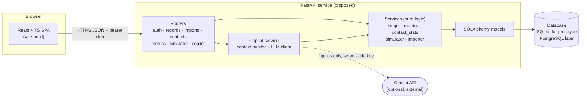
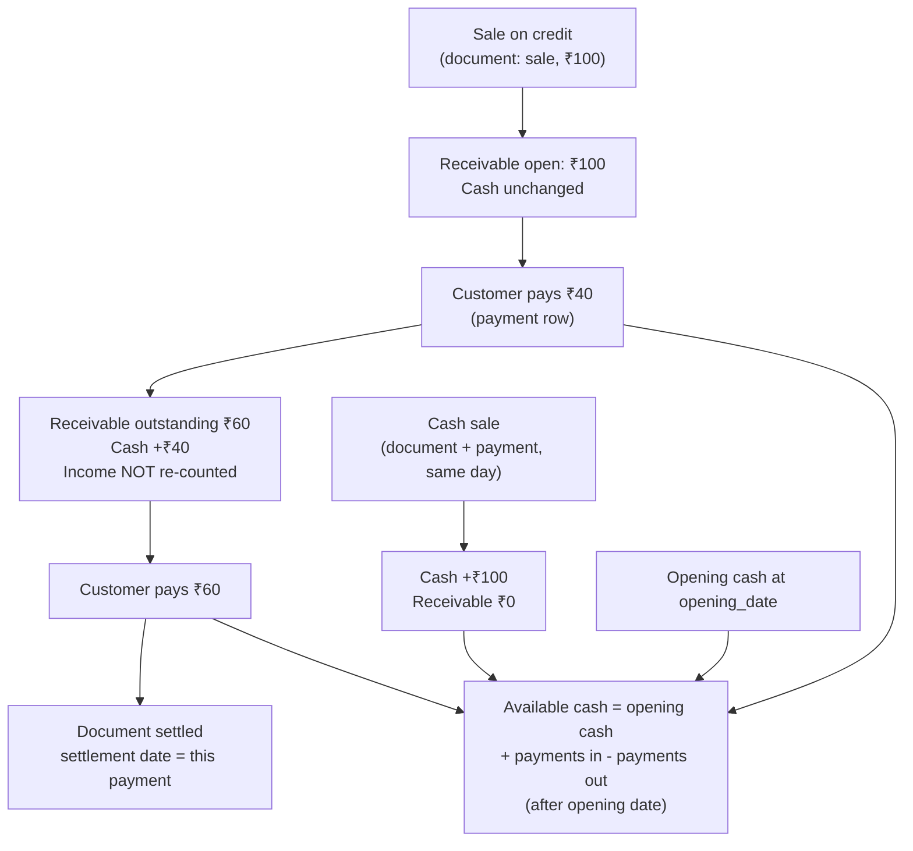
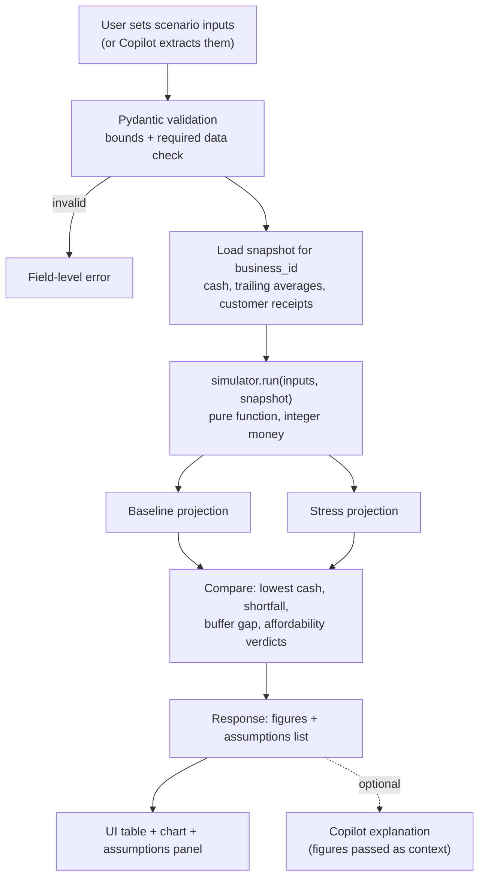
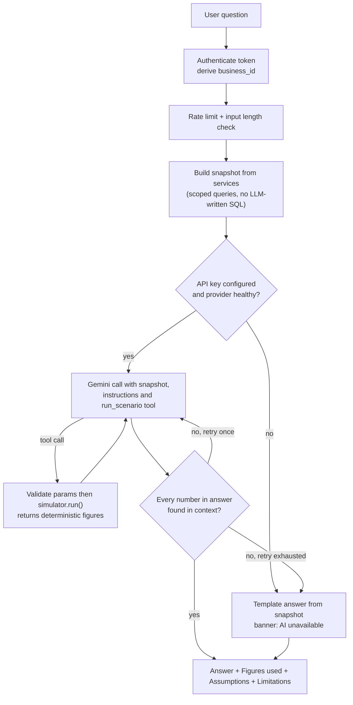
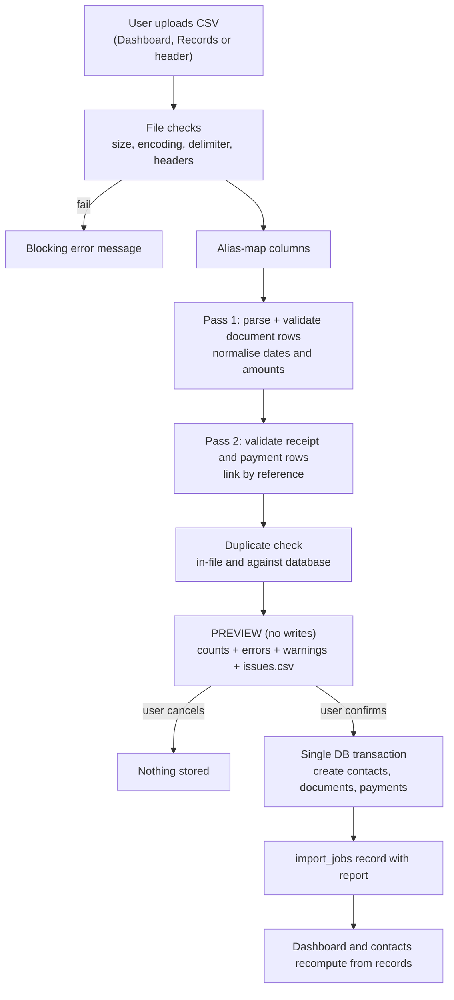

# FlowTrust — Pre-Implementation Audit Report

> **Status:** Phase 0 (audit only). Nothing described here has been built.
> Every feature, table, endpoint and diagram in this document is a **proposal**.
> Companion file: [`open-questions.md`](./open-questions.md) (decisions needed from you).
> Audit date: 2026-10-19.

---

## 1. Executive Summary

### What FlowTrust is
A financial-intelligence and risk-management web app for small businesses. The deck's tagline is *"Beyond Balance. Into Resilience."* It turns a business's own records (CSV or manual entry) into:

1. a cash/obligations dashboard,
2. transparent customer/supplier payment-behaviour statistics,
3. a baseline-vs-stress cash simulator, and
4. (proposed) an AI Copilot that *explains* numbers the application has already calculated.

The deck's guiding rule, which this audit adopts as an architectural principle: **"The application calculates the numbers. The AI helps explain them."**

### What is already decided (by the supplied material)
| Decision | Source |
|---|---|
| Product name, tagline, positioning (small businesses; resilience, not bookkeeping) | Deck slides 1, 9 |
| Data pipeline: CSV + manual entry → validate/normalise → data engine → analytics / contact intelligence / risk simulation → Copilot | Slide 3 |
| Core MVP = financial data management, dashboard + statistics, customer/supplier payment insights, *basic* risk simulation | Slide 3 ("CORE") |
| Copilot = existing model (Gemini named), no training, exact maths stays in application code | Slides 3, 7, 8 |
| Ratings must come from *disclosed criteria*, not "arbitrary trust scores"; thin history shows "Insufficient" | Slide 5 |
| Output wording: "estimated affordability under selected assumptions — not a guarantee" | Slide 6 |
| Inventory management is excluded | Your brief |
| Nav: Dashboard, Financial Records, Relationship Intelligence, Risk Simulator, AI Copilot; Settings separate; light + dark; responsive; login | Your brief (**not in the deck**) |
| Proposed (not final) stack: React/TS/Vite/Tailwind/Recharts, FastAPI/Pydantic, PostgreSQL/SQLAlchemy/Alembic, Pandas/NumPy, Gemini, Pytest | Slide 8 + your brief |

### What remains unresolved (highest impact first)
1. **Accounting basis**: are "Income vs expenses" cash-basis or accrual? (The deck's own chart data is inconsistent on this — see §2.4.)
2. **Opening balances and the record model** (how a sale, its partial payments and historical data fit together without double counting).
3. **Definitions** of on-time, delay, rating thresholds, minimum history, and what a *supplier* "rating" even means.
4. **Simulator baseline method** (run-rate vs scheduled collections), horizon, and the investment-affordability rule.
5. **Is the Copilot in the 8-hour MVP?** The deck classifies it "advanced / feasibility-dependent"; your brief makes it a primary tab.
6. **Stack deviations I recommend**: SQLite instead of PostgreSQL for the prototype; drop Alembic; probably drop Pandas/NumPy; Python version (see §13).
7. **Hackathon facts** that size the scope: team size/skills, submission format, hosted-vs-local demo, judging criteria (deck leaves team fields blank).

### Biggest technical risks
| # | Risk | Why it matters | Mitigation |
|---|---|---|---|
| R1 | Double-counting / wrong cash figures | One wrong ₹ on the dashboard destroys credibility | Two-table ledger (documents + payments), integer money, invariants tested |
| R2 | 8 hours is less than the deck's scope | Incomplete pages are worse than fewer complete ones | P0 ≈ 7.5 h (see §4); Copilot is stretch |
| R3 | Simulator numbers that look plausible but are unprincipled | The core differentiator | Written formulas, pure functions, unit tests, shown assumptions |
| R4 | CSV variability (dates, Indian number formats, Excel quirks) | Live demo may involve a file nobody pre-tested | One documented template, preview step, row-level error report |
| R5 | Environment: Python **3.14.6**, no PostgreSQL, no Docker, no `uv` | Wheels for data libs may be missing; DB setup can burn an hour | SQLite + SQLAlchemy; Python 3.12/3.13 venv; avoid heavy libs |
| R6 | LLM provider failure / rate limit / invented figures in a live demo | Embarrassing, hard to recover | Deterministic fallback, number-grounding check, pre-computed context |
| R7 | Multi-tenant leak | Trust product that leaks data | `business_id` derived only from the auth token; isolation tests |

---

## 2. Source Material Review

### 2.1 What I actually inspected
| Resource | Location | Result |
|---|---|---|
| Project workspace | `c:\Users\SHAURYA GUPTA\Documents\projects\flowtrust` | **Empty.** No files, no `.git`, no README/AGENTS.md/CLAUDE.md, no code, no sample data. |
| `FlowTrust_Hack_Cosmic_Presentation.pptx` | `Downloads\` (**outside** the workspace) | **Inspected.** 80 KB, 9 slides, 2 native charts with embedded data, no images, no speaker notes. Generated with python-pptx; title "FlowTrust – Hack Cosmic Submission". I read the slide XML text, chart data and colour values. I did **not** render it visually, so layout/typography impressions are inferred from XML only. |
| `flowtrust.pdf` | `Downloads\` (outside workspace) | **Partially inspected.** 9 pages, produced by *Microsoft Print to PDF* from the PPTX on 2026-10-19 17:37. Text is in embedded CID fonts and I have no PDF text tool (and did not install one). Treated as a rendering of the deck; **content not independently verified**. |
| Local toolchain | this machine (read-only version checks) | Node v24.20.0, Git 2.54.0, Python 3.14.6 + pip 26.1.2. **Not found:** PostgreSQL (`psql`/`pg_ctl`), Docker, `uv`. No Python packages from the proposed stack are installed. `npm --version` could not be read from my shell (unverified). `GEMINI_API_KEY` is not set in the environment. |

I did not modify, move or overwrite any of these files.

### 2.2 Missing or inaccessible (explicitly **not** inspected)
- **Screenshot / visual references** — none exist in the workspace. I did not find any file that I could confidently identify as a FlowTrust reference.
- **Sample data / proposed data model / architecture notes / previous technical decisions** — none found.
- **GitHub repository** — none; workspace is not a git repo and no remote is known.
- **Unidentified personal files in `Downloads\`** (e.g. `bbe6096d-…pptx`, `Gemini_Generated_Image_….png`, `Screenshot 2026-08-25 ….jpg`): names do not indicate FlowTrust and they live in a personal folder, so I did **not** open them. If any are your visual references, tell me which (question **G3**).
- The documents open in your editor belong to a different project (`blitz-backend`, NestJS) and are not part of FlowTrust; not inspected.
- Hackathon rules, dates, judging criteria, team composition — not supplied.

### 2.3 Information extracted from the deck

| Slide | Content that matters for building |
|---|---|
| 1 | Hero mock: Available cash ₹4,80,000; Receivables ₹1,25,000; **Risk outlook "Moderate"**; Net cash flow monthly trend May–Sep; Obligations/upcoming outflows ₹92,000; **"Payment status: 2 due soon"**. Four pillars: financial analytics, relationship intelligence, risk simulation, AI-assisted decisions. Labelled illustrative/synthetic. |
| 2 | Pain points: irregular cash flow, delayed customer payments, unclear payment reliability, limited risk visibility, uncertain investment decisions, scattered information. |
| 3 | Pipeline and MVP split. **CORE:** data management, dashboard/statistics, customer/supplier payment insights, basic risk simulation. **ADVANCED / FEASIBILITY-DEPENDENT:** AI model + RAG. |
| 4 | Dashboard KPIs: available cash, net cash flow (*"Inflows − outflows"*), receivables, payables, income-vs-expenses monthly chart, expense categories (Rent, Payroll, Utilities, Supplies). Indicators: average monthly expenses, **receivables ageing**, **on-time payment rate** ("eligible payments made by their expected due date"). |
| 5 | Contact profile: total transaction value ₹6,40,000; outstanding ₹24,000; on-time 89 %; avg delay 3.2 days; "18 recorded payments". Comparison table with ratings *Strong / Watch / Insufficient*. Filters: period and contact type. **Custom categories** (e.g. "Regular Suppliers", "Priority Customers"): create, assign contacts, compare members by chosen metric. |
| 6 | Scenario inputs: revenue decline −20 %, largest-customer delay +30 days, unexpected expense ₹50,000, proposed investment ₹1,00,000. Output table: inflows, outflows, projected cash position, potential shortfall (baseline vs stress). |
| 7 | Copilot example: *"What happens if my largest customer delays payment by 30 days?"* Pipeline: records → relevant data → metrics + context → existing model → explanation. |
| 8 | Stack mapping (see §13). "Deployment selected only if required. No hosting is claimed." "Vector search is optional." |
| 9 | Differentiators; comparison deliberately vague ("varies by product") — **no competitor claims to verify**. "FlowTrust features shown are proposed, not completed." |

Visual evidence in the deck XML: Aptos font; colours `#2160F5` (saturated blue, dominant), `#14213D`/`#334155`/`#64748B` (navy/slate text), `#E2E8F0` borders, `#F5F7FB`/`#F9FBFE`/`#EEF5FF` surfaces, `#F59E0B` amber, `#10B981` green, `#FFFFFF`.

### 2.4 Conflicts and inconsistencies found

| # | Finding | Evidence | Impact |
|---|---|---|---|
| X1 | **Net cash flow ≠ income − expenses in the deck's own charts.** Income (₹k): 280, 310, 295, 355, 340. Expenses: 230, 255, 260, 275, 298. Difference: 50, 55, 35, 80, 42. Plotted net cash flow: 32, 48, 35, 61, 42. Only Jul and Sep match. | `chart1.xml`, `chart2.xml` | Not necessarily wrong (income/expenses may be accrual, net cash flow cash-basis), but then FlowTrust must define and show both bases. Needs decision **B1**. |
| X2 | **Slide 6 arithmetic.** Stress inflows ₹2,35,000 vs baseline ₹3,20,000 is **−26.6 %**, not −20 %. (−20 % would be ₹2,56,000; the remaining ₹21,000 is plausibly the delayed customer's receipts — an *inference*, not stated.) Outflows +₹50,000 = the unexpected expense ✓. **The ₹1,00,000 investment is not in either column.** Shortfall is ₹0 in both. | Slide 6 | Simulator spec must state exactly how each input moves inflows/outflows, and whether investment is part of the stress table or a separate affordability test (**B9**). A scenario with ₹0 shortfall is also a weak demo (**G4**). |
| X3 | **Reconciles correctly:** baseline projected cash 5,22,000 = 4,80,000 + 42,000; stress 3,87,000 = 4,80,000 + 2,35,000 − 3,28,000; on-time 89 % ≈ 16/18. | Slides 4–6 | The deck is internally consistent apart from X1/X2. |
| X4 | **Slide 1 "Upcoming outflows ₹92,000" vs slide 4 "Payables ₹92,000".** Same number, different concepts (outflows also include rent/payroll that are not payables). | Slides 1, 4 | Must define "upcoming outflows" (**B10**; default in §8). |
| X5 | **Supplier "rating" meaning.** Slide 5 rates Supplier A "Strong" on *on-time payment rate*. For a supplier, payment records show how reliably **we** pay **them**, not how reliable **they** are. | Slide 5 | Misleading if shown as supplier quality. Decision **A2**. |
| X6 | **Copilot status.** Deck: "advanced / feasibility-dependent", "proposed". Brief: capability E and a primary navigation tab. | Slides 3, 7 vs brief | Scope decision **A1**. |
| X7 | **Palette.** Deck uses saturated blue `#2160F5` plus amber and green accents and pure white. Your brief wants muted/desaturated blue, off-white, red only for critical, minimal other status colours. | Deck XML vs brief | I follow the brief; deck colours are reference only. Confirm **G3**. |
| X8 | **Deck is silent** on login, accounts, settings, themes, mobile, opening balances, due-date handling, CSV columns. These come only from your brief. | — | Defaults proposed in this report. |
| X9 | **PostgreSQL in the deck; none installed locally; no Docker.** | Slide 8 vs env | Decision **F1**. |
| X10 | **Currency**: the extractor rendered "₹" as "?". Indian digit grouping (4,80,000) strongly implies INR. | Slides 1,4–6 | Assumed INR + `en-IN` formatting; confirm **A3**. |
| X11 | Team name and members are blank on slide 1. | Slide 1 | Cosmetic, but also means team size is unknown (**G1**). |

---

## 3. Product Understanding

**Target user.** An owner-operator of a small trading/service business (roughly 1–20 staff) who sells and buys on credit, tracks money in spreadsheets or a basic ledger, and has no finance team. Comfortable with a phone and CSV/Excel, not with accounting jargon. *(Inferred from the deck; no persona was supplied.)*

**Core problem.** Records say what happened; owners need to know *what could happen next* and *who to trust* — will the cash last if my biggest customer pays late, can I afford this purchase, which suppliers/customers behave reliably.

**Main user journeys**
1. **Get data in:** sign in → set opening cash → upload CSV (or load demo data / add a record) → see import report.
2. **Understand position:** open Dashboard → cash, receivables, payables, trends, what is due/overdue.
3. **Judge relationships:** open a customer/supplier → history, on-time %, delay, outstanding → compare within a category.
4. **Stress test:** choose a scenario (revenue −20 %, delay, expense, investment) → baseline vs stress → shortfall/affordability + assumptions.
5. **Ask (stretch):** "What if my largest customer pays 30 days late?" → grounded explanation.

**Primary differentiators** (per deck slide 9): financial stress simulation (core differentiator), transparent relationship statistics with custom categories, grounded AI explanations. Bookkeeping and charts are table stakes.

---

## 4. Proposed MVP

### 4.1 Recommended scope
Prove one thing end to end: **records in → correct numbers → insight that changes a decision.** That means CSV/manual data → trustworthy dashboard → contact statistics → stress simulator, with correctness and a smooth live demo valued over breadth. Copilot is a stretch goal built on top of the same calculation services.

### 4.2 Feature matrix
Effort = realistic hours *including both UI and API*, assuming one developer working with AI assistance. Complexity: S/M/L.

#### P0 — Essential (total ≈ 7.5 h)
| ID | Feature | User value | Depends on | Cx | Effort | Demo importance |
|---|---|---|---|---|---|---|
| FT-1 | Repo scaffold, env, config, git, README | Foundation | decisions F1/F3/G1 | S | 0.4 h | – |
| FT-2 | Auth (register/login, password hashing, token) + tenant scoping | Account-specific data (brief) | FT-1 | S–M | 0.5 h | Med |
| FT-3 | Data model + money/ledger core + invariant tests | Correct numbers | FT-1 | M | 0.9 h | High (invisible but critical) |
| FT-4 | Synthetic demo data seed + "Load demo data" button | Reliable demo, instant value | FT-3 | S | 0.4 h | **Very high** |
| FT-5 | CSV import: template, preview, validation, dedupe, error report | Core data entry; "uploads easy to find" | FT-3 | M–L | 1.0 h | **Very high** |
| FT-6 | Manual entry: add sale/expense; record (partial) payment | Partial-payment tracking | FT-3 | M | 0.4 h | High |
| FT-7 | Financial Records list + filters; upload entry points | History, discoverability | FT-3, FT-5 | S | 0.4 h | High |
| FT-8 | Dashboard: KPIs, income-vs-expenses chart, net cash-flow chart | Financial position | FT-3 | M | 0.8 h | **Very high** |
| FT-9 | Contact intelligence: list, detail, on-time %, avg delay, outstanding, ranking, "Insufficient data" | Differentiator | FT-3 | M | 0.9 h | **Very high** |
| FT-10 | Risk simulator: revenue decline, customer delay, unexpected expense, investment; baseline vs stress; assumptions panel | **Core differentiator** | FT-3, FT-8 logic | L | 1.1 h | **Very high** |
| FT-11 | App shell, nav, responsive layout, theme tokens (light/dark), onboarding + minimal Settings (business name, opening cash, theme) | Brief requirements | FT-1 | M | 0.7 h | High |

**P0 total = 7.5 h**, leaving ~0.5 h of an 8 h day for demo rehearsal and bug-fixing. There is **no slack for the Copilot** in this plan.

#### P1 — Valuable if time permits (in suggested order)
| ID | Feature | User value | Depends on | Cx | Effort | Demo imp. |
|---|---|---|---|---|---|---|
| FT-12 | AI Copilot (Gemini + deterministic offline mode + scenario tool) | Deck pillar; wow factor | FT-8–FT-10 | M–L | 1.0–1.5 h | High |
| FT-13 | Receivables ageing buckets + overdue list + "due soon" | Deck indicator; actionable | FT-3 | S | 0.4 h | Med–High |
| FT-14 | Custom categories + within-category comparison | Deck feature | FT-9 | M | 0.75 h | Med |
| FT-15 | Expense-category breakdown chart | Deck slide 4 | FT-8 | S | 0.2 h | Low–Med |
| FT-16 | Period filter (3/6/12 months) on contact stats | Deck slide 5 | FT-9 | S | 0.3 h | Low |
| FT-17 | Copilot numeric-grounding verifier | Safety | FT-12 | S–M | 0.4 h | Low (but protects demo) |
| FT-18 | Dark-theme polish (chart colours, contrast audit) | Brief | FT-11 | S | 0.4 h | Low–Med |
| FT-19 | CSV column-mapping UI | Flexibility for real files | FT-5 | M | 0.75 h | Low |
| FT-20 | Save/compare scenarios | Convenience | FT-10 | S | 0.4 h | Low |
| FT-21 | Delete-my-data / export CSV | Privacy story | FT-3 | S | 0.4 h | Low |

#### P2 — Future development
Multi-user roles/invites; email verification and password reset; bank-feed/XLSX/Tally/Zoho import; recurring transactions and forecasting models; multi-currency; GST/tax handling; credit notes/refunds; vector search over documents/notes; PDF reports; notifications/reminders; audit log; hosted deployment, backups, rate limiting at the edge; Alembic migrations; PostgreSQL migration; internationalisation.

### 4.3 Excluded for now
- **Inventory management** (deliberately excluded by you).
- Invoicing/PDF generation, payroll, tax filing, bank reconciliation, payment collection.
- Real credit scoring — the deck explicitly says no "trust score"; ratings are rule-based and disclosed.
- Model training/fine-tuning (deck: none).

### 4.4 Trade-off notes
- **Copilot deferred, not removed from the product story.** Because the deck itself marks it "advanced", this is consistent with your material; the cost is a weaker AI narrative in the demo. If you want it in the demo, option 2 of **A1** (drop manual-entry forms, import-only) buys it.
- **Categories (FT-14) are deferred** though they are on slide 5. Contact stats + ratings carry the differentiator; categories are a grouping layer on top. The schema will include `category_id` from day one so nothing is rebuilt.
- **Simplified implementations in P0:** one currency; one owner per business; strict CSV template; run-rate simulator baseline; ratings by a single transparent rule.

---

## 5. Frontend Architecture (proposal)

### 5.1 Pages and navigation
| Route | Page | Notes |
|---|---|---|
| `/login`, `/register` | Auth | Seeded demo credentials shown on the login page for judges |
| `/` → `/dashboard` | Dashboard | KPIs, two charts, due/overdue summary, **prominent "Import CSV" button** and an empty-state with *Import CSV · Add record · Load demo data* |
| `/records` | Financial Records | Table + filters, **"Import CSV" and "Add record" in the page header**, row action "Record payment" |
| `/contacts`, `/contacts/:id` | Relationship Intelligence | Ranked table (customers / suppliers tabs), contact detail with history |
| `/simulator` | Risk Simulator | Inputs left/top, baseline-vs-stress result, assumptions panel |
| `/copilot` | AI Copilot (P1) | Hidden from nav until it works |
| `/settings` | Settings | Reached from the header/avatar menu, **not** a sixth tab |

### 5.2 Usability concerns with the proposed navigation
1. **"Relationship Intelligence" is jargon.** A shop owner will look for "Customers & Suppliers". Suggest that as the visible label (keep the concept internally). → **A6**.
2. **Do not ship a tab that does not work.** If Copilot is stretch (A1), omit its tab rather than show a stub; judges penalise dead ends more than missing features.
3. **Mobile:** five tabs fit a bottom bar; Settings goes in the top bar. Tables (Records, Contacts) must collapse to card lists below ~640 px; this is the costliest responsive work and is budgeted in FT-7/FT-9.
4. **Empty and first-run states matter more than any page.** New account = no data = every page blank. Onboarding must (a) ask opening cash, (b) offer import / demo data. Without this, the first impression is five empty screens.
5. **Cross-links between differentiators:** Simulator ↔ Contacts ("largest customer" links to its profile) and Copilot ↔ Simulator ("explain this scenario"). Cheap and makes the product feel connected.
6. **Upload discoverability:** global header action "Import CSV" on every page + Dashboard empty state + Records header. One import dialog reused everywhere.
7. **Settings** needs only: business name, opening cash/date, default payment terms, theme, (P1) delete data.
8. **Colour semantics:** red only for critical (shortfall, "At risk", overdue). "Watch"/"Strong" rating badges should use blue shades/neutral grey, not amber/green, to honour "minimal use of other status colours" (deck's `#F59E0B`/`#10B981` are not carried over).

### 5.3 Component structure
```
src/
  app/            router, providers (auth, theme, query client), layout shell
  pages/          one folder per route (thin; compose features)
  features/       records/, import/, dashboard/, contacts/, simulator/, copilot/, settings/
  components/     ui primitives: Button, Card, Table, Badge, Dialog, Field, EmptyState, Skeleton, Toast
  charts/         thin Recharts wrappers (read colours from CSS variables)
  lib/            api client, money formatting (Intl en-IN), date helpers, theme
  types/          API types (generated from FastAPI OpenAPI if time permits)
```

### 5.4 State and API integration
- **Server state:** TanStack Query is recommended (loading/error/cache for free, small). Fallback: plain `fetch` + custom hooks. *(Low-impact default; no question needed.)*
- **Local UI state:** React state/context only. No Redux/Zustand.
- **Money:** API sends **integer minor units (paise)**; frontend only *formats* (`Intl.NumberFormat('en-IN')`). **The frontend never computes financial metrics** — avoids duplicate logic and rounding drift.
- **Auth:** bearer token held in memory + `localStorage` for the prototype (acceptable for a demo; production hardening: httpOnly cookie). 401 → redirect to login.
- **Errors:** one API error envelope `{error: {code, message, details[]}}` rendered by a single toast/inline component.

### 5.5 Responsive design
Breakpoints: `<640` single column + bottom nav; `640–1023` two-column cards, collapsible side drawer; `≥1024` fixed sidebar. Charts use `ResponsiveContainer`; limit to one chart per row on mobile; no horizontal page scroll; touch targets ≥ 44 px. Test widths: 390, 768, 1280.

### 5.6 Theme handling
CSS custom properties define semantic tokens (`--bg`, `--surface`, `--border`, `--text`, `--muted`, `--accent`, `--accent-strong`, `--danger`) under `:root` and `[data-theme="dark"]`; Tailwind maps to them. Default follows `prefers-color-scheme`, user override persisted in `localStorage`, set before first paint to avoid flash. Charts read tokens at render so they re-theme. Defining tokens in P0 costs ~0.2 h; *polishing* dark charts is P1 (FT-18). Final colour values are **not** chosen here — they will be proposed with a token sheet in the UI phase, after you confirm the visual references (G3).

---

## 6. Backend Architecture (proposal)

### 6.1 System architecture diagram

*Single deployable backend plus a static frontend. The dotted line is optional: the product must work without it.*

### 6.2 API modules
| Module | Responsibility (examples) |
|---|---|
| `auth` | `POST /auth/register`, `/auth/login`, `GET /me` |
| `business` | `GET/PATCH /business` (name, opening cash/date, default terms) |
| `records` | `GET/POST /documents`, `POST /documents/{id}/payments`, delete (P1) |
| `imports` | `POST /imports/preview`, `POST /imports/{id}/commit`, `GET /imports/template` |
| `contacts` | `GET /contacts` (with stats), `GET /contacts/{id}`, categories CRUD (P1) |
| `metrics` | `GET /metrics/summary`, `/metrics/monthly`, `/metrics/ageing` |
| `simulator` | `POST /simulate` (stateless) |
| `demo` | `POST /demo/load` (dev/demo only; flagged and clearly labelled) |
| `copilot` (P1) | `POST /copilot/ask` |

### 6.3 Business logic and service boundaries
- **Routers are thin:** parse/validate → call service → shape response. No arithmetic in routers.
- **Services are pure where possible.** `simulator.run(inputs, baseline_snapshot)` and metric functions take plain typed data, not a DB session → trivially unit-testable and reusable by the Copilot.
- **One money module** (`money.py`): parse ("₹1,25,000", "1250.50"), integer minor-unit arithmetic, rounding rule (half-up, only at display), formatting. No `float` anywhere in money paths.
- **Every query is scoped by `business_id`** supplied by a single `current_business` dependency derived from the token. Business id is never accepted from request bodies or from the LLM.

### 6.4 Validation
Pydantic models at every boundary; amounts > 0; dates within sane range (e.g. 2000-01-01…today+5y); due ≥ issue; scenario inputs bounded (decline 0–100 %, delay 0–365 d, amounts ≥ 0, horizon ∈ {30,60,90}); payment ≤ outstanding (checked in a DB transaction).

### 6.5 Authentication
Email + password; hash with Argon2id (or bcrypt via `passlib`/`argon2-cffi`); short-lived signed token (JWT, HS256, secret from env); constant-time login failure message; no user enumeration on register beyond a generic error. Details and hardening split in Appendix A.

---

## 7. Database and Data Model

### 7.1 Design principle
**Only documents and payments are facts; everything else is derived.** "Receivable" and "payable" are not tables — they are *open documents*. "Cash" is not stored — it is computed from opening cash and payments. This removes the main source of inconsistency (stored totals drifting from records).

### 7.2 Proposed entities
| Table | Purpose | Key columns |
|---|---|---|
| `users` | Login identity | `id`, `email` (unique), `password_hash`, `created_at` |
| `businesses` | Tenant | `id`, `owner_user_id` (unique → 1:1 for MVP), `name`, `currency` (`INR`), `opening_cash_minor`, `opening_date`, `default_terms_days` (30) |
| `contacts` | Customers and suppliers | `id`, `business_id`, `name`, `name_key` (normalised), `kind` (`customer`/`supplier`), `category_id` (nullable), unique(`business_id`,`kind`,`name_key`) |
| `categories` (P1) | User-created groups | `id`, `business_id`, `name`, `kind`, unique(`business_id`,`name`) |
| `documents` | A sale or an expense **as billed** (accrual event) | `id`, `business_id`, `kind` (`sale`/`expense`), `contact_id` (nullable for e.g. rent paid in cash), `issue_date`, `due_date`, `amount_minor` (>0), `reference`, `expense_category` (text; for expenses), `description`, `source` (`manual`/`import`/`demo`), `import_job_id`, `dedupe_key`, unique(`business_id`,`dedupe_key`) |
| `payments` | **The only rows that move cash** | `id`, `business_id`, `document_id` (NOT NULL), `paid_date`, `amount_minor` (>0), `source`, `import_job_id`, `dedupe_key` |
| `import_jobs` | Audit of uploads | `id`, `business_id`, `filename`, `file_sha256`, `status`, `rows_total/ok/skipped/failed`, `report_json`, `created_at` |

**Deliberately not tables:** receivables, payables, transactions (= documents + payments), customer/supplier ratings and statistics (derived on read — a few thousand rows, fast enough), chat history (browser session in MVP), embeddings, `risk_scenarios` (the simulator is stateless in P0; a `scenarios(params_json, result_json)` table appears only with FT-20).

### 7.3 Relationships
```
users 1──1 businesses 1──* contacts *──0..1 categories
                      1──* documents *──0..1 contacts
                      1──* payments  *──1    documents
                      1──* import_jobs
```
Every business-owned table carries `business_id` with an index; every query filters on it.

### 7.4 Important constraints
- `amount_minor` as **integer** (paise). SQLite `NUMERIC` is stored as floating point and would silently break exactness; integers are exact in SQLite and PostgreSQL.
- `CHECK(amount_minor > 0)`, `CHECK(due_date >= issue_date)`.
- Σ payments per document ≤ document amount — enforced in the service inside a transaction (cannot be a simple SQLite constraint). Overpayment is rejected (**B7**).
- Credit sales/purchases require a contact; cash expenses (rent, payroll) may have none.
- `dedupe_key` = SHA-256 of normalised (`business`, `kind`, `date`, `contact`, `amount`, `reference`) → idempotent re-imports.
- Foreign keys enabled explicitly (`PRAGMA foreign_keys=ON` on SQLite).
- Deleting a document cascades its payments; deleting a contact with documents is refused.

### 7.5 Opening balances and historical data
- **Opening cash** = cash on hand at `opening_date` (default: the day before the earliest recorded document/payment, editable). Entered once during onboarding.
- **Opening receivables/payables** = imported or entered as ordinary documents dated **before** `opening_date` with no payment; they are *not* added to opening cash.
- **Payments dated on/before `opening_date`** are assumed to be already inside opening cash: they are kept for statistics (history of payment behaviour) but **excluded from the cash calculation**. The importer warns about each such row.
- Imported history is otherwise treated exactly like manual records.

### 7.6 Partial payments
A document may have many `payments`. `outstanding = amount − Σ payments`. A document is *settled* when outstanding = 0; its **settlement date** is the date of the payment that brought it to 0. Each payment is linked to a specific document (no unallocated payments in MVP; **B3**). Status is derived: `open`, `partially_paid`, `settled`, plus `overdue` when `due_date < today` and outstanding > 0.

### 7.7 Financial data flow


---

## 8. Financial Calculations

All formulas below are **proposed definitions** for review; items needing your confirmation are marked **→ Qx**. "Today" is the business's current date (server date, or a fixed "as-of" date for demo data).

### 8.1 Concept separation
| Concept | Definition | Stored or derived |
|---|---|---|
| Initial business capital | Not modelled separately; **opening cash** is what matters for liquidity | stored (`businesses`) |
| Available cash | `opening_cash + Σ payments_in − Σ payments_out` (paid_date > opening_date, ≤ today) | derived |
| Income (billed) | Σ sale documents by `issue_date` | derived |
| Expenses (billed) | Σ expense documents by `issue_date` | derived |
| Cash inflow / outflow | Σ payments on sale / expense documents by `paid_date` | derived |
| Net cash flow | cash inflow − cash outflow (matches slide 4: "Inflows − outflows") | derived |
| Receivables | Σ (sale amount − payments) over open sale docs, as of today | derived |
| Payables | Σ (expense amount − payments) over open expense docs | derived |
| Outstanding (per contact) | same, filtered by contact | derived |

### 8.2 Double-counting rules (must be enforced and tested)
1. A credit sale does **not** touch cash; only its payments do.
2. A payment never creates income; it reduces outstanding and adds cash. Income is recognised once, on the document.
3. A cash sale/expense is *one* user action that writes one document + one same-day payment atomically.
4. Opening receivables/payables must not also be included in opening cash.
5. Re-importing a file must not duplicate rows (dedupe key + file hash warning).
6. Payments before the opening date are excluded from cash (§7.5).
7. In the simulator, recurring costs already in the run-rate must not be added again as "scheduled" payables (§10).
8. A *proposed* investment is simulation-only; if the user later actually buys it, it is recorded as an expense document — never both.

### 8.3 Required metrics
| Metric | Formula | Minimum data | MVP? |
|---|---|---|---|
| Available cash | §8.1 | opening cash | P0 |
| Cash in / out, net cash flow (per month & selected period) | payments grouped by `paid_date` month | any payments | P0 |
| Receivables / payables | §8.1 | documents | P0 |
| Monthly income vs expenses chart | **→ B1:** recommended **cash basis** (receipts vs payments) so the chart gap equals net cash flow and fixes deck inconsistency X1 | ≥ 2 months | P0 |
| Average monthly expenses | mean of cash outflow over the last 3 *complete* months (configurable) | ≥ 1 complete month | P0 (feeds simulator + buffer) |
| Receivables ageing | open sale docs bucketed by days past due: Current, 1–30, 31–60, 61–90, 90+ | open sales | P1 (FT-13) |
| Overdue receivables / payables | open docs with `due_date < today` | — | P1 |
| "Due soon" | open docs due within next 7 days (**→ B10**) | — | P1 |
| "Upcoming outflows" | outstanding payables due within the next 30 days **plus** nothing else (recurring costs are *not* included; label it "Payables due in 30 days") (**→ B10**) | — | P1 |
| Largest-customer concentration | top customer's share of trailing-3-month receipts | ≥ 1 customer | P1 |
| Runway (months) | `cash ÷ avg monthly net outflow` only if net cash flow < 0, else "n/a" | ≥ 3 months | P2 |
| Dashboard "Risk outlook" | Low/Moderate/High from simulator results (**→ B10**) | simulator | P1 — omit from P0 dashboard if undecided |

### 8.4 Edge cases
Negative cash (allowed, shown in red); zero/one month of history (show "not enough history", no trend line); current partial month excluded from averages; documents with future dates; due date missing (use default terms, flagged — **B6**); duplicate contact names differing by case/whitespace (normalised `name_key`); payment date before document date (rejected); very large amounts (integers fine; format only on display); time zone (store dates, not datetimes; "today" is server date in `Asia/Kolkata`, overridable for the demo).

### 8.5 Unresolved accounting assumptions (→ open questions)
B1 cash vs accrual presentation · B2 opening-balance convention · B3 payment-to-document linkage · B4 definitions of on-time and delay · B5 thresholds and minimum history · B6 missing due dates · B7 overpayments, refunds, credit notes, taxes (GST), owner draws/loans · B8 simulator baseline method · B9 investment-affordability rule · B10 "risk outlook", "due soon", "upcoming outflows".

---

## 9. Statistical Intelligence

### 9.1 Indicators
"Settled document" = fully paid. Unit of analysis = **document** (not individual payment) so partial payments do not distort rates. Delay for a settled document = `max(0, settlement_date − due_date)` in days (early = 0; **→ B4**).

| Indicator | Formula | Required data | Edge cases | Min. data | MVP? |
|---|---|---|---|---|---|
| Total transaction value | Σ document amounts in period | documents | period filter, mixed kinds | ≥ 1 doc | P0 |
| Outstanding amount | Σ (amount − payments), open docs | docs + payments | none | – | P0 |
| On-time rate | settled docs with settlement ≤ due ÷ settled docs | due dates, payments | partial payments (use final settlement), missing due (default terms) | **n ≥ 5 settled** to rate (**B5**); show n always | P0 |
| Average delay (days) | mean of delay over **all** settled docs (early = 0) | as above | outliers: also show **max**, and *avg delay of late payments only* in detail view | n ≥ 5 | P0 |
| Currently overdue | count and ₹ of open docs past due | open docs | **Survivorship bias:** a customer who never pays has no *settled* docs → would look "100 % on time". Therefore overdue items are always displayed beside the rate and push rating down to "At risk" if large | – | P0 |
| Payments recorded | count of settled docs / payments | – | – | – | P0 |
| Share of total (concentration) | contact value ÷ total | – | – | – | P1 |
| Trend (last 3 vs prior 3 docs on-time) | compare windows | n ≥ 10 | noisy | P2 |

### 9.2 Rating logic (transparent, shown in UI tooltip)
Proposed (**→ B5**, consistent with the deck's sample rows 89 %/3.2 d = Strong and 76 %/6.1 d = Watch):
- **Insufficient data:** fewer than 5 settled documents (shown as "–", unranked; deck's Supplier C).
- **Strong:** on-time ≥ 85 % and no open item > 30 days overdue.
- **Watch:** on-time 60–84 %, or any open item > 30 days overdue.
- **At risk:** on-time < 60 %, or open overdue > 60 days.
These are *rules*, not scores; every badge links to the rule and the numbers behind it.

### 9.3 Ranking and category logic
- Ranking is **within one kind** (customers with customers) and, when a category is selected, within that category. Metric selectable: on-time %, average delay, outstanding, total value.
- Contacts with insufficient data are listed after ranked ones, never given a rank.
- Ties: broken by larger sample, then name. Always show `n`.
- Direction: ascending for delay/outstanding ("lower is better"), descending for on-time/value; labels say which.
- Category: one category per contact in MVP (nullable `category_id`; **A5**); category comparison = same table filtered to that category plus category-level aggregates (value-weighted on-time rate).

### 9.4 Limitations (to display in the product)
- History is limited to **recorded** transactions; missing records change the picture (deck says so too).
- **Customer** metrics describe how they pay *you*; **supplier** metrics describe how *you* pay them — not supplier quality (**A2**).
- Small samples (5–10 docs) are noisy; rates are shown with `n`, not as confident scores.
- Due dates may be assumed from default terms; flagged rows should be visible.
- Seasonality, disputes, bank clearing dates and one-off large items are not modelled.
- This is a payment-behaviour summary, **not a credit score**, and must not be marketed as one.

---

## 10. Risk Simulator

### 10.1 Principle
**Every number is deterministic application code.** The AI may (a) translate a typed question into scenario parameters, which are validated, bounded and echoed back to the user, and (b) explain results in words. It never computes, adjusts or invents figures.

### 10.2 Scenario inputs (all optional; at least one required)
| Input | Type / bounds | Source in deck |
|---|---|---|
| Horizon | 30 / 60 / 90 days (default 30 — **B8**) | implied (monthly figures) |
| Revenue decline | 0–100 % applied to projected cash inflows | −20 % |
| Customer payment delay | customer (default: largest by trailing-3-month receipts, user-changeable) + 0–365 days | "largest customer +30 days" |
| Unexpected expense | amount ≥ 0, occurs at start of horizon (conservative) | ₹50,000 |
| Proposed investment | amount ≥ 0, paid at start of horizon | ₹1,00,000 |
| Minimum cash buffer | amount ≥ 0; default = 1 month of average cash outflow, editable (**B9**) | not in deck |

### 10.3 Proposed calculation (pending B8, B9)
Let `C0` = current available cash; `R` and `O` = average monthly cash receipts / payments over the last 3 **complete** months; `r_c` = that customer's average monthly receipts; `H` = horizon days; `d` = decline; `N` = delay days; `E` = unexpected expense; `I` = investment; `B` = buffer.

```
Baseline
  inflows_base  = R × H/30
  outflows_base = O × H/30
  cash_end_base = C0 + inflows_base − outflows_base

Stress
  inflows_s  = inflows_base × (1 − d)  −  r_c × (1 − d) × min(N, H)/30     # receipts pushed past the horizon
  outflows_s = outflows_base + E                                           # I handled in affordability below
  cash_end_s = C0 + inflows_s − outflows_s

Daily path (for "lowest cash"): receipts/payments accrue evenly per day; E (and I) hit on day 0;
the delayed customer's receipts are absent for the first N days.

Outputs
  lowest_cash, day_of_lowest
  shortfall   = max(0, −lowest_cash)               # cash goes negative
  buffer_gap  = max(0, B − lowest_cash)            # below chosen safety buffer
Investment affordability (evaluated for baseline AND stress, with I deducted on day 0)
  Affordable     : lowest_cash ≥ B
  Tight          : 0 ≤ lowest_cash < B
  Not affordable : lowest_cash < 0
```
**Why a run-rate baseline:** it avoids double-counting (open receivables are already part of what customers historically pay) and needs no forecasting model. **Its weakness:** it ignores the individual ageing of open receivables and seasonality. The alternative is a *schedule-based* baseline (open receivables expected at `due_date + customer's average delay`, plus new-sales run-rate net of those) — more faithful, but ~2× the logic and more double-counting risk; recommended for P2 or if you rank realism above time (**B8**).

### 10.4 Outputs
Table matching deck slide 6 (inflows, outflows, projected cash, potential shortfall) for Baseline vs Stress; plus lowest cash and when; buffer gap; investment verdicts; a line chart of daily projected cash (two series); **assumptions panel** listing `C0`, `R`, `O`, `r_c`, window dates, and every input; fixed disclaimer: *"Estimate under the stated assumptions — not a guarantee."*

### 10.5 Dependencies and data sufficiency
Needs ≥ 1 complete month of payments for `R`/`O` (warn below 3); a customer with receipts for the delay input; otherwise the relevant input is disabled with an explanation, never silently zero.

### 10.6 Must be deterministic vs AI
| Deterministic (code, unit-tested) | AI-assisted (language only) |
|---|---|
| All ratios, sums, averages, projections, verdict thresholds, rating labels | Parsing a natural-language scenario into parameters (validated by Pydantic, shown to user) |
| Choosing "largest customer" | Explaining *why* a shortfall occurs using supplied figures |
| Risk outlook label | Plain-language suggestions framed as options, with limitations |

### 10.7 Risk simulation flow


---

## 11. AI Copilot and Retrieval

### 11.1 Recommendation in one paragraph
Use **fixed, parameterised server-side retrieval — no text-to-SQL, no vector database.** On each question the server builds a compact JSON "business snapshot" from the deterministic services (a small business's headline metrics, 6-month trend, top contacts, overdue items fit in a few thousand tokens), optionally runs the simulator through a single validated tool call, and asks Gemini to *explain only the supplied figures*. If no API key is configured or the provider fails, the Copilot falls back to template answers generated from the same snapshot, so the feature always demonstrates something real.

### 11.2 Answers to the questions you asked
| Question | Answer |
|---|---|
| Is structured SQL retrieval enough for MVP? | **Yes.** All relevant data is structured and tiny. |
| What genuinely needs embeddings? | Only unstructured text: free-text notes/descriptions, uploaded policies/contracts/PDF invoices. None is in scope. |
| Is a vector DB needed? | **No.** Even with notes later, an in-process index or `pgvector` would do. The deck itself says "vector search is optional". |
| How are calculated figures supplied? | As labelled JSON (`{"metric_id": "...", "label": "...", "value_minor": ..., "as_of": ...}`) plus a rendered text version, with currency and period stated. |
| How to prevent invented figures? | (1) System prompt: use only supplied figures; say "not available in your data" otherwise; (2) low temperature; (3) **post-check (FT-17):** extract numbers from the answer and verify each exists in the context (allowing formatting variants); on failure, regenerate once, then fall back to template; (4) UI shows "Figures used" list. |
| How to ensure no cross-business access? | `business_id` comes only from the verified token; the model is given **no database access and no `business_id` parameter**; context is built server-side from scoped queries; tool arguments contain scenario parameters only. Automated test: user A's token can never yield user B's figures. |
| Missing data / provider failures? | Context carries explicit `data_gaps` ("only 2 months of history", "no customers with ≥5 settled invoices"); answer must mention them. Timeouts (≈15 s), one retry on 429/5xx with backoff, then deterministic fallback with a visible "AI unavailable — showing calculated summary" banner. Per-user rate limit (e.g. 10/min) protects the free quota. |
| Demo without an API key? | Yes: offline mode answers the suggested prompts (position summary, overdue receivables, best/worst payers, run scenario X) from templates; the simulator and all analytics are unaffected. |

### 11.3 Prompt-injection and data-leak considerations
Contact names, descriptions and CSV text are **untrusted input**. They enter the prompt inside a delimited data block marked "data, not instructions"; the model has **no write tools** and no network tools; output is rendered as plain text/markdown with escaping. Only figures needed for the answer are sent; for the public/synthetic demo, contact names may be sent, but for real businesses this is a disclosure to a third party that must be stated in Settings (**E2**).

### 11.4 Capability scope (**E3**)
The deck's example ("What happens if my largest customer delays payment by 30 days?") requires the Copilot to *run a scenario*. Proposed minimal design: one function-calling tool `run_scenario(params)` that wraps the simulator, plus read-only snapshot context. No other tools in MVP.

### 11.5 Retrieval flow


---

## 12. CSV Import Pipeline

### 12.1 Supported format (proposal, **D1/D2**)
One documented template, `records.csv`, UTF-8 (BOM and Windows-1252 tolerated), comma or semicolon delimiter, header row required, ≤ 5 MB / 10,000 rows. XLSX is not supported in the prototype (Excel users "Save as CSV").

| Column | Required | Meaning |
|---|---|---|
| `type` | yes | `sale`, `expense`, `receipt` (money received), `payment` (money paid) |
| `date` | yes | Issue date for sale/expense; paid date for receipt/payment |
| `party` | for credit rows | Customer (sale/receipt) or supplier (expense/payment) name; blank allowed for cash expenses like rent |
| `amount` | yes | Positive number |
| `reference` | recommended | Document number. **Receipts/payments use it to link to their sale/expense** (partial payments) |
| `due_date` | optional | Defaults to `date + default_terms_days` (flagged as assumed) |
| `paid_date` | optional | Shortcut on a sale/expense row: creates a full payment on that date (one-line settled records) |
| `category` | optional | Expense category (Rent, Payroll, Utilities, Supplies…) |
| `description` | optional | Free text |

Parsing rules: amounts accept `₹`, `Rs`, `INR`, thousands separators including Indian grouping (`1,25,000.50`), at most 2 decimals; negatives and zero are errors. Dates accept `YYYY-MM-DD` and `DD/MM/YYYY` / `DD-MM-YYYY` — **never `MM/DD`** (India convention, **D3**); ambiguous formats are rejected, not guessed.

### 12.2 Validation
- **File level (blocking):** size/rows, encoding, delimiter, required headers (after alias mapping).
- **Row level — errors (row skipped):** bad date, bad amount, unknown type, missing party on credit rows, `due_date < date`, receipt/payment with no matching reference, payment exceeding outstanding (also accounting for earlier rows in the same file), reference collision with different data.
- **Row level — warnings (row kept):** due date assumed from default terms; payment on/before opening date (excluded from cash); future date; new contact auto-created; possible duplicate.
- Two-pass processing: documents first, then payments, so file order does not matter.

### 12.3 Column mapping
P0: strict template with case-insensitive alias map (`Customer`, `Supplier`, `Name` → `party`; `Amt`, `Amount (INR)` → `amount`; `Invoice No` → `reference`, …). P1 (FT-19): preview-and-map UI for unknown headers.

### 12.4 Duplicate handling
Documents with a `reference` are unique per (`business`, `kind`, `reference`); others use the `dedupe_key` hash. Duplicates (within file or already stored) are **skipped and reported**, never silently merged. A previously imported file hash triggers an "already imported on …" warning requiring confirmation. Contacts auto-created from names deduplicate on a normalised name key (case/whitespace only; **no fuzzy matching** in MVP, with the risk that "ABC Traders" and "A.B.C. Traders" remain separate).

### 12.5 Error reporting
Preview returns: counts (total / ok / warnings / errors / duplicates), the first N issues inline, and a **downloadable `import-issues.csv`** (row number, column, value, severity, message, suggested fix). Nothing is written until the user confirms; commit is one DB transaction for the valid rows; the `import_jobs` row stores the report.

Security: file size cap before parsing, no formula execution, cells starting with `= + - @` are stored verbatim but neutralised in any CSV export, text escaped in UI.

### 12.6 Import flow


---

## 13. Recommended Technology Stack

Verdicts: **Keep** · **Change** · **Drop (for prototype)** · **Confirm**.

| Technology | Why needed | Alternatives | Trade-offs | Verdict |
|---|---|---|---|---|
| React + TypeScript + Vite | SPA, typed API boundaries, fast dev server | Next.js, plain JS | TS adds some friction for beginners but catches API-shape bugs; Next.js adds SSR you don't need | **Keep** |
| Tailwind CSS | Fast consistent styling, easy theme tokens | CSS modules | Class noise; pin one major version at setup | **Keep** |
| Recharts | Bar/line charts needed | Chart.js, visx | Adequate for 3–4 simple charts; theming via CSS variables needs wrappers | **Keep** |
| React Router | 7 routes + auth guard | single-page tabs | Small; fine | **Keep** |
| TanStack Query | Loading/error/caching | hand-written hooks | One more dependency; saves time | **Add (low-impact)** |
| FastAPI + Pydantic v2 | Typed validation, auto OpenAPI docs, quick | Flask, Django | Excellent fit; async not important here | **Keep** |
| SQLAlchemy 2.x | ORM + portability SQLite→Postgres | raw SQL, SQLModel | Some learning curve; worth it for portability | **Keep** |
| **PostgreSQL** | Production-grade DB (deck) | **SQLite**, hosted Postgres | Not installed locally, no Docker, setup/credentials/connection debugging can cost 30–60 min of an 8 h day; SQLite is zero-setup, one file, perfect for single-user demo; SQLAlchemy lets you switch by changing `DATABASE_URL` | **Change → SQLite for prototype (F1)** |
| **Alembic** | Schema migrations | `create_all()` + seed script | Migrations are valuable in production, pure overhead when schema changes hourly and DB is disposable | **Drop (P2, with Postgres)** |
| **Pandas / NumPy** | Statistics (deck) | stdlib `csv` + SQL + integers | Dataset ≤ 10k rows; SQL `GROUP BY` and Python suffice; Pandas is a heavy install, may lack wheels for Python 3.14, and silently converts to float (hurts exactness) | **Drop for P0 (F4)**; reintroduce for forecasting (P2) |
| Money as integers (+ `Decimal` for parsing/percent) | Exact currency maths | `Decimal` columns | Integers are exact everywhere and simplest to test | **Keep (refines deck's "Decimal-based")** |
| Pytest | Calculation + API tests | unittest | Standard | **Keep** |
| Vitest (frontend) | Money formatting, tiny logic | none | Only if time; no E2E in 8 h | **Optional** |
| Argon2id / bcrypt | Password hashing | PBKDF2 | Needs compiled wheel; verify on chosen Python | **Keep (confirm install)** |
| JWT (python-jose/PyJWT) | Stateless auth | server sessions | Simple; production adds cookie flags/rotation | **Keep** |
| Gemini via official `google-genai` SDK | LLM explanation (deck) | OpenAI, Groq, local Ollama | Free-tier limits and model names change — **verify current model id and quota at implementation time**; keep provider behind one interface; offline fallback mandatory | **Keep, optional (E1)** |
| ruff + ESLint/Prettier | Lint/format | – | Cheap quality | **Keep** |
| Git + GitHub | VC | – | Repo is not initialised; private until demo data reviewed | **Keep (confirm F6)** |
| Hosting | Demo | local only; Render/Railway/Fly + Vercel/Netlify | Hosted adds secrets, CORS, cold starts, free-tier sleep; deck says "no hosting is claimed" | **Local-first; hosting P2 unless required (F5/G1)** |

### Environment findings that affect the stack
- **Python 3.14.6 is the only Python found.** Pure-Python libs (FastAPI, SQLAlchemy) are usually fine; compiled ones (`pydantic-core`, Argon2/bcrypt, NumPy/Pandas, DB drivers) can lag on a brand-new Python. I did not verify availability (and installing is out of scope). Recommendation: create the venv on **Python 3.12 or 3.13** if you can install it; otherwise run a 10-minute dependency install check first (**F3**).
- **No PostgreSQL, no Docker, no `uv`.** Another reason for SQLite.
- **Node v24** is present; pin the Vite/React/Tailwind versions in `package.json` at setup.

### Choices still requiring confirmation
SQLite vs PostgreSQL (F1) · dropping Pandas/NumPy (F4) · Python version (F3) · LLM provider/key (E1) · hosting (F5).

---

## 14. Repository and Documentation Plan

### 14.1 Recommended structure (monorepo; **not created yet**)
```
flowtrust/
  README.md                  what it is, how to run, demo accounts, honest status
  AGENTS.md                  conventions for AI coding assistants (money rules, tenancy rule, no float)
  .gitignore  .env.example
  docs/
    audit-report.md          (this document)
    open-questions.md
    decisions.md             short ADR log of answered questions
    financial-rules.md       single source of truth for every formula/definition (§8–10)
    data-model.md            tables, constraints, invariants
    csv-format.md            template, rules, error codes, sample file
    demo-script.md           2–3 minute narrative + data to show
  backend/
    app/
      main.py  config.py  db.py
      core/        security.py  errors.py
      models/      (SQLAlchemy)
      schemas/     (Pydantic)
      api/         auth.py business.py records.py imports.py contacts.py metrics.py simulator.py copilot.py demo.py
      services/    money.py ledger.py metrics.py contact_stats.py simulator.py importer.py copilot/
    scripts/       seed_demo.py
    tests/
      unit/        test_money.py test_ledger.py test_metrics.py test_contact_stats.py test_simulator.py test_importer.py
      api/         test_auth.py test_tenant_isolation.py test_import_flow.py test_copilot_fallback.py
      fixtures/    golden_records.csv  expected_metrics.json  bad_rows.csv
    requirements.txt  (or pyproject.toml)  pytest.ini
  frontend/
    src/ (see §5.3)   index.html  vite.config.ts  tailwind config  tsconfig.json  package.json
  samples/
    demo_records.csv         synthetic, safe to publish
```

### 14.2 Required Markdown files
`README.md`, `AGENTS.md`, and the six in `docs/` above. `financial-rules.md` is the one that matters: code, tests and UI copy must all quote it, which prevents formulas from drifting between the deck, backend and Copilot prompts.

### 14.3 Testing structure and priorities
1. **Ledger invariants:** `cash = opening + Σin − Σout`; `Σ outstanding = Σ documents − Σ payments`; no negative outstanding; cash sale leaves receivable 0; credit sale leaves cash unchanged.
2. **Golden dataset:** seeded demo data → exact expected dashboard figures and contact stats (including the "Insufficient data" and "survivorship" cases).
3. **Simulator:** hand-computed scenarios incl. zero history, delay ≥ horizon, investment verdict boundaries.
4. **Importer:** each error/warning type, duplicates, two-pass linking, Indian number formats, DD/MM dates.
5. **Tenant isolation:** user A cannot read/modify/import into B's data at any endpoint (and Copilot context).
6. **Copilot fallback:** no key → templated answer; provider error → templated answer; invented number → rejected.
Frontend: manual checklist at 390/768/1280 and both themes; optional Vitest for formatting.

### 14.4 Configuration and environment
| Variable | Purpose |
|---|---|
| `APP_ENV` | `dev`/`demo` (enables demo-load endpoint) |
| `DATABASE_URL` | `sqlite:///./flowtrust.db` now, Postgres URL later |
| `SECRET_KEY` | JWT signing (required; no default in demo/prod) |
| `CORS_ORIGINS` | Frontend origin(s) |
| `GEMINI_API_KEY`, `GEMINI_MODEL` | Optional; absent ⇒ offline Copilot |
| `AS_OF_DATE` | Optional fixed "today" so demo numbers never drift |

`.env` is git-ignored; `.env.example` has placeholders only. Frontend receives only `VITE_API_BASE_URL` — **no secret ever uses a `VITE_` prefix**. Proposed run flow (not executed): create venv → install requirements → `python -m scripts.seed_demo` → `uvicorn` ; `npm install` → `npm run dev`. A single README "Quick start" is a P0 deliverable.

---

## 15. Implementation Roadmap

Total P0 ≈ **7.5 h** + **0.5 h** rehearsal = 8 h. Estimates assume one developer using AI assistance and *pre-approved decisions*; each unanswered "blocks implementation" question in `open-questions.md` adds rework risk. The order is **slice-first**: data in → correct numbers → differentiator, then widen.

| Milestone | Scope (feature IDs) | Depends on | Effort | Cumulative | Testing checkpoint (must pass before moving on) |
|---|---|---|---|---|---|
| **M0 Scaffold** | FT-1: repo, env, config, git, README quick-start, dependency install check | answers to F1, F3, G1 | 0.4 h | 0.4 | Backend "hello" + frontend dev server both run; `pytest` runs |
| **M1 Core** | FT-2, FT-3: models, money module, ledger/outstanding/cash logic, auth, `current_business` dependency | M0, B1–B3 | 1.4 h | 1.8 | Ledger invariants pass; tenant-isolation test passes; password hashing verified |
| **M2 Data in** | FT-4 demo seed, FT-5 CSV import (preview → confirm), FT-11 shell + login + onboarding + minimal Settings + theme tokens | M1, D1, D2, B6 | 2.1 h | 3.9 | Golden CSV imports with expected counts; bad-rows CSV yields exact error list; re-import is idempotent; app usable at 390 px |
| **M3 Dashboard** | FT-8: KPI cards, income-vs-expenses chart, net cash-flow chart | M2, B1 | 0.8 h | 4.7 | **Dashboard numbers equal golden expected values to the paisa**; cash-sale vs credit-sale case verified |
| **M4 Simulator** | FT-10: inputs, baseline vs stress, investment verdicts, assumptions panel | M3, B8, B9 | 1.1 h | 5.8 | Hand-computed scenarios match; delay ≥ horizon and no-history cases handled |
| ▶ **Vertical slice complete (§17)** | | | | | Full demo path works end to end on fresh DB in < 2 min |
| **M5 Contacts** | FT-9: ranked list, detail, ratings, insufficient-data handling | M2, A2, B4, B5 | 0.9 h | 6.7 | Golden stats exact incl. survivorship case; ranking order verified |
| **M6 Records** | FT-6 manual entry/partial payment, FT-7 records list/filters | M1 | 0.8 h | 7.5 | Overpayment rejected; partial payment updates outstanding/cash, not income |
| **M7 Rehearsal** | Bug-fix, copy, empty states, demo script, no new features | all | 0.5 h | 8.0 | Run `demo-script.md` twice; both themes; phone width; no console errors |
| *Stretch (only if ahead of schedule)* | FT-12 Copilot → FT-13 ageing → FT-14 categories → FT-17 verifier → FT-18 dark polish | M3–M5 | 1.0–1.5 h, 0.4, 0.75, 0.4, 0.4 | – | Copilot works with and without key; invented-number test rejects |

**Cut order if behind** (protects the differentiators): (1) skip all stretch items; (2) simplify FT-6 to "record payment" only; (3) FT-7 to a read-only list without filters; (4) shrink dark-theme work to tokens only; (5) replace the simulator's daily path with start/end values only. **Never cut:** ledger tests, import preview/error report, the assumptions panel, contact "Insufficient data" handling.

**Risk to flag honestly:** the deck's full vision (Copilot, categories, ageing, saved scenarios) does not fit in 8 h next to a correct ledger, import and simulator. Eight hours is feasible only with the P0 list above and pre-agreed decisions.

---

## 16. Risks and Open Questions

Full detail (options, defaults, why it matters) is in [`open-questions.md`](./open-questions.md). Summary:

| ID | Ambiguity | Why it matters | Recommended default | You must decide? | Blocks |
|---|---|---|---|---|---|
| A1 | Copilot in MVP? | Scope/time | Stretch, not in P0 | **Yes** | Scope |
| A2 | What a supplier "rating" means | Misleading claims | "Payment timeliness (our payments)", no supplier-quality claim | Yes | M5 |
| A3 | Currency/locale | Formatting/schema | INR, `en-IN` | Confirm | No |
| A4 | Contact both customer and supplier? | Schema | No (one kind per contact) | Confirm | No |
| A5 | Categories per contact | Schema | One (nullable) | Confirm | No |
| A6 | Nav label wording | Usability | "Customers & Suppliers" | Optional | No |
| B1 | Cash vs accrual in charts | Correctness (deck X1) | Cash basis in charts | **Yes** | M3 |
| B2 | Opening balance convention | Cash correctness | §7.5 | **Yes** | M1 |
| B3 | Payment ↔ document linkage | Partial payments, stats | Every payment linked to a document | **Yes** | M1 |
| B4 | On-time and delay definitions | Rating validity | §9.1 | Yes | M5 |
| B5 | Thresholds and min. history | Rating fairness | n ≥ 5; 85 / 60 | Yes | M5 |
| B6 | Missing due dates | Delay stats | Default terms 30 d, flagged | **Yes** | M2 |
| B7 | Overpay/refund/tax/loans | Scope | Reject overpay; out of scope | Confirm | No |
| B8 | Simulator baseline + horizon | Core differentiator | Run-rate, 30 d | **Yes** | M4 |
| B9 | Investment affordability rule | Core differentiator | Buffer = 1 month outflow | **Yes** | M4 |
| B10 | Risk outlook / due soon / upcoming outflows | Dashboard semantics | §8.3 | Optional | No |
| C1 | Auth mode | Security/demo | Email+password + seeded demo | **Yes** | M1 |
| C2 | One vs many users per business | Schema | 1:1 now | Confirm | No |
| C3 | New-account starting state | Onboarding | Empty + "Load demo data" | Confirm | No |
| C4 | Delete/export data | Privacy | Delete P1, export P2 | Optional | No |
| D1 | CSV template shape | Import design | Single file with `type` | **Yes** | M2 |
| D2 | Will real exports (Tally/Zoho/bank) be used? | Import scope | No; template only | **Yes** | M2 |
| D3 | Date formats | Silent errors | ISO + DD/MM only | Confirm | No |
| D4 | Contact name matching | Duplicates | Exact normalised only | Confirm | No |
| E1 | LLM provider/key/quota | Copilot feasibility | Gemini free key, optional | Yes | Copilot |
| E2 | Data sent to third-party LLM | Privacy | Aggregates + names for synthetic data | Confirm | No |
| E3 | Copilot capabilities | Design | Read-only + `run_scenario` tool | Yes | Copilot |
| E4 | Offline fallback acceptable | Demo reliability | Yes | Confirm | No |
| F1 | SQLite vs PostgreSQL | Setup time/deck deviation | SQLite | **Yes** | M0 |
| F2 | Drop Alembic | Time | Drop | Confirm | No |
| F3 | Python version | Install risk | 3.12/3.13 venv | **Yes** | M0 |
| F4 | Drop Pandas/NumPy | Exactness/install | Drop | Confirm | No |
| F5 | Deployment | Scope | Local demo; host only if required | **Yes** | – |
| F6 | GitHub repo name/visibility | Hygiene | Private; no push until approved | Optional | No |
| G1 | Hackathon facts | Scope sizing | 8 h, 1–2 devs, local live demo + backup video | **Yes** | M0 |
| G2 | Approve P0/P1/P2 + cut order | Scope | As §4/§15 | **Yes** | Scope |
| G3 | Visual references / palette override | UI | Brief palette; deck colours reference only | **Yes** (before UI) | M2 |
| G4 | Demo story + dataset realism | Demo impact | Scenario producing a visible shortfall | Optional | M2 seed |

---

## 17. Recommended First Vertical Slice

**Smallest complete journey that proves FlowTrust's thesis (≈ M0–M4):**

1. Open app → log in with the seeded **demo account** (synthetic data, clearly labelled).
2. (Fresh account) Onboarding asks **opening cash**, then **Import CSV** of the sample file → preview shows e.g. "118 ok · 4 warnings · 3 errors" with a downloadable issue list → confirm.
3. **Dashboard** shows available cash, receivables, payables, net cash flow, and an income-vs-expenses chart — numbers match the golden file exactly.
4. **Risk Simulator:** choose "largest customer pays 30 days late" + "unexpected expense ₹50,000" → baseline vs stress table, lowest cash, shortfall, assumptions panel.

Why this slice: it exercises auth/tenancy, the data model, import validation, the ledger, deterministic analytics and the core differentiator through every layer, while skipping everything that does not change the story. Contacts and manual entry then extend it; Copilot sits on top of the same services.

---

## 18. Definition of Done (prototype usable)

**Functional**
- [ ] A new user can register, set opening cash, import the sample CSV and see correct dashboard figures with no manual DB work.
- [ ] CSV preview reports every error/warning with row numbers; invalid rows never reach the DB; re-importing the same file creates no duplicates.
- [ ] A credit sale does not change cash; a partial payment changes outstanding and cash but not income; overpayment is rejected.
- [ ] Contacts page shows on-time %, average delay, outstanding and a rating with visible rule; contacts with < 5 settled documents show "Insufficient data" and are unranked.
- [ ] Simulator returns baseline vs stress with shortfall/lowest cash and lists all assumptions; investment verdict follows the documented thresholds.
- [ ] Light and dark themes both usable; Dashboard, Records, Contacts and Simulator are usable at 390 px width.
- [ ] Any Copilot shipped works **with and without** an API key and never shows a figure absent from its context.

**Quality**
- [ ] `pytest` passes: ledger invariants, golden dataset, simulator, importer, tenant isolation.
- [ ] No `float` in money code paths (reviewed/grepped).
- [ ] Every endpoint is auth-protected except register/login/health, and filters by `business_id`.

**Safety and delivery**
- [ ] No secrets in repo or frontend bundle; `.env.example` present; `.env` and DB files git-ignored.
- [ ] All shipped data is synthetic and labelled as such; no real customer financials anywhere.
- [ ] README quick-start works from a clean clone in ≤ 10 minutes; demo script rehearsed twice.
- [ ] UI never claims unbuilt features; simulator output carries the "estimate, not a guarantee" notice.

---

## Appendix A — Security, Privacy and Reliability

| Area | Necessary for prototype | Production-hardening (defer) |
|---|---|---|
| Authentication | Email+password, Argon2id/bcrypt hash, signed expiring token, generic login errors | Email verification, password reset, MFA, lockout/rate limiting, httpOnly cookies + CSRF, refresh-token rotation |
| Data isolation | `business_id` from token on **every** query; isolation tests; IDs not guessable-by-trust (still checked) | Row-level security (Postgres RLS), audit logs, pen-test |
| Passwords | Never stored/logged in plain text | Breach-password check, policy |
| Secrets | `.env` git-ignored; `.env.example`; keys server-side only; no `VITE_` secrets; pre-push scan for keys | Secret manager, rotation |
| API errors | Consistent envelope; no stack traces or SQL in responses; request size limits | Structured logging, alerting |
| CSV validation | Size/row caps, encoding, strict parsing, preview-before-write, formula-cell neutralisation | Virus scan, async processing, per-row audit |
| Database integrity | Integer money, CHECKs, FKs on, atomic transactions, dedupe keys | Migrations, backups, constraints in Postgres |
| Calculation accuracy | Single money module, golden tests, formulas in `financial-rules.md` | Independent reconciliation reports |
| AI permissions | No DB access/`business_id` for model; server-built context; delimited untrusted text; no write tools; output escaped | Content filtering, usage quotas per tenant, provider DPA review |
| Rate limits/provider failure | Timeout, one retry, deterministic fallback, small per-user limit | Gateway-level limits, circuit breaker, queue |
| Safe demo data | Fully synthetic seed + sample CSV; labelled "synthetic" in UI | – |
| Export/deletion | (P1) delete my data | Export, retention policy, account deletion, GDPR/DPDP review |
| Transport | HTTPS if hosted; CORS restricted to known origin | HSTS, CSP, dependency scanning |

---
*End of report. Nothing above has been implemented; no dependencies have been installed, no database created, no repository initialised, and nothing has been pushed.*
