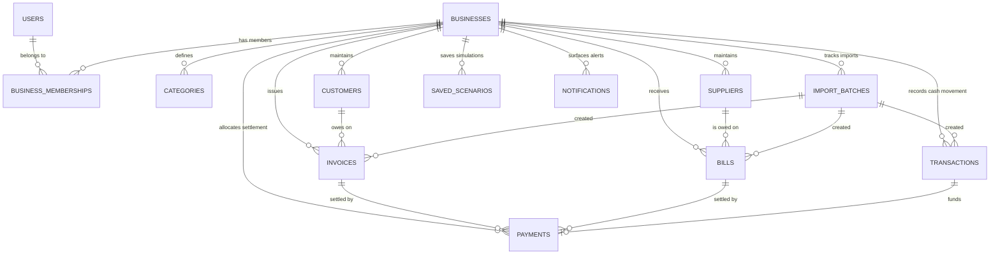

# FlowTrust — Dataset Strategy, Canonical Data Model, and Synthetic Data Specification

**Status:** Approved Authoritative Specification (v1.0 — Dataset Strategy Defined; Synthetic CSV Generation Pending Approval)  
**Project:** FlowTrust — *Beyond Balance. Into Resilience.*  
**Authoritative Scope:** Canonical Database & Domain Data Model, Required MVP Dataset Collection, CSV Schema Specifications, Cross-Dataset Financial Consistency, Risk Simulator Dataset Coverage, and Future Synthetic Data Generation Plan  
**Related Specifications:** [FINANCIAL_FOUNDATION_SPECIFICATION.md](../financial/FINANCIAL_FOUNDATION_SPECIFICATION.md) · [CSV_IMPORT_AND_VALIDATION_SPECIFICATION.md](./CSV_IMPORT_AND_VALIDATION_SPECIFICATION.md) · [RISK_SIMULATOR_SPECIFICATION.md](../features/RISK_SIMULATOR_SPECIFICATION.md) · [CUSTOMER_SUPPLIER_INTELLIGENCE_SPECIFICATION.md](../features/CUSTOMER_SUPPLIER_INTELLIGENCE_SPECIFICATION.md)

---

## 1. Repository Dataset Audit Status & Purpose

### 1.1 Actual Repository Inspection Findings
A complete inspection of the FlowTrust repository confirms that **no CSV datasets or sample financial files currently exist in the repository**.

Per the project's staged engineering plan:
1. **This document defines FlowTrust's canonical data model, required dataset inventory, CSV schemas, financial consistency invariants, and synthetic data generation strategy from scratch.**
2. **Actual synthetic CSV files have not yet been generated** and will be produced deterministically in a dedicated follow-up task after this specification is reviewed.

### 1.2 Classification of Data in FlowTrust
To prevent conflating database tables, user-uploaded CSV exports, and synthetic demo fixtures, FlowTrust separates data into five distinct classes:

| Data Class | Purpose | Storage / Location |
|---|---|---|
| **1. Core Canonical Business Records** | Authoritative relational entities representing a workspace's actual financial position (`businesses`, `customers`, `suppliers`, `categories`, `invoices`, `bills`, `transactions`, `payments`). | PostgreSQL (Supabase) with Row Level Security (RLS). |
| **2. Supporting Operational & Planning Records** | Traceability, planning, and alert metadata (`business_memberships`, `import_batches`, `import_batch_rows`, `saved_scenarios`, `notifications`). | PostgreSQL (Supabase) scoped to `business_id`. |
| **3. Import-Source CSV Files** | External flat files uploaded by users (or used to test CSV ingestion) that undergo column mapping, validation, and deduplication before creating canonical records. | Uploaded transiently via CSV Import workflow; tracked via `import_batches`. |
| **4. Synthetic Business Scenarios (Demo & QA)** | Coherent, multi-file fictional business datasets designed to demonstrate FlowTrust features and verify financial calculations across normal and edge cases. | Future seed/fixture directory (to be generated after spec approval); flagged with `is_demo = true` in demo workspaces. |
| **5. Deliberately Invalid Import Fixtures** | Malformed, ambiguous, or duplicate-heavy CSV files used exclusively by automated tests to verify parser rejection and warning behavior. | Isolated test fixture directory (`tests/fixtures/csv/invalid/`); **never** loaded into demo or production workspaces. |

---

## 2. Canonical Data Model

FlowTrust's database schema is the single source of truth for all application features. Source CSV files do not need to match database tables 1:1; the CSV import layer maps and transforms incoming rows into these canonical entities.

### 2.1 Entity 1: `businesses` (Workspace & Opening Financial Position)
* **Purpose:** Represents an isolated business workspace, its configuration, its join code, and its opening balance anchor.
* **Record Classification:** Core Business Entity (Database only).

| Field Name | Data Type | Required? | Constraints & Default | Description |
|---|---|---|---|---|
| `id` | `UUID` | Required | `PRIMARY KEY DEFAULT gen_random_uuid()` | Stable unique workspace identifier. |
| `name` | `VARCHAR(120)` | Required | `NOT NULL`, length `2..120` | Display name of the business. |
| `currency_code` | `CHAR(3)` | Required | `NOT NULL DEFAULT 'INR'` | ISO-4217 currency code (`INR` for MVP). |
| `timezone` | `VARCHAR(64)` | Required | `NOT NULL DEFAULT 'Asia/Kolkata'` | IANA timezone for date-boundary evaluation. |
| `join_code` | `VARCHAR(16)` | Required | `UNIQUE NOT NULL` | 10-char uppercase alphanumeric code (`ABCDEFGHJKLMNPQRSTUVWXYZ23456789`). |
| `join_code_generated_at` | `TIMESTAMPTZ` | Required | `NOT NULL DEFAULT now()` | Timestamp of last join-code generation/regeneration. |
| `opening_cash_balance` | `NUMERIC(14,2)` | Required | `NOT NULL DEFAULT 0.00` | Combined bank + physical cash balance as of `opening_balance_date`. |
| `opening_balance_date` | `DATE` | Optional | `NULL` | Cutoff date for `opening_cash_balance`. Transactions on/before this date do not alter post-opening cash. |
| `opening_receivables_balance` | `NUMERIC(14,2)` | Required | `NOT NULL DEFAULT 0.00 >= 0` | Aggregate unitemized opening receivables (0 if itemized as `invoices`). |
| `opening_payables_balance` | `NUMERIC(14,2)` | Required | `NOT NULL DEFAULT 0.00 >= 0` | Aggregate unitemized opening payables (0 if itemized as `bills`). |
| `target_cash_buffer` | `NUMERIC(14,2)` | Optional | `NULL >= 0` | User-configured minimum cash safety buffer for Simulator/Reports. |
| `is_demo` | `BOOLEAN` | Required | `NOT NULL DEFAULT false` | True if workspace contains synthetic demonstration data. |
| `created_at` | `TIMESTAMPTZ` | Required | `NOT NULL DEFAULT now()` | Creation timestamp. |
| `updated_at` | `TIMESTAMPTZ` | Required | `NOT NULL DEFAULT now()` | Last update timestamp. |

### 2.2 Entity 2: `business_memberships` (Workspace Access Control)
* **Purpose:** Links authenticated users (`auth.users`) to authorized businesses in a many-to-many relationship.
* **Record Classification:** Supporting Security Metadata (Database only).

| Field Name | Data Type | Required? | Constraints & Default | Description |
|---|---|---|---|---|
| `id` | `UUID` | Required | `PRIMARY KEY DEFAULT gen_random_uuid()` | Membership record ID. |
| `business_id` | `UUID` | Required | `FK -> businesses(id) ON DELETE CASCADE` | Target business workspace. |
| `user_id` | `UUID` | Required | `FK -> auth.users(id) ON DELETE CASCADE` | Authenticated Supabase user ID. |
| `joined_via` | `VARCHAR(24)` | Required | `'CREATOR' \| 'JOIN_CODE' \| 'DEMO_SEED'` | How membership was established. |
| `created_at` | `TIMESTAMPTZ` | Required | `NOT NULL DEFAULT now()` | Timestamp when user joined workspace. |
| *(Constraint)* | `UNIQUE` | Required | `UNIQUE (business_id, user_id)` | Prevents duplicate membership rows. |

### 2.3 Entity 3: `categories` (Income & Expense Classification)
* **Purpose:** Provides predefined standard categories and user-defined custom categories for classifying transactions, invoices, and bills.
* **Record Classification:** Supporting Financial Metadata (Database; referenced by name in CSVs).

| Field Name | Data Type | Required? | Constraints & Default | Description |
|---|---|---|---|---|
| `id` | `UUID` | Required | `PRIMARY KEY DEFAULT gen_random_uuid()` | Category ID. |
| `business_id` | `UUID` | Required | `FK -> businesses(id) ON DELETE CASCADE` | Owning business workspace. |
| `name` | `VARCHAR(80)` | Required | `NOT NULL`, `UNIQUE (business_id, direction, lower(name))` | Category label (e.g., `Sales`, `Rent`, `Salaries`). |
| `direction` | `VARCHAR(16)` | Required | `'INFLOW' \| 'OUTFLOW'` | Whether category applies to income/inflows or expenses/outflows. |
| `is_system_default` | `BOOLEAN` | Required | `NOT NULL DEFAULT false` | True for seeded standard categories ([FINANCIAL_FOUNDATION_SPECIFICATION.md](../financial/FINANCIAL_FOUNDATION_SPECIFICATION.md) §5). |
| `is_archived` | `BOOLEAN` | Required | `NOT NULL DEFAULT false` | Soft-archive flag preserving historical records. |

### 2.4 Entities 4 & 5: `customers` and `suppliers` (Counterparty Directories)
* **Purpose:** Maintain distinct directory entities with stable unique IDs so invoices, bills, and payments never rely on fragile free-text strings.
* **Record Classification:** Core Business Entities (Database; referenced by `external_code` or `name` during CSV import).

| Field Name | Data Type | Required? | Constraints & Default | Description |
|---|---|---|---|---|
| `id` | `UUID` | Required | `PRIMARY KEY DEFAULT gen_random_uuid()` | Stable unique entity ID. |
| `business_id` | `UUID` | Required | `FK -> businesses(id) ON DELETE CASCADE` | Owning business workspace. |
| `external_code` | `VARCHAR(64)` | Optional | `UNIQUE (business_id, external_code)` where not null | Optional human/CSV code (e.g., `CUST-001`, `SUP-001`). |
| `name` | `VARCHAR(160)` | Required | `NOT NULL`, length `1..160` | Customer or supplier business/contact name. |
| `email` | `VARCHAR(255)` | Optional | Valid email format if provided | Optional email address. |
| `phone` | `VARCHAR(40)` | Optional | `NULL` | Optional contact phone number. |
| `address` | `TEXT` | Optional | `NULL` | Optional billing/shipping address. |
| `notes` | `TEXT` | Optional | `NULL` | Optional internal relationship notes. |
| `status` | `VARCHAR(16)` | Required | `'ACTIVE' \| 'ARCHIVED' DEFAULT 'ACTIVE'` | Archived entities cannot be selected for new documents but retain full history. |
| `created_at` | `TIMESTAMPTZ` | Required | `NOT NULL DEFAULT now()` | Creation timestamp. |
| `updated_at` | `TIMESTAMPTZ` | Required | `NOT NULL DEFAULT now()` | Last update timestamp. |

### 2.5 Entities 6 & 7: `invoices` (Customer Receivables) and `bills` (Supplier Payables)
* **Purpose:** Track contractual obligations owed by customers (`invoices`) and owed to suppliers (`bills`). Issuing an invoice or recording a bill **never** directly modifies `Available Cash`.
* **Record Classification:** Core Financial Obligations (Database + Document CSV Import).

| Field Name | Data Type | Required? | Constraints & Default | Description |
|---|---|---|---|---|
| `id` | `UUID` | Required | `PRIMARY KEY DEFAULT gen_random_uuid()` | Document primary key. |
| `business_id` | `UUID` | Required | `FK -> businesses(id) ON DELETE CASCADE` | Owning business workspace. |
| `customer_id` / `supplier_id` | `UUID` | Required | `FK -> customers(id)` (on `invoices`) / `suppliers(id)` (on `bills`) `ON DELETE RESTRICT` | Linked counterparty ID. |
| `document_number` | `VARCHAR(64)` | Required | `UNIQUE (business_id, document_number)` | Invoice number (`INV-2026-001`) or Bill number (`BILL-2026-001`). |
| `issue_date` | `DATE` | Required | `NOT NULL` | Date invoice was issued or bill was received. |
| `due_date` | `DATE` | Optional | `NULL` or `due_date >= issue_date` | Contractual payment due date. Nullable if unknown in legacy imports. |
| `category_id` | `UUID` | Optional | `FK -> categories(id) ON DELETE SET NULL` | Associated income/expense category. |
| `total_amount` | `NUMERIC(14,2)` | Required | `NOT NULL CHECK (total_amount > 0)` | Gross document amount in workspace currency. |
| `amount_paid` | `NUMERIC(14,2)` | Required | `NOT NULL DEFAULT 0.00 CHECK (amount_paid >= 0 AND amount_paid <= total_amount)` | Sum of active linked `payments.allocated_amount`. |
| `status` | `VARCHAR(20)` | Required | `'UNPAID' \| 'PARTIALLY_PAID' \| 'PAID' \| 'CANCELLED'` | Synchronized deterministically from `total_amount`, `amount_paid`, and cancellation flag. |
| `cancelled_at` | `TIMESTAMPTZ` | Optional | `NULL` | Timestamp if document was cancelled. |
| `cancellation_reason` | `TEXT` | Optional | `NULL` | Audit note when cancelled. |
| `description` | `TEXT` | Optional | `NULL` | Line summary or memo. |
| `import_batch_id` | `UUID` | Optional | `FK -> import_batches(id) ON DELETE SET NULL` | Source CSV import batch, if imported. |
| `import_row_number` | `INTEGER` | Optional | `NULL` | 1-based row number in source CSV. |
| `created_at` | `TIMESTAMPTZ` | Required | `NOT NULL DEFAULT now()` | Creation timestamp. |
| `updated_at` | `TIMESTAMPTZ` | Required | `NOT NULL DEFAULT now()` | Last update timestamp. |

### 2.6 Entity 8: `transactions` (Actual Settled Cash Movements)
* **Purpose:** Represents every actual cash inflow or outflow affecting bank balances or physical cash.
* **Record Classification:** Core Cash Ledger Record (Database + Transaction/Bank CSV Import).

| Field Name | Data Type | Required? | Constraints & Default | Description |
|---|---|---|---|---|
| `id` | `UUID` | Required | `PRIMARY KEY DEFAULT gen_random_uuid()` | Transaction primary key. |
| `business_id` | `UUID` | Required | `FK -> businesses(id) ON DELETE CASCADE` | Owning business workspace. |
| `transaction_date` | `DATE` | Required | `NOT NULL` | Actual date money entered or left the account. |
| `direction` | `VARCHAR(16)` | Required | `'INFLOW' \| 'OUTFLOW'` | Cash movement direction (`INFLOW` increases cash; `OUTFLOW` decreases cash). |
| `transaction_kind` | `VARCHAR(32)` | Required | `'DIRECT_INCOME' \| 'DIRECT_EXPENSE' \| 'INVOICE_PAYMENT' \| 'BILL_PAYMENT' \| 'INTERNAL_TRANSFER' \| 'OPENING_BALANCE_MARKER'` | Semantic classification preventing double-counting between direct sales and invoice settlements. |
| `amount` | `NUMERIC(14,2)` | Required | `NOT NULL CHECK (amount > 0)` | Positive magnitude of cash movement; sign is governed strictly by `direction`. |
| `payment_account` | `VARCHAR(20)` | Required | `'BANK' \| 'CASH' DEFAULT 'BANK'` | Account type included in `Available Cash`. |
| `category_id` | `UUID` | Optional | `FK -> categories(id) ON DELETE SET NULL` | Income/expense category. |
| `description` | `TEXT` | Required | `NOT NULL` | Narration, memo, or transaction description. |
| `counterparty_type` | `VARCHAR(16)` | Optional | `'CUSTOMER' \| 'SUPPLIER' \| NULL` | Optional link type. |
| `customer_id` | `UUID` | Optional | `FK -> customers(id) ON DELETE RESTRICT` | Linked customer if applicable. |
| `supplier_id` | `UUID` | Optional | `FK -> suppliers(id) ON DELETE RESTRICT` | Linked supplier if applicable. |
| `external_reference` | `VARCHAR(120)` | Optional | `NULL` | Bank UTR, cheque number, or external transaction ID. |
| `is_pre_opening_cutoff` | `BOOLEAN` | Required | `NOT NULL DEFAULT false` | True when `transaction_date <= businesses.opening_balance_date`. |
| `dedup_fingerprint` | `VARCHAR(64)` | Required | `NOT NULL` (indexed per `business_id`) | Normalized hash of `(transaction_date, direction, amount, normalized_description)` for duplicate detection. |
| `import_batch_id` | `UUID` | Optional | `FK -> import_batches(id) ON DELETE SET NULL` | Source CSV import batch if imported. |
| `import_row_number` | `INTEGER` | Optional | `NULL` | 1-based row number in source CSV. |
| `status` | `VARCHAR(16)` | Required | `'ACTIVE' \| 'VOIDED' DEFAULT 'ACTIVE'` | Voided records are excluded from balances while preserving history. |
| `created_at` | `TIMESTAMPTZ` | Required | `NOT NULL DEFAULT now()` | Creation timestamp. |

### 2.7 Entity 9: `payments` (Document Payment Allocations)
* **Purpose:** Links an actual cash movement (`transactions`) to a specific customer `invoice` or supplier `bill`, enabling partial payments, multi-instalment settlements, and exact payment-delay calculations.
* **Record Classification:** Core Financial Linkage Record (Database; created via UI or Document/Payment CSV import).

| Field Name | Data Type | Required? | Constraints & Default | Description |
|---|---|---|---|---|
| `id` | `UUID` | Required | `PRIMARY KEY DEFAULT gen_random_uuid()` | Payment allocation ID. |
| `business_id` | `UUID` | Required | `FK -> businesses(id) ON DELETE CASCADE` | Owning business workspace. |
| `transaction_id` | `UUID` | Required | `FK -> transactions(id) ON DELETE RESTRICT` | The underlying cash ledger movement (`INVOICE_PAYMENT` or `BILL_PAYMENT`). |
| `target_type` | `VARCHAR(16)` | Required | `'INVOICE' \| 'BILL'` | Whether payment settles a customer invoice or supplier bill. |
| `invoice_id` | `UUID` | Optional | `FK -> invoices(id) ON DELETE RESTRICT` | Required when `target_type = 'INVOICE'`. |
| `bill_id` | `UUID` | Optional | `FK -> bills(id) ON DELETE RESTRICT` | Required when `target_type = 'BILL'`. |
| `payment_date` | `DATE` | Required | `NOT NULL` | Actual settlement date (matches `transactions.transaction_date`). |
| `allocated_amount` | `NUMERIC(14,2)` | Required | `NOT NULL CHECK (allocated_amount > 0)` | Amount applied toward the target document. |
| `payment_reference` | `VARCHAR(120)` | Optional | `NULL` | Receipt / UTR reference. |
| `status` | `VARCHAR(16)` | Required | `'ACTIVE' \| 'VOIDED' DEFAULT 'ACTIVE'` | Status of the allocation. |
| `created_at` | `TIMESTAMPTZ` | Required | `NOT NULL DEFAULT now()` | Creation timestamp. |

### 2.8 Entities 10, 11, & 12: Supporting Operational Tables
1. **`import_batches` & `import_batch_rows`:**
   * `import_batches`: `id (UUID)`, `business_id (UUID)`, `uploaded_by (UUID)`, `file_name (VARCHAR)`, `file_sha256 (CHAR(64))`, `dataset_format ('TRANSACTIONS' | 'BANK_STATEMENT' | 'DOCUMENTS')`, `status ('COMPLETED' | 'PARTIAL_COMPLETED' | 'FAILED' | 'CANCELLED')`, `total_rows (INT)`, `imported_rows (INT)`, `skipped_duplicate_rows (INT)`, `rejected_error_rows (INT)`, `pre_opening_rows (INT)`, `created_at (TIMESTAMPTZ)`.
   * `import_batch_rows`: `id (UUID)`, `import_batch_id (UUID)`, `row_number (INT)`, `raw_payload_json (JSONB)`, `validation_status ('IMPORTED' | 'SKIPPED_DUPLICATE' | 'REJECTED_ERROR')`, `messages_json (JSONB)`, `created_record_id (UUID NULL)`.
2. **`saved_scenarios` (Hypothetical Risk Simulator Storage):**
   * `id (UUID)`, `business_id (UUID)`, `created_by (UUID)`, `name (VARCHAR(120))`, `horizon_days (INT: 30 | 60 | 90)`, `inputs_json (JSONB)`, `baseline_snapshot_json (JSONB)`, `scenario_outputs_json (JSONB)`, `source_data_as_of (TIMESTAMPTZ)`, `created_at (TIMESTAMPTZ)`, `updated_at (TIMESTAMPTZ)`.
   * *Strict Boundary:* Saved scenarios never reference or write to `transactions`, `invoices`, `bills`, or `payments`.
3. **`notifications` (In-App Operational Alerts):**
   * `id (UUID)`, `business_id (UUID)`, `condition_key (VARCHAR(160))`, `category ('OVERDUE_INVOICE' | 'BILL_DUE_SOON' | 'CASH_COVERAGE_WARNING' | 'IMPORT_SUMMARY')`, `severity ('INFO' | 'REMINDER' | 'ALERT')`, `title (VARCHAR(160))`, `message (TEXT)`, `target_path (VARCHAR(255))`, `is_dismissed (BOOLEAN DEFAULT false)`, `dismissed_at (TIMESTAMPTZ NULL)`, `resolved_at (TIMESTAMPTZ NULL)`, `created_at (TIMESTAMPTZ)`.

---

## 3. Required MVP CSV Dataset Collection

Rather than inventing a fragmented set of ten CSV files, FlowTrust's MVP officially defines **three distinct CSV dataset formats** that together test every ingestion, mapping, financial calculation, receivables/payables linkage, customer delay metric, and Risk Simulator requirement.

| Format ID | Dataset Format Name | MVP Support Level | Primary Canonical Targets |
|---|---|---|---|
| **CSV Format 1** | **Unified Cash Transactions & Ledger CSV** (`flowtrust_transactions.csv`) | **Officially Supported Template + Flexible Mapping** | `transactions`, `categories`, `customers`/`suppliers`, and optional linked `payments` |
| **CSV Format 2** | **Bank-Style Statement CSV (Debit/Credit Split)** (`bank_statement_export.csv`) | **Supported via Flexible Column Mapping** | `transactions` (`BANK` account inflows/outflows) |
| **CSV Format 3** | **Invoices, Bills & Settlement Schedule CSV** (`flowtrust_documents.csv`) | **Officially Supported Template + Flexible Mapping** | `customers`, `suppliers`, `invoices`, `bills`, and settled `payments` + `transactions` |

### 3.1 CSV Format 1: Unified Cash Transactions & Ledger CSV (`flowtrust_transactions.csv`)
* **Intended Purpose:** The primary, standard FlowTrust CSV format for importing income, expenses, and cash receipts/payments.
* **Realistic Source Context:** A small business owner's cashbook spreadsheet, standard FlowTrust CSV template, or basic accounting cash ledger export.
* **Schema Specification:**

| Column Name | Accepted Header Aliases | Data Type | Required? | Format & Conventions |
|---|---|---|---|---|
| `transaction_date` | `date`, `txn_date`, `payment_date` | `DATE` | **Required** | `YYYY-MM-DD`, `DD/MM/YYYY`, or `DD-MM-YYYY`. |
| `description` | `narration`, `particulars`, `memo`, `details` | `STRING` | **Required** | Non-empty text (`1..500` chars). |
| `amount` | `value`, `total_amount`, `amt` | `DECIMAL` | **Required** | Positive number (e.g., `25000` or `25,000.50`). Sign determined by `type`; if negative amount is supplied without `type`, sign determines direction after preview confirmation. |
| `type` | `direction`, `transaction_type`, `flow` | `ENUM` | **Required** | Case-insensitive: `INFLOW`, `INCOME`, `RECEIPT`, `CREDIT` ($\rightarrow$ `INFLOW`); `OUTFLOW`, `EXPENSE`, `PAYMENT`, `DEBIT` ($\rightarrow$ `OUTFLOW`); `TRANSFER`, `OPENING_BALANCE`. |
| `category` | `category_name`, `head`, `expense_head` | `STRING` | Optional | Matched case-insensitively to `categories.name`; defaults to `Other Income` / `Other Expenses` if blank. |
| `account` | `payment_account`, `mode`, `channel` | `ENUM` | Optional | `BANK` (default), `CASH`. (`UPI`, `NEFT`, `IMPS`, `RTGS`, `CHEQUE` map to `BANK`). |
| `reference_id` | `external_reference`, `utr`, `ref_no`, `txn_id` | `STRING` | Optional | External unique reference used for Layer-1 duplicate detection. |
| `counterparty_name` | `party_name`, `contact_name`, `customer_or_supplier` | `STRING` | Optional | Trimmed and matched case-insensitively to `customers` or `suppliers`. |
| `counterparty_role` | `party_type`, `contact_type` | `ENUM` | Optional | `CUSTOMER` or `SUPPLIER` (inferred from `type` or `document_number` if omitted). |
| `document_number` | `invoice_number`, `bill_number`, `invoice_ref`, `doc_ref` | `STRING` | Optional | If provided and matches an open `invoice` or `bill`, creates a linked `payments` allocation (`INVOICE_PAYMENT` / `BILL_PAYMENT`) instead of an unlinked `DIRECT_INCOME` / `DIRECT_EXPENSE`. |

* **Capabilities & Limitations:**
  * Supports cash history, income/expense breakdowns, and settling existing open invoices/bills when `document_number` is present.
  * Cannot by itself establish *unpaid* invoices/bills or contractual `due_date` delays unless paired with existing documents or CSV Format 3.

### 3.2 CSV Format 2: Bank-Style Statement Export (`bank_statement_export.csv`)
* **Intended Purpose:** Enables small-business owners to import a generic CSV exported from a business bank account where inflows and outflows appear in separate Debit/Withdrawal and Credit/Deposit columns.
* **Realistic Source Context:** Generic tabular bank account activity export (unbranded; FlowTrust makes no claim of proprietary bank integration).
* **Schema Specification:**

| Column Name | Accepted Header Aliases | Data Type | Required? | Format & Conventions |
|---|---|---|---|---|
| `date` | `txn_date`, `transaction_date`, `value_date` | `DATE` | **Required** | `YYYY-MM-DD`, `DD/MM/YYYY`, or `DD-MM-YYYY`. |
| `narration` | `description`, `particulars`, `remarks` | `STRING` | **Required** | Bank transaction narration. |
| `debit` | `withdrawal`, `withdrawal_amt`, `dr`, `paid_out` | `DECIMAL` | **Conditionally Required** | Positive number representing cash outflow (`OUTFLOW`). Blank or `0` when row is a credit. |
| `credit` | `deposit`, `deposit_amt`, `cr`, `paid_in` | `DECIMAL` | **Conditionally Required** | Positive number representing cash inflow (`INFLOW`). Blank or `0` when row is a debit. *(Exactly one of `debit` or `credit` must be `> 0` per row).* |
| `chq_ref_no` | `reference_no`, `utr_no`, `tran_id` | `STRING` | Optional | Bank reference ID for duplicate detection. |
| `closing_balance` | `balance`, `running_balance` | `DECIMAL` | Optional (Ignored for ledger writes) | Displayed in Preview for informational sanity-checking only; **never** imported as a transaction amount. |

* **Capabilities & Limitations:**
  * Reliably populates `transactions` (`payment_account = 'BANK'`) for historical cash inflows, outflows, and net cash flow.
  * **Explicit Limitation:** Bank statements do not contain invoice issue dates, contractual due dates, or unpaid receivables/payables. Therefore, importing only a bank statement cannot populate `Total Receivables`, `Total Payables`, or `Customer Payment Delay` metrics.

### 3.3 CSV Format 3: Invoices, Bills & Settlement Schedule CSV (`flowtrust_documents.csv`)
* **Intended Purpose:** Allows bulk import of customer invoices and supplier bills—including unpaid, partially paid, and completed historical documents—to establish receivables, payables, customer payment-delay histories, and Risk Simulator schedules.
* **Realistic Source Context:** Billing register, invoice log spreadsheet, or accounts receivable/payable tracker.
* **Schema Specification:**

| Column Name | Accepted Header Aliases | Data Type | Required? | Format & Conventions |
|---|---|---|---|---|
| `document_type` | `type`, `doc_type`, `record_type` | `ENUM` | **Required** | `INVOICE` (customer receivable) or `BILL` (supplier payable). |
| `document_number` | `invoice_no`, `bill_no`, `doc_number`, `ref_no` | `STRING` | **Required** | Unique per business (`INV-2026-001`, `BILL-2026-014`). |
| `counterparty_name` | `customer_name`, `supplier_name`, `party_name` | `STRING` | **Required** | Name of customer (for `INVOICE`) or supplier (for `BILL`). |
| `counterparty_code` | `customer_code`, `supplier_code`, `party_id` | `STRING` | Optional | Stable external code (`CUST-01`, `SUP-01`) if available. |
| `issue_date` | `invoice_date`, `bill_date`, `doc_date` | `DATE` | **Required** | Document date (`YYYY-MM-DD`, `DD/MM/YYYY`, or `DD-MM-YYYY`). |
| `due_date` | `payment_due_date`, `maturity_date` | `DATE` | Optional | Must be `>= issue_date` when provided. If blank, imported with `due_date = NULL` (never invented). |
| `total_amount` | `invoice_amount`, `bill_amount`, `gross_amount` | `DECIMAL` | **Required** | Must be `> 0`. |
| `amount_paid` | `paid_amount`, `settled_amount`, `received_amount` | `DECIMAL` | Optional | Defaults to `0.00`. Must satisfy `0 <= amount_paid <= total_amount`. |
| `settlement_date` | `paid_date`, `payment_date`, `last_payment_date` | `DATE` | Conditionally Required | Required if `amount_paid > 0` so that the corresponding payment record and historical delay metric have a valid `payment_date` (`>= issue_date`). |
| `payment_reference` | `receipt_no`, `utr`, `payment_txn_id` | `STRING` | Optional | Used to link or deduplicate against already-imported `transactions`. |
| `category` | `category_name` | `STRING` | Optional | Defaults to `Sales` (for `INVOICE`) or `Inventory Purchases` / `Other Expenses` (for `BILL`). |
| `status` | `doc_status` | `ENUM` | Optional | `UNPAID`, `PARTIALLY_PAID`, `PAID`, `CANCELLED`. Validated against `total_amount` and `amount_paid`. |
| `description` | `notes`, `particulars` | `STRING` | Optional | Optional document summary. |

### 3.4 Deferred / Unsupported Formats (Out of Scope for MVP)
* Proprietary Tally XML/CSV dumps with multi-line voucher splits, GST tax-slab sub-ledgers (`CGST`/`SGST`/`IGST` split rows), or journal vouchers.
* Multi-currency CSV files requiring historical FX rate conversion tables.
* PDF, XLSX (binary Excel), or image/OCR invoice uploads (users must export spreadsheets to `.csv` first).

---

## 4. Cross-Dataset Financial Consistency Invariants

To guarantee that datasets behave as a single coherent financial system rather than disconnected sample files, all canonical records and synthetic datasets must obey the following **eight consistency invariants**:

1. **Invariant 1 — Zero Invoice/Transaction Double-Counting on Import:**
   * When importing `flowtrust_documents.csv` (Format 3) alongside `flowtrust_transactions.csv` (Format 1):
     * If a paid/partially paid invoice (`INV-2026-005`, `amount_paid = ₹30,000`, `payment_reference = 'UTR-9001'`) is imported via Format 3, AND the corresponding cash receipt (`reference_id = 'UTR-9001'`, `document_number = 'INV-2026-005'`, `amount = ₹30,000`) is imported via Format 1, the import engine links both to the **single** `transactions` record (`UTR-9001`) and **single** `payments` allocation (`₹30,000`). It **never** creates two ₹30,000 cash inflows!
2. **Invariant 2 — Exact Allocation Reconciliation:**
   * For every `invoice` and `bill`, `document.amount_paid` must equal the exact sum of `payments.allocated_amount` where `payments.status = 'ACTIVE'`.
   * For every `payment`, `payment.allocated_amount` must not exceed its parent `transaction.amount`.
3. **Invariant 3 — Opening Balance Cutoff Partitioning:**
   * Every transaction with `transaction_date <= businesses.opening_balance_date` has `is_pre_opening_cutoff = true`.
   * Post-opening `Available Cash` is always computed as `opening_cash_balance + sum(post_opening_inflows) - sum(post_opening_outflows)`.
4. **Invariant 4 — Strict Separation of Obligations vs. Cash:**
   * Unpaid (`UNPAID`) and remaining balances on partially paid (`PARTIALLY_PAID`) invoices and bills contribute **zero** to `Available Cash`, `Cash Inflows`, `Cash Outflows`, and `Net Cash Flow`.
5. **Invariant 5 — Internal Transfers & Opening Markers Excluded from Income/Expenses:**
   * Rows classified as `INTERNAL_TRANSFER` (e.g., cash withdrawal from bank to petty cash box) or `OPENING_BALANCE_MARKER` (e.g., `"Opening Balance B/F"` row in a bank CSV) are excluded from `Cash Inflows (Income)` and `Cash Outflows (Expenses)` so revenue and expenses are never artificially inflated.
6. **Invariant 6 — Counterparty Identity Stability:**
   * Across all CSV files in a synthetic scenario, a customer or supplier uses an identical canonical `counterparty_name` and `counterparty_code` (`CUST-001`..`CUST-00N`, `SUP-001`..`SUP-00M`).
7. **Invariant 7 — Completed-Payment Isolation:**
   * Historical payment delay (`payment_date - due_date`) is computed exclusively from `PAID` customer invoices with non-null `due_date` and active `payments`. Open overdue invoices are never folded into completed delay averages.
8. **Invariant 8 — Read-Only Simulation Boundary:**
   * Risk Simulator datasets and `saved_scenarios` exist strictly in simulation structures; running a simulation never inserts or updates `transactions`, `invoices`, `bills`, or `payments`.

---

## 5. Dataset Coverage for Risk Simulator Scenarios

The canonical data model and synthetic dataset collection are designed to test every Risk Simulator requirement without requiring separate ad-hoc CSV files for each slider:

| Simulator Test Scenario | Required Canonical Data Elements | Covered By Synthetic Profile |
|---|---|---|
| **1. Baseline Cash Projection (30/60/90d)** | `opening_cash_balance`, post-opening `DIRECT_INCOME` / `DIRECT_EXPENSE` history ($\ge 90$ days), open `invoices` with future `due_date`, open `bills` with future `due_date`. | Profile A (`Kaveri Packaging`) |
| **2. Revenue Decline (`0–50%`)** | Recurring `DIRECT_INCOME` run-rate transactions separate from open contractual invoices. | Profile A & Profile B |
| **3. Customer Payment Delay (`0–60d`)** | Multiple open (`UNPAID` and `PARTIALLY_PAID`) customer invoices due at staggered dates (e.g., Day +5, Day +18, Day +25) so a `+15d` or `+30d` delay pushes specific invoices beyond the 30-day horizon. | Profile A & Profile B |
| **4. Unexpected Expense (`₹0–₹5,00,000`)** | Known baseline cash trajectory where a one-off outflow on Day 1 or Day 15 reduces `Minimum Projected Cash` below buffer or below `₹0`. | Profile A & Profile B |
| **5. Proposed Investment (Initial + Recurring + Optional Benefit)** | Sufficient baseline cash to test an investment that is affordable in baseline but causes a cash deficit when combined with a 15-day customer payment delay. | Profile A |
| **6. Overdue Receivables & Partial Payments** | At least 2 `PARTIALLY_PAID` invoices (e.g., ₹50,000 total, ₹20,000 paid, ₹30,000 outstanding) and at least 2 overdue invoices (one `<30d` overdue, one `>90d` overdue). | Profile A & Profile B |
| **7. Missing Due Dates & Insufficient History** | Invoices/bills with `due_date = NULL` and a workspace with `<14 days` of transaction history. | Profile C (`Narmada Retail`) |

---

## 6. Synthetic Data Strategy for Later Generation

> **Important:** The synthetic CSV files will be generated in a subsequent implementation step after this specification is approved. When generated, they must follow the exact plan below.

### 6.1 Coherent Fictional Business Profiles (3 Valid Profiles + 1 Invalid Fixture Suite)

#### Profile A: `Kaveri Packaging Solutions` (Primary Demo Workspace & Comprehensive Baseline)
* **Business Context:** Small B2B corrugated box & packaging manufacturer in Pune, India (`INR`, FY 2026–27).
* **Time Span:** 6 months of historical data (`1 May 2026` to `22 October 2026`, with `opening_balance_date = 2026-04-30` and `opening_cash_balance = ₹3,40,000.00`).
* **Counterparties:** 8 Customers (`CUST-001` to `CUST-008`) and 5 Suppliers (`SUP-001` to `SUP-005`).
* **Designed Financial Position (as of `2026-10-22`):**
  * `Available Cash`: `₹4,80,000.00` (`₹4,45,000` Bank + `₹35,000` Cash).
  * `Total Outstanding Receivables`: `₹3,15,000.00` across 6 open invoices (including `₹75,000.00` overdue across 2 invoices and 1 partially paid invoice of `₹80,000` total with `₹30,000` already received).
  * `Total Outstanding Payables`: `₹1,95,000.00` across 4 open supplier bills (including `₹85,000.00` due within the next 7 days and `₹1,10,000.00` due in days 8–30).
  * **Customer Intelligence Coverage:**
    * `CUST-001 ( Sahyadri Foods Pvt Ltd )`: 6 completed invoices, `100%` on-time rate, median delay `-1.5 days` $\rightarrow$ **`Regular Payer`**.
    * `CUST-002 ( Deccan Beverages )`: 5 completed invoices, `60%` on-time rate, median delay `+9.0 days`, ₹25,000 currently 12 days overdue $\rightarrow$ **`Watch — Payment Delays Observed`**.
    * `CUST-003 ( Malwa Agro Exports )`: 4 completed invoices, `25%` on-time rate, median delay `+22.5 days`, ₹50,000 currently 38 days overdue $\rightarrow$ **`Elevated Overdue Exposure`**.
    * `CUST-004 ( Konkan Spices Co )`: Only 1 completed invoice (`n = 1`), ₹0 overdue $\rightarrow$ **`Insufficient Data`**.
  * **Risk Simulator Behavior:**
    * 30-day Baseline Ending Cash is comfortably positive (`~₹5,35,000`).
    * Applying `25% Revenue Decline` + `30-Day Customer Payment Delay` + `₹75,000 Unexpected Expense` + `₹1,50,000 Proposed Investment` pushes `Minimum Projected Cash` negative (`< ₹0`), triggering a deterministic cash-shortfall warning.

#### Profile B: `Vindhya Electricals & Switchgear` (Delayed Collections & Payables Concentration Stress Case)
* **Business Context:** Electrical component distributor facing high receivables lock-up and heavy upcoming supplier obligations.
* **Purpose:** Exercises high-overdue Risk Overview Reports, immediate `CASH_COVERAGE_WARNING` notifications (where 7-day supplier bills + overdue bills exceed `Available Cash`), and multi-instalment partial payments.

#### Profile C: `Narmada General Traders` (Sparse / Incomplete History Edge-Case Workspace)
* **Business Context:** Newly onboarded business with only 12 days of transactions (`<14 days`), 2 customers (`n = 1` and `n = 0` completed invoices), 1 open invoice missing a `due_date`, and partial-month/partial-year coverage.
* **Purpose:** Verifies that the Dashboard, Customer Intelligence, Risk Simulator, Reports, and AI Copilot cleanly render `Insufficient data` and partial-coverage disclosures without division-by-zero errors or fabricated trends.

#### Suite D: `csv_validation_fixtures/` (Isolated Invalid & Edge-Case CSV Test Suite)
Kept strictly separate from Profiles A–C so invalid rows never pollute demo data:
1. `fixture_01_empty_file.csv` (0 bytes) and `fixture_02_headers_only.csv` (headers, 0 data rows).
2. `fixture_03_missing_required_columns.csv` (missing `amount` and `date`).
3. `fixture_04_malformed_dates_and_amounts.csv` (contains `2026-02-30`, `03/04/2026` mixed with `25/04/2026`, `₹12,abc.00`, negative zero, both Debit and Credit populated on the same bank row).
4. `fixture_05_duplicates_and_reimport.csv` (contains exact `reference_id` duplicates, fuzzy same-date-amount-description duplicates, and legitimate same-date-same-amount-different-description transactions).
5. `fixture_06_pre_opening_cutoff_mix.csv` (contains 5 transactions dated before `opening_balance_date` and 5 dated after `opening_balance_date` to verify zero double-counting of `opening_cash_balance`).

### 6.2 Data Authenticity, Privacy, and Reproducibility Rules
1. **100% Synthetic Entities:** All business names, customer/supplier names, emails (`@example.com` / `.invalid`), phone numbers (`+91-90000-000XX` fictional range), and transaction references (`UTR-SYNTH-XXXX`) must be explicitly synthetic. Zero real personal data, real GSTINs, or real bank account numbers may be used.
2. **Deterministic Seeded Generation:** When the generator script (`scripts/generate-synthetic-datasets.ts`) is created in the future dataset-generation task, it must use a fixed PRNG seed and deterministic date offsets relative to a documented anchor date (`2026-10-22`), plus output a `manifest.json` containing SHA-256 checksums and expected ground-truth financial totals (`expected_available_cash`, `expected_receivables`, `expected_payables`, `expected_customer_delays`) for automated test assertions.

---

## 7. Dataset Validation & Acceptance Criteria

Before any generated synthetic CSV dataset is accepted into the repository in the next phase, an automated verification suite must confirm all twelve acceptance criteria below:

1. **Schema Conformance:** Every CSV file parses cleanly via PapaParse with zero unquoted-delimiter structural errors and matches the column specifications in Section 3.
2. **Required Field Completeness:** All valid scenario files (Profiles A, B, C) have `100%` non-null values for required columns (`date`/`issue_date`, `amount`/`total_amount`, `type`/`document_type`).
3. **Date Format Unambiguity:** Every date in valid scenario CSVs uses ISO `YYYY-MM-DD` (or an explicitly tested `DD/MM/YYYY` fixture) with `due_date >= issue_date` and `settlement_date >= issue_date`.
4. **Identifier Uniqueness:** Every `document_number` and `reference_id` is unique within its business profile (except in `fixture_05_duplicates_and_reimport.csv`).
5. **Cross-File Counterparty Integrity:** Every `counterparty_name` and `counterparty_code` referenced in `flowtrust_transactions.csv` and `flowtrust_documents.csv` maps deterministically to a single intended customer or supplier entity.
6. **Payment Allocation Reconciliation:** Sum of `payments` linked to any invoice or bill equals `document.amount_paid` and never exceeds `document.total_amount`.
7. **Opening Balance Reconciliation:** Computing `Available Cash` from `opening_cash_balance` + post-cutoff inflows - post-cutoff outflows matches the profile's ground-truth cash balance to the exact paisa (`±₹0.00`), even when pre-cutoff historical transactions are present.
8. **Validation Fixture Accuracy:** Running the CSV validator against `Suite D` flags the exact expected error codes and row numbers for every invalid row.
9. **Duplicate-Detection Precision:** Re-importing Profile A's transaction CSV flags `100%` of previously imported rows as duplicates (`CONFIRMED_DUPLICATE` where `reference_id` exists, `POSSIBLE_DUPLICATE` otherwise), and does not auto-reject two distinct transactions that share a date and amount but have different descriptions.
10. **Feature & Simulator Coverage:** Profile A exercises all 4 Customer Risk Indicator states (`Regular Payer`, `Watch`, `Elevated Overdue Exposure`, `Insufficient Data`) and produces both a positive baseline and a negative stressed cash balance in the Risk Simulator.
11. **Strict Separation of Invalid Fixtures:** Invalid test fixtures reside in a separate test directory and cannot be loaded by the user-facing `"Load Synthetic Demo Data"` action.
12. **Zero PII / Confidential Data:** Automated regex checks confirm no real PAN, Aadhaar, GSTIN, real bank IFSC/account numbers, or non-example email domains exist in any CSV file.

