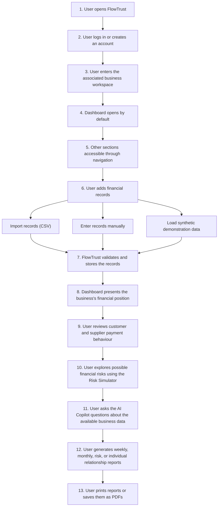

# FlowTrust — Project Specification

**Project Name:** FlowTrust  
**Tagline:** Beyond Balance. Into Resilience.  
**Document Status:** In Progress  
**Current Version:** 1.0

---

# 1. Scope of the Project

## 1.1 Project Overview

FlowTrust is an AI-assisted financial intelligence and risk management platform
designed for small businesses, particularly businesses with irregular income
and limited financial visibility.

The platform aims to help business owners understand their financial position,
monitor customer and supplier payment behaviour, identify potential financial
risks, simulate future cash-flow scenarios, and make more informed business
decisions.

FlowTrust will combine financial record management, cash-flow analysis,
relationship intelligence, risk simulation, and an AI-powered assistant in
one application.

The platform must present financial information clearly, transparently, and
in a way that business owners can understand and act upon.

## 1.2 Project Goal

The goal is to build a complete, functional portfolio-quality prototype
that demonstrates the major capabilities of FlowTrust.

The project will prioritise:
- Functional end-to-end workflows rather than static UI alone.
- Correct and transparent financial calculations.
- Clear separation between actual financial data and simulated projections.
- Useful customer and supplier payment intelligence.
- Practical risk simulation.
- AI-assisted financial explanations grounded in actual business data.
- Professional, responsive, and user-friendly design.
- Maintainable code, input validation, error handling, and testing.
- A foundation that can be extended after the initial prototype.

The project will be developed incrementally. All major features do not need
to be implemented simultaneously.

## 1.3 Target Users and Account Structure

The primary target users are small-business owners who need a clearer
understanding of their cash flow, outstanding payments, financial risks,
and customer/supplier relationships.

The platform should be understandable to users who do not have advanced
financial or technical knowledge.

### Initial Account Structure

- A business may have multiple users.
- Multiple authorised users may access the same business's data.
- Business financial records must be associated with the correct business.
- Authentication and access control must prevent unauthorised access to
  another business's information.
- The initial version will support the basic multi-user business structure.
- A detailed user hierarchy, advanced roles, and granular permissions are
  reserved for future scope.

The initial access rules for users within a business must be defined during
architecture and authentication design.

## 1.4 Core Features

### 1.4.1 Financial Dashboard

The dashboard will provide an overview of the business's financial position.

Planned capabilities:
- Display available cash.
- Show money received and money paid.
- Display net cash flow.
- Show outstanding receivables and payables.
- Present relevant financial trends and summaries.
- Highlight important overdue payments and financial risks.
- Provide easy access to CSV import.
- Provide access to relevant financial and risk reports.

Exact metrics, calculations, and chart definitions will be specified
during the financial logic and UI/UX design stages.

### 1.4.2 Financial Records Management

Users will be able to maintain and review their business's financial records.

Planned capabilities:
- Record income and expenses.
- Maintain customer invoices and supplier bills.
- Record payments against financial documents.
- Support partial payments.
- Track outstanding and overdue balances.
- View transaction and payment history.
- Import financial records using a documented CSV format.
- Validate records and identify invalid or duplicate imports.

Financial documents and actual cash movements must be handled separately
to prevent incorrect cash-flow calculations and double-counting.

Detailed transaction rules and data structures will be defined separately.

### 1.4.3 Customer and Supplier Intelligence

The platform will provide individual profiles for customers and suppliers.

Planned capabilities:
- View customer and supplier transaction histories.
- Display outstanding and overdue balances.
- Analyse payment settlement behaviour.
- Calculate payment-related metrics when sufficient data is available.
- Highlight relationships that may require attention.
- Generate individual customer and supplier performance reports.

Metrics must be transparent and based on available records.

The platform must not claim to assess supplier delivery quality, product
quality, or other performance characteristics unless the necessary data
is available.

Insufficient transaction history must not be presented as a reliable rating.

### 1.4.4 Risk Simulator

The risk simulator will help users explore how possible financial events
could affect their business's cash position.

Planned scenarios:
- Decline in revenue.
- Delays in customer payments.
- Unexpected expenses.
- Proposed investments.
- Cash-buffer and financial sustainability analysis.

Users should be able to compare a baseline projection with a stressed
scenario and understand the potential financial impact.

Simulation results must be clearly identified as projections, not actual
financial outcomes.

Exact formulas, assumptions, scenario parameters, and result classifications
will be defined during the financial logic stage.

### 1.4.5 AI Copilot

FlowTrust will include an AI-assisted financial copilot that helps users
understand their business data and explore possible financial scenarios.

Planned capabilities:
- Answer questions about business finances.
- Explain financial metrics and trends.
- Summarise relevant risks.
- Provide data-grounded insights and recommendations.
- Help users explore risk scenarios through natural-language requests.
- Explain scenario results in understandable language.

Financial calculations must be performed by deterministic backend logic.
The AI must not be treated as the authoritative calculator for financial
figures.

The copilot should use authorised business data, clearly communicate
uncertainty, and avoid inventing missing financial information.

The initial implementation is intended to be read-only, apart from
explicitly permitted and validated simulation actions.

AI provider selection and detailed integration rules remain to be finalised.

### 1.4.6 Reports and Printable Business Intelligence

FlowTrust must include a reporting feature that allows users to generate
professional reports and print them or save them as PDFs.

Planned report types:

**A. Weekly Financial Report**
- Financial summary for a selected week.
- Money received and money paid.
- Net cash flow.
- Relevant outstanding balances.
- Important overdue payments.

**B. Monthly Financial Report**
- Financial summary for a selected month.
- Cash-flow trends.
- Receivables and payables.
- Comparison with a previous period where appropriate.
- Relevant financial observations.

**C. Risk Assessment Report**
- Summary of relevant financial risks.
- Outstanding and overdue payment exposure.
- Cash-buffer information.
- Risk simulation results where available.
- Clear separation between actual figures and projected outcomes.

**D. Customer Performance Report**
- Customer transaction history.
- Total invoiced amount and amount received.
- Outstanding and overdue balances.
- Payment settlement metrics where sufficient data is available.
- Relevant historical trends.

**E. Supplier Performance Report**
- Supplier transaction history.
- Total invoiced amount and amount paid.
- Outstanding and overdue balances.
- Payment settlement metrics where sufficient data is available.
- Relevant historical trends.

Report requirements:
- Users must be able to select the relevant reporting period where applicable.
- Reports must have a clean, professional, print-friendly layout.
- Users must be able to print reports.
- Users should be able to save reports as PDFs.
- Individual customer or supplier reports should be accessible from their
  respective profiles.
- A dedicated Reports section should provide access to available reports.
- Reports must distinguish actual historical data from simulated projections.
- Reports must not imply that unavailable information has been verified.

The initial implementation may use browser printing and print-to-PDF.
A separate PDF-generation system can be considered if required later.

The precise report layouts, available filters, and export options remain
to be finalised.

### 1.4.7 Account and Settings

Planned capabilities:
- Login and account-specific business data.
- Business preferences where required.
- Light and dark themes.
- An onboarding experience for new accounts.
- An option to load synthetic demonstration data.

The initial product is expected to support one user per business.

Authentication, authorisation, and account security requirements will be
specified during architecture design.

## 1.5 User Journey

The intended high-level user journey is:

The Dashboard is the default landing page after the user enters the business
workspace.

The other application sections should remain accessible through the
application's navigation.

The exact navigation structure, screen layouts, onboarding experience,
and interactions will be finalised during the UI/UX design stage.

## 1.6 User Interface Requirements

The interface should be professional, clear, and appropriate for a
business-finance application.

Planned design direction:
- Muted and restrained colour palette.
- Light and dark theme support.
- Clear typography and visual hierarchy.
- Consistent spacing and reusable components.
- Readable financial tables and charts.
- Responsive layouts for desktop and mobile.
- Clear loading, empty, success, and error states.
- Accessible navigation and understandable labels.
- Print-friendly report layouts.

The interface should avoid unnecessary visual complexity and prioritise
readability of financial information.

Detailed design tokens, colours, page layouts, and component specifications
will be defined during the UI/UX stage.

## 1.7 Features Outside the Initial Scope

The following are excluded from the initial prototype unless explicitly
approved later:

- Inventory management.
- Custom machine-learning model training.
- Automatic access to external banking systems.
- Arbitrary imports from every accounting or banking platform.
- Automatic supplier quality or delivery assessment without supporting data.
- AI-driven financial calculations without deterministic verification.
- Unrestricted AI actions that modify financial records.
- Complex enterprise accounting and tax workflows.

These exclusions may be reconsidered in future versions.

## 1.8 Development Approach

FlowTrust will be developed incrementally while maintaining the agreed
feature priority order:

- P0 ? Foundation
- P1 ? Core financial functionality
- P2 ? Customer/supplier intelligence and risk simulation
- P3 ? AI Copilot and reporting
- P4 ? UI polish, responsiveness, and final testing

The initial scope is a complete, functional portfolio-quality prototype.
All major features will be planned, but implementation will occur in phases.

Development will follow these stages:

1. Finalise product scope and user requirements.
2. Finalise the technology stack.
3. Design the application architecture.
4. Define the database and financial data model.
5. Specify API contracts.
6. Define and test financial calculations.
7. Design the user interface and user experience.
8. Implement the core workflows.
9. Integrate customer/supplier intelligence and risk simulation.
10. Integrate AI capabilities and reporting.
11. Test, debug, and prepare the demonstration.

Antigravity and other AI development tools may assist with implementation,
but generated code must be reviewed, understood, and tested.

Important architectural and product decisions must be documented before
they are treated as final.

## 1.9 Current Status

**Project direction:** Portfolio-quality functional prototype.

**Scope status:** Initial proposal documented; detailed requirements pending.

**Technology stack:** Not finalised.

**Database design:** Not finalised.

**API specification:** Not finalised.

**Financial formulas:** Require detailed specification and testing.

**UI/UX design:** Direction established; detailed design pending.

**Implementation:** To begin after the relevant requirements and
technical decisions have been agreed upon.